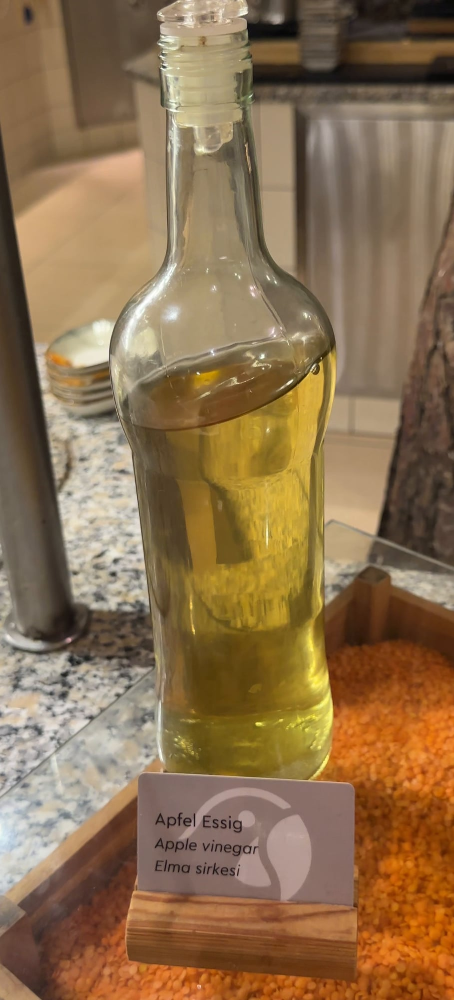

## Zutaten
- {{1–2 EL}} Apfelessig
- {{1/2}} Zitrone
- {{3}} Zweige Minze
- {{250 ml}} Mineralwasser mit Kohlensäure
- Eiswürfel

## Zubereitung
1. **Essig ins Glas:** Apfelessig in ein Glas geben.
   
2. **Zitrone und Minze:** Zitrone in Scheiben schneiden, eine Scheibe auspressen und mit den übrigen Scheiben und der Minze ins Glas geben. Minze leicht andrücken.
3. **Auffüllen:** Eiswürfel dazugeben und mit eiskaltem Sprudelwasser auffüllen.
4. **Servieren:** Kurz umrühren und sofort trinken, am besten nach dem Essen.

## Tipps
- Mengen geschätzt.
- Mit etwas Honig wird es milder.
