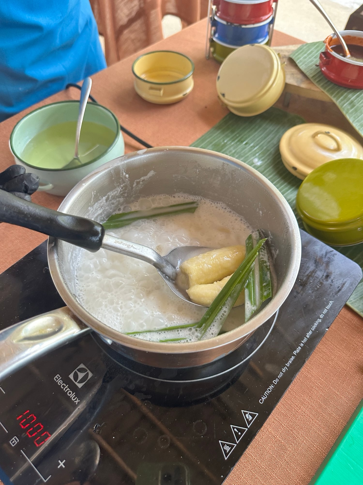
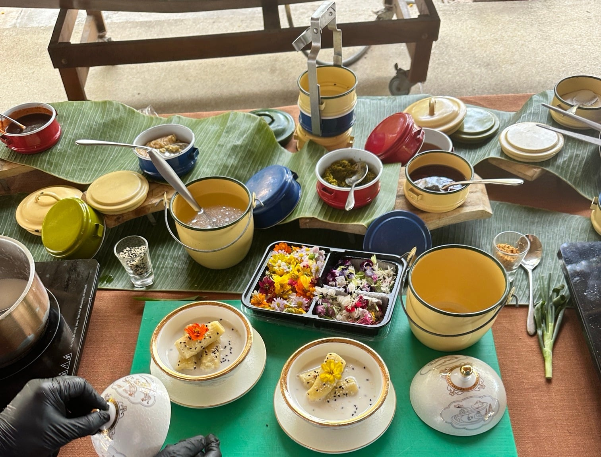

## Zutaten
- {{3}} kleine reife Bananen (am besten Thai-Bananen)
- {{250 ml}} Kokosmilch
- {{100 ml}} Wasser
- {{2}} Pandanblätter, verknotet (optional)
- {{1 EL}} Agavendicksaft
- {{1}} Prise Salz
- {{1 TL}} gerösteter Sesam
- essbare Blüten zum Garnieren (optional)

## Equipment
- Kleiner Topf

## Zubereitung
1. **Bananen schneiden:** Bananen schälen und schräg in ca. 4 cm lange Stücke schneiden.
2. **Kokosmilch erwärmen:** Kokosmilch, Wasser und Pandanblätter im Topf aufkochen. Bananen dazugeben und bei kleiner Hitze ca. 5 Min. ziehen lassen, bis sie weich sind.
   
3. **Abschmecken:** Pandanblätter herausnehmen. Mit Agavendicksaft und Salz abschmecken.
   
4. **Servieren:** Warm in Schalen füllen, mit Sesam bestreuen und mit Blüten garnieren.

## Tipps
- Mengen geschätzt.
- Auf Thai heißt das Dessert Kluay Buat Chi.
