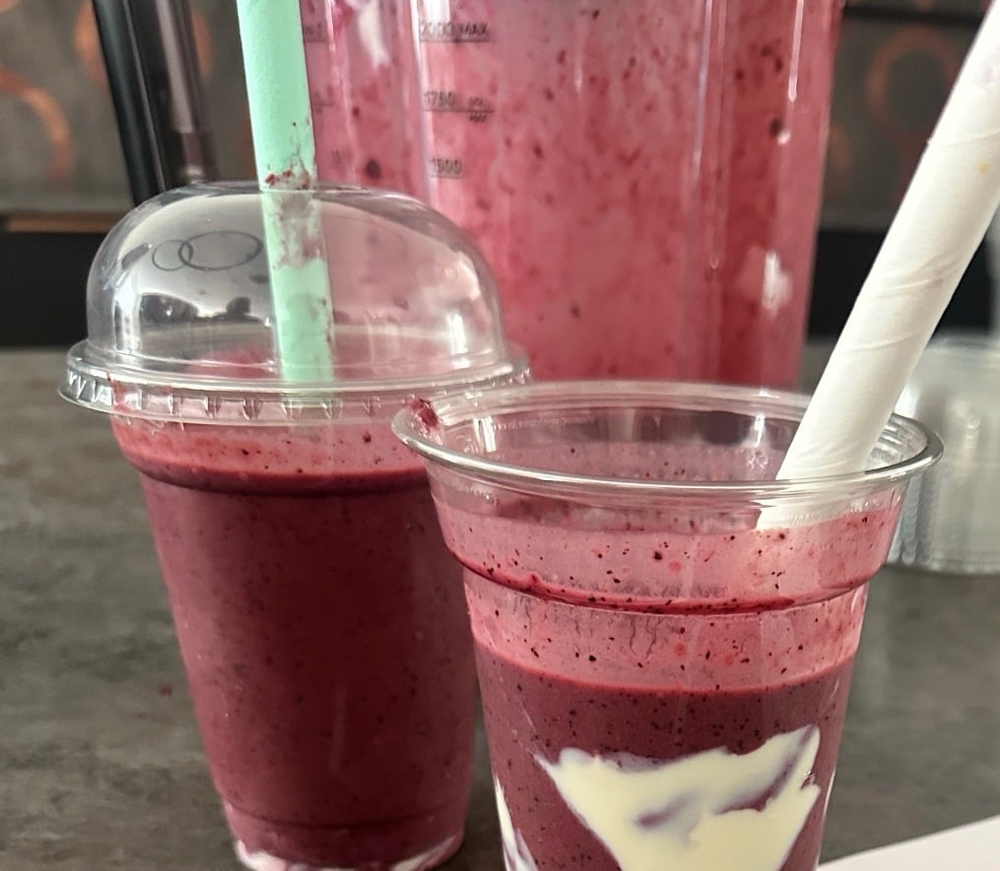

## Zutaten
- {{3}} Orangen
- {{400 g}} Joghurt, ungesüßt (z. B. Sojajoghurt)
- {{500 ml}} Mangosaft
- {{180 g}} Maracujamark, tiefgekühlt
- {{200 g}} TK-Blaubeeren
- {{2 1/2}} Bananen, tiefgekühlt
- {{2 EL}} Mandelmus

## Equipment
- Kenwood Glasmixaufsatz

## Zubereitung
1. **Orangen vorbereiten:** Orangen schälen und grob zerteilen.
2. **Mixen:** Joghurt, Mangosaft, Maracujamark, Orangen, Blaubeeren, Bananen und Mandelmus in den Mixer geben und ca. 1 Min. glatt mixen.
3. **Servieren:** Smoothie auf {{5}} Gläser verteilen und sofort servieren.
   

## Tipps
- Für Schlieren im Glas etwas Joghurt zurückbehalten und vor dem Einfüllen an die Glasinnenseite streichen.
