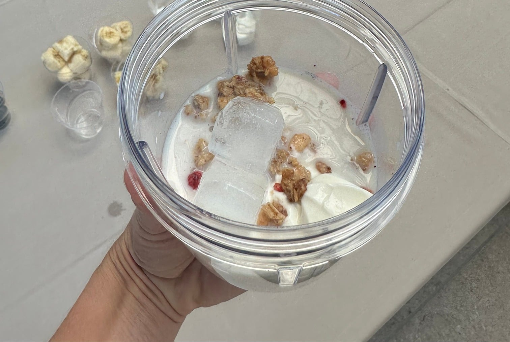

## Zutaten
- {{1 Tasse}} Heidelbeeren (frisch oder TK)
- {{1 Tasse}} Banane, in Scheiben
- {{1 Tasse}} griechischer Joghurt
- {{1/2 Tasse}} Granola
- {{1 Tasse}} Hafermilch
- {{4}} Eiswürfel

## Equipment
- Kenwood Smoothie-to-go-Aufsatz oder Glasmixaufsatz

## Zubereitung
1. **Einfüllen:** Joghurt, Hafermilch, Banane, Heidelbeeren, Granola und Eiswürfel in den Mixaufsatz geben.
   
2. **Mixen:** Ca. 1 Min. cremig mixen.
3. **Servieren:** In Gläser füllen und sofort servieren.

## Tipps
- Granola bewusst auf eine halbe Tasse reduziert (das Original nimmt eine ganze), das spart ca. 125 kcal pro Glas.
- Ein Teil des Granola eignet sich auch als Topping obendrauf.
