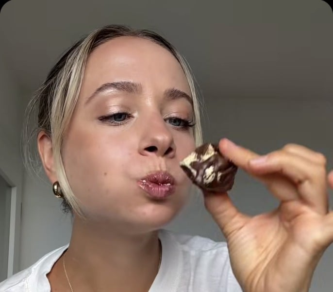

## Zutaten
- {{100 g}} Skyr
- {{20 g}} Nussmus (z. B. Erdnuss, Cashew oder Mandel) oder Light-Frischkäse
- {{10 g}} veganes Proteinpulver (optional, z. B. Cookie Dough)
- {{50 g}} Zartbitterschokolade (mind. 70 %)

## Equipment
- Riegel-Silikonform oder Backpapier

## Zubereitung
1. **Masse:** Skyr, Nussmus und nach Belieben Proteinpulver verrühren.
2. **Formen:** Masse in kleine Mulden der Silikonform füllen oder je nach Konsistenz als Bällchen oder Häufchen auf Backpapier setzen.
3. **Einfrieren:** Ein paar Stunden einfrieren, bis die Bites fest sind.
4. **Schokolieren:** Schokolade schmelzen, die Bites darin überziehen und kurz fest werden lassen.
   

## Tipps
- Nur 3 Zutaten, ideal als kleiner Vorrat im Gefrierfach.
- Menge der Schokolade geschätzt.
