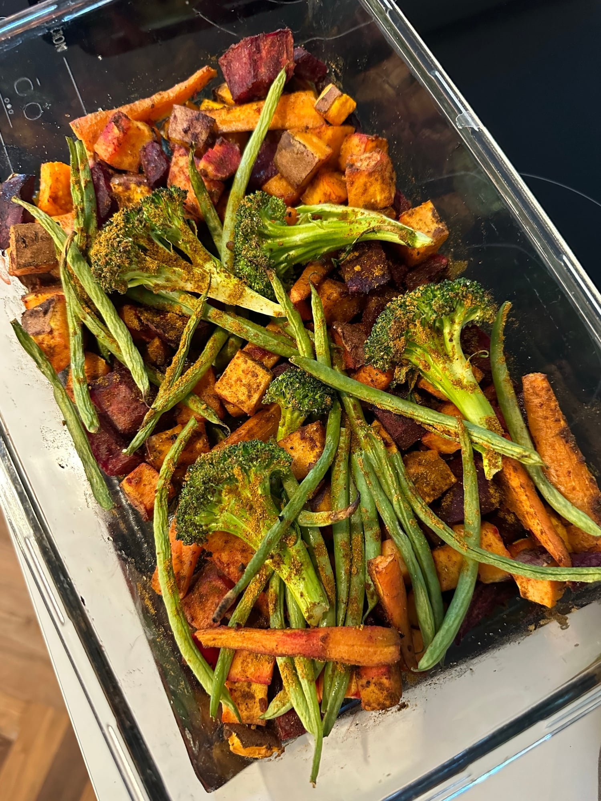
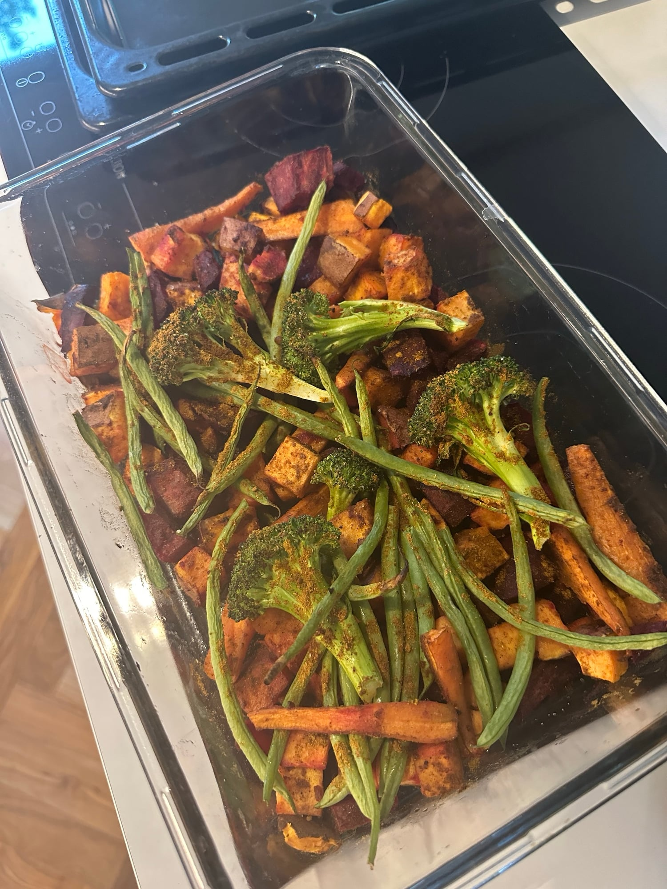

## Zutaten
- {{1}} Süßkartoffel (ca. 400 g), gewürfelt
- {{2}} Rote Bete (ca. 250 g), geschält und gewürfelt
- {{3}} Karotten, längs geviertelt
- {{2 EL}} Kokosöl oder Olivenöl
- {{2 TL}} Currypulver
- {{1 TL}} Paprikapulver
- {{150 g}} grüne Bohnen, geputzt
- {{1/2}} Brokkoli, in Röschen
- {{2}} Burrata (à 125 g)
- {{3 EL}} Kürbiskerne
- Olivenöl, Salz, Pfeffer

## Equipment
- Auflaufform oder Backblech

## Zubereitung
1. **Ofen vorheizen:** Backofen auf 200 °C Ober-/Unterhitze vorheizen.
2. **Wurzelgemüse rösten:** Süßkartoffel, Rote Bete und Karotten mit Öl, Curry, Paprikapulver, Salz und Pfeffer mischen und ca. 25 Min. im Ofen rösten.
3. **Grünes Gemüse dazugeben:** Bohnen und Brokkoli untermischen, mit etwas Curry bestäuben und weitere ca. 15 Min. rösten, bis alles weich und leicht gebräunt ist.
   
   
4. **Kürbiskerne rösten:** Kürbiskerne in einer Pfanne ohne Fett ca. 2–3 Min. rösten, bis sie duften.
5. **Servieren:** Burrata in tiefe Teller geben, das warme Gemüse darauf verteilen, mit Kürbiskernen bestreuen und mit etwas Olivenöl beträufeln.

## Tipps
- Mengen geschätzt.
- Mit Kürbiskernen super während der Periode.
