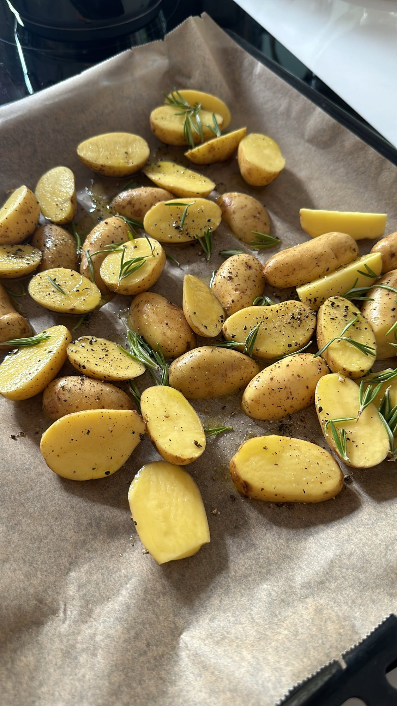
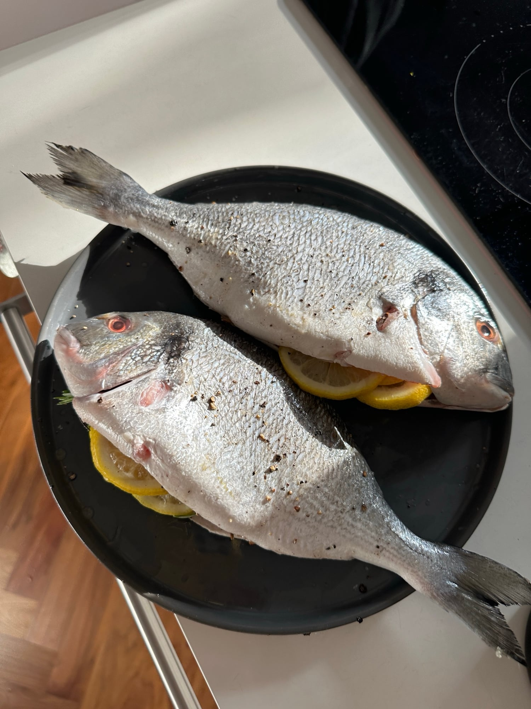
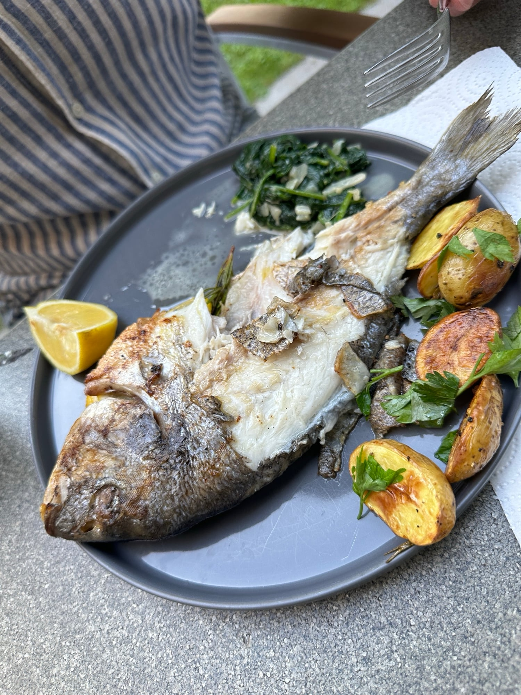
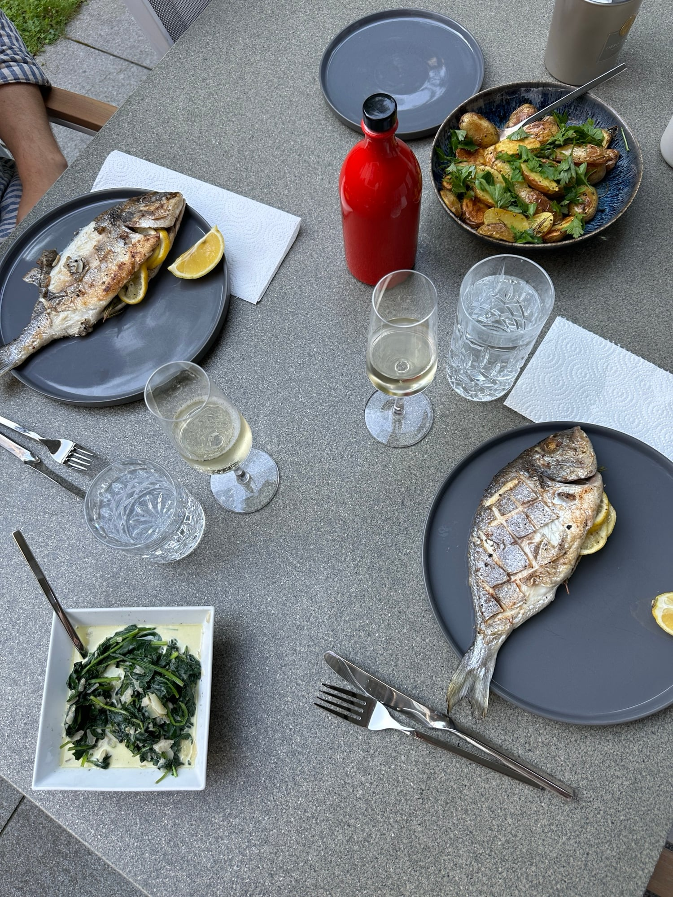
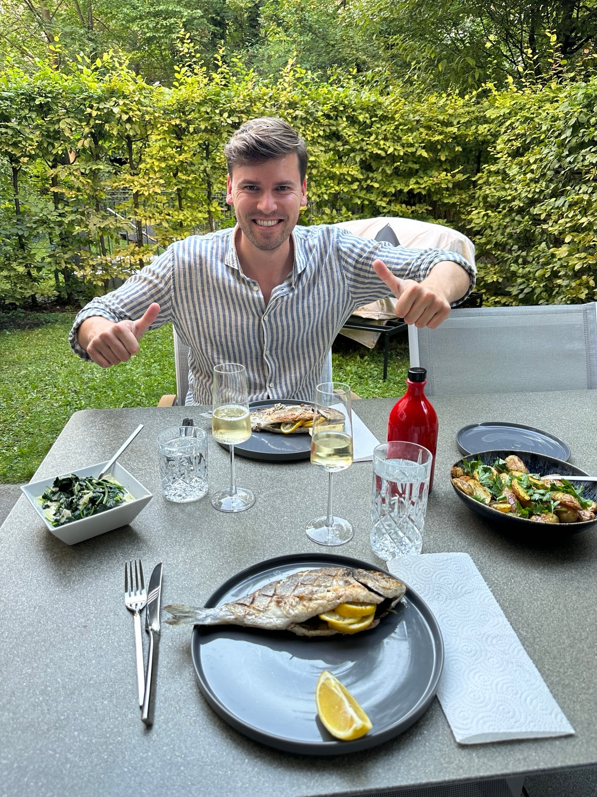

## Zutaten
### Ofenkartoffeln
- {{600 g}} kleine Kartoffeln (Drillinge)
- {{2}} Zweige Rosmarin
- {{1/2 Bund}} glatte Petersilie

### Dorade
- {{2}} Doraden (à ca. 400 g, küchenfertig)
- {{1}} Zitrone, in Scheiben
- {{2}} Zweige Rosmarin

### Rahmspinat
- {{1}} Knoblauchzehe, in Scheiben
- {{300 g}} Blattspinat
- {{100 ml}} Sahne
- {{20 g}} Parmesan, gehobelt

### Dazu
- {{1}} Zitrone, in Spalten
- Olivenöl, Salz, Pfeffer

## Equipment
- 2 Backbleche mit Backpapier
- Pfanne

## Zubereitung
1. **Kartoffeln rösten:** Backofen auf 220 °C Ober-/Unterhitze vorheizen. Kartoffeln halbieren, mit Olivenöl, Rosmarinnadeln, Salz und Pfeffer auf einem Blech mischen und ca. 35–40 Min. goldbraun rösten.
   
2. **Doraden vorbereiten:** Doraden innen und außen salzen und pfeffern, die Haut auf beiden Seiten rautenförmig einschneiden. Bauch mit Zitronenscheiben und Rosmarin füllen.
   
3. **Doraden garen:** Doraden mit Olivenöl einreiben, auf das zweite Blech legen und ca. 20–25 Min. mitbacken. Für eine knusprige Haut die letzten ca. 3 Min. den Grill zuschalten.
4. **Rahmspinat:** Knoblauch in etwas Olivenöl andünsten, Spinat dazugeben und zusammenfallen lassen. Sahne angießen, ca. 3 Min. einköcheln lassen, mit Salz und Pfeffer abschmecken und mit Parmesan bestreuen.
5. **Servieren:** Petersilie grob zupfen und unter die Kartoffeln heben. Doraden mit Kartoffeln, Rahmspinat und Zitronenspalten servieren.
   
   
   

## Tipps
- Mengen geschätzt.
- Die Dorade ist gar, wenn sich die Rückenflosse leicht herausziehen lässt.
