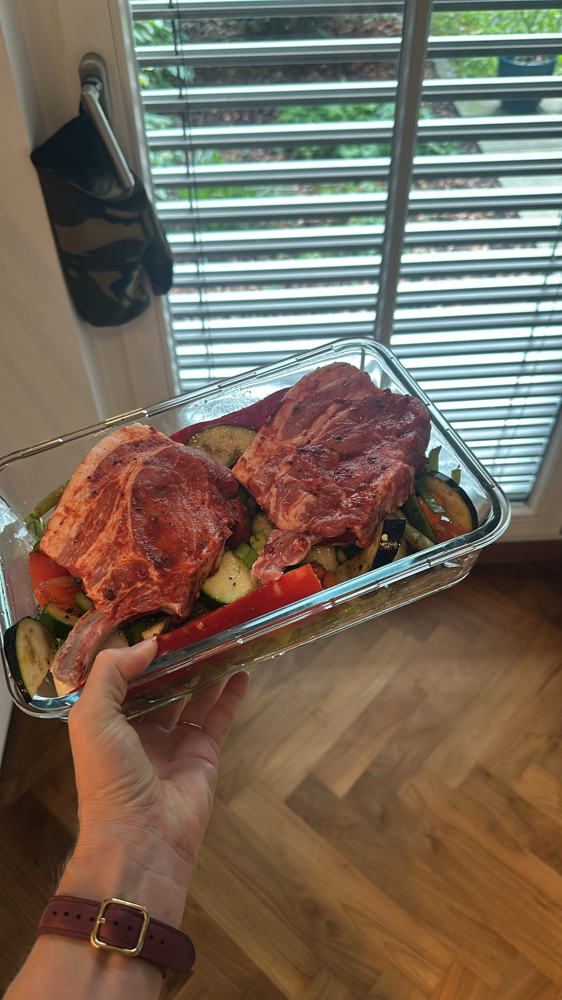
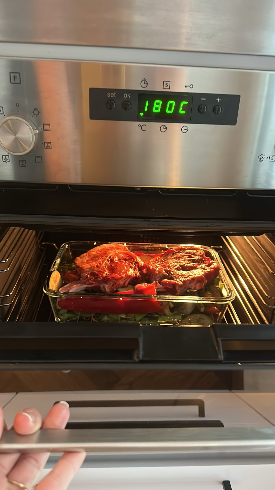

## Zutaten
- {{500 g}} kleine festkochende Kartoffeln
- {{2}} rote Zwiebeln
- {{150 ml}} Rotwein
- {{3 EL}} Olivenöl
- {{3}} Zweige Rosmarin oder Thymian (getrocknete Thymianzweige gehen auch)
- {{200 g}} Pfifferlinge oder anderes Gemüse nach Wahl (optional)
- {{2}} Duroc-Schweinekoteletts (à ca. 250 g)
- Salz, Pfeffer

## Equipment
- Auflaufform

## Zubereitung
1. **Ofen vorheizen:** Backofen auf 200 °C Ober-/Unterhitze vorheizen.
2. **Kartoffeln vorgaren:** Kartoffeln halbieren oder vierteln, Zwiebeln in Spalten schneiden. Mit Rotwein, Olivenöl, Kräutern, Salz und Pfeffer in der Auflaufform mischen und ca. 25 Min. im Ofen garen, da die Kartoffeln länger brauchen als das Fleisch.
3. **Pilze dazugeben:** Pfifferlinge putzen, große Exemplare halbieren und unter die Kartoffeln mischen.
4. **Fleisch garen:** Koteletts nur salzen und pfeffern, oben auf das Gemüse legen und höchstens ca. 20 Min. im Ofen garen.
   
   
5. **Kross werden lassen:** Zum Schluss die Form auf die oberste Schiene stellen und den Ofen kurz auf höchste Stufe schalten, bis das Fleisch leicht kross ist.
6. **Servieren:** Koteletts mit Kartoffeln, Pilzen und dem Rotwein-Olivenöl-Sud aus der Form anrichten.

## Tipps
- Mengen geschätzt.
