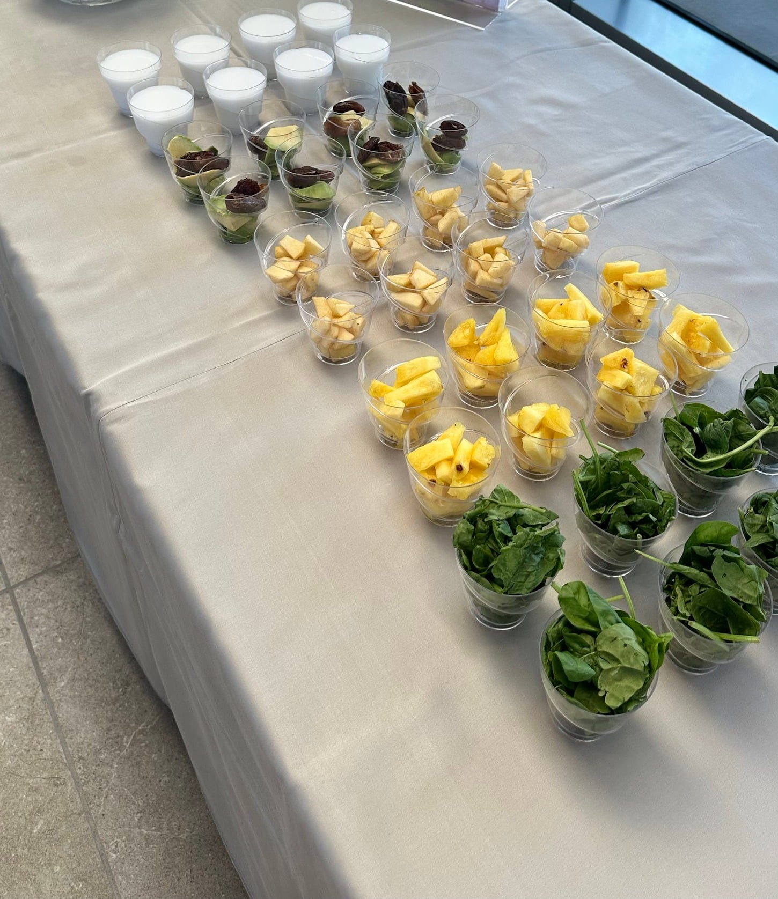

## Zutaten
- {{1 Tasse}} Babyspinat
- {{1 Tasse}} Ananas, gewürfelt
- {{1 Tasse}} grüner Apfel, gewürfelt
- {{1 Tasse}} Avocado, gewürfelt
- {{1 Tasse}} Kokoswasser
- {{4}} Medjool-Datteln, entsteint
- {{4}} Eiswürfel

## Equipment
- Kenwood Smoothie-to-go-Aufsatz oder Glasmixaufsatz

## Zubereitung
1. **Vorbereiten:** Ananas, Apfel und Avocado würfeln, Datteln entsteinen.
   
2. **Mixen:** Alle Zutaten in den Mixaufsatz geben und ca. 1 Min. sehr fein mixen.
3. **Servieren:** In Gläser füllen und sofort servieren.

## Tipps
- Wer es weniger süß mag, nimmt nur {{2}} Datteln.
