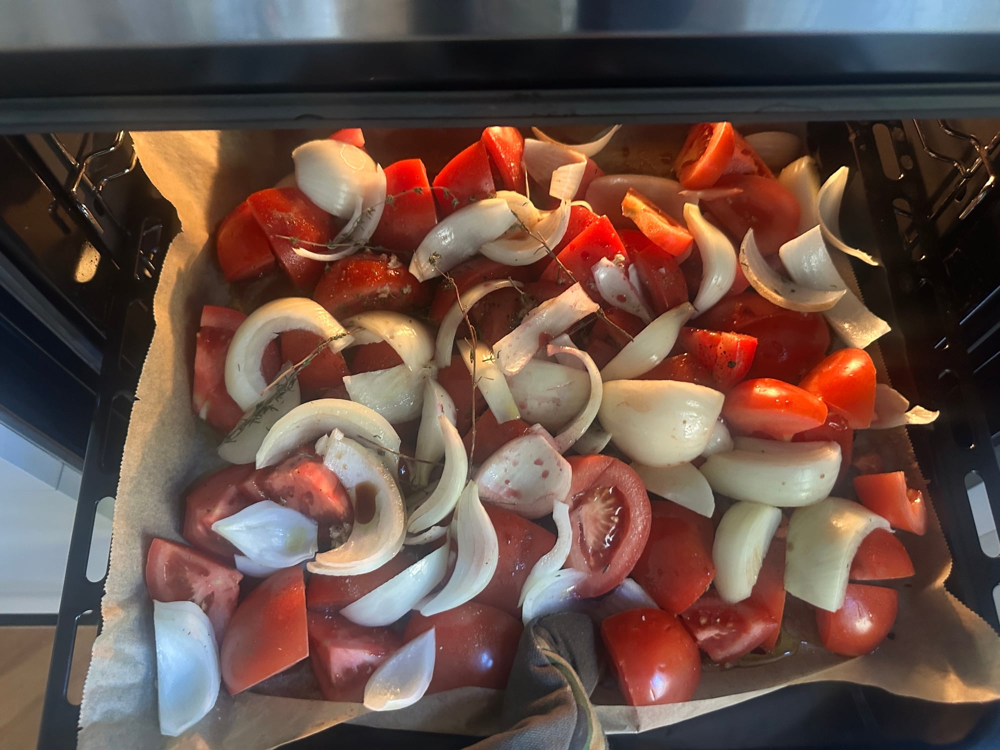
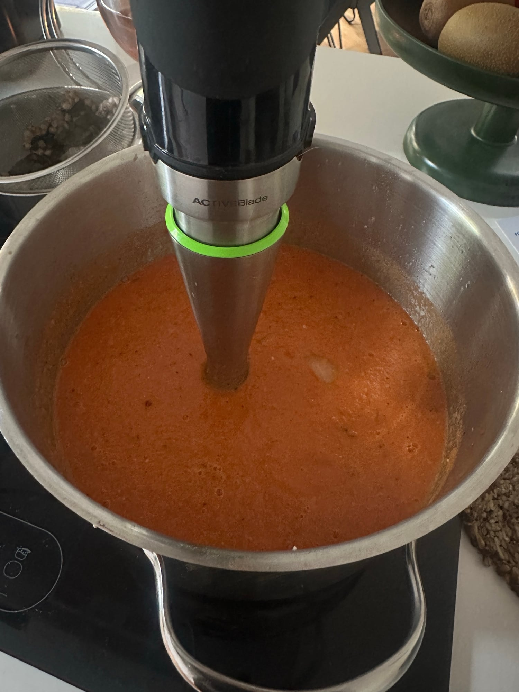
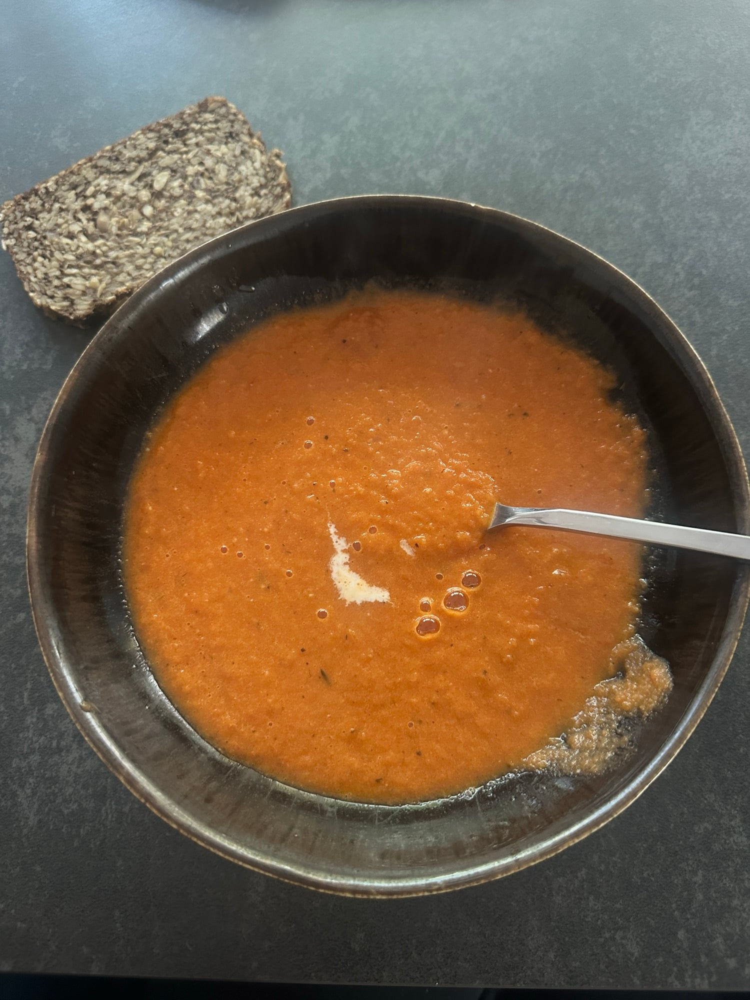

## Zutaten
- {{1 kg}} reife Tomaten
- {{2}} Zwiebeln (egal welche, z. B. Gemüsezwiebeln)
- {{4}} Knoblauchzehen
- {{1}} rote Chilischote (optional)
- {{4 EL}} Balsamico-Essig
- {{3}} Zweige Thymian (optional)
- {{1/2 Bund}} Basilikum zum Garnieren
- Olivenöl, Salz, Pfeffer

## Equipment
- Backblech mit Backpapier
- Großer Topf
- Stabmixer (z. B. Braun)

## Zubereitung
1. **Vorbereiten:** Backofen auf 220 °C vorheizen und ein Blech mit Backpapier auslegen.
2. **Aufs Blech:** Tomaten vierteln, Zwiebeln schälen und in Spalten schneiden, Knoblauch grob hacken und nach Belieben die Chili ohne Stiel und Samen dazugeben. Alles auf dem Blech verteilen, mit reichlich Olivenöl und dem Balsamico beträufeln, salzen, pfeffern und nach Belieben die Thymianzweige darauflegen.
   
   
3. **Rösten:** Im oberen Teil des Ofens ca. 25–30 Min. rösten, bis die Zwiebeln weich und die Tomaten leicht gebräunt sind.
4. **Pürieren:** Thymianzweige entfernen, alles mit dem Saft vom Blech in den Topf geben und mit dem Stabmixer pürieren *(Vorsicht, die Suppe ist heiß und spritzt!)*. Mit Salz und Pfeffer abschmecken.
   
   
   
   
   
5. **Servieren:** Suppe in Schalen füllen und mit Basilikum und etwas Olivenöl garnieren.
   
   
   

## Tipps
- Alles auf einem Blech, kein Andünsten im Topf nötig.
- Ohne Croutons und Crème fraîche: Beides braucht die Suppe nicht, es hat auch nicht dazu gepasst.
- Dazu passt eine Scheibe Vollkornbrot.
