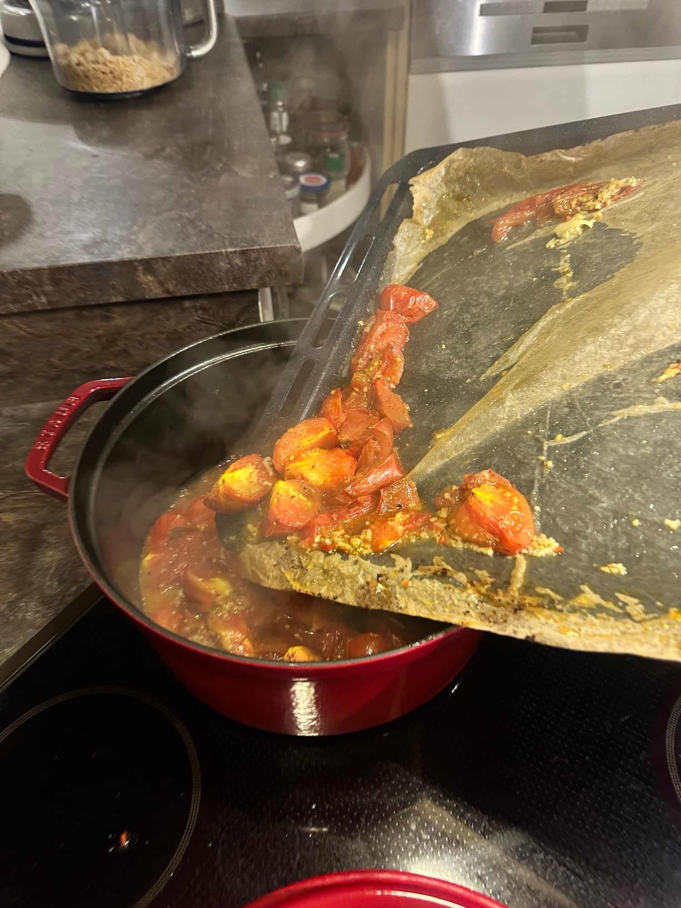
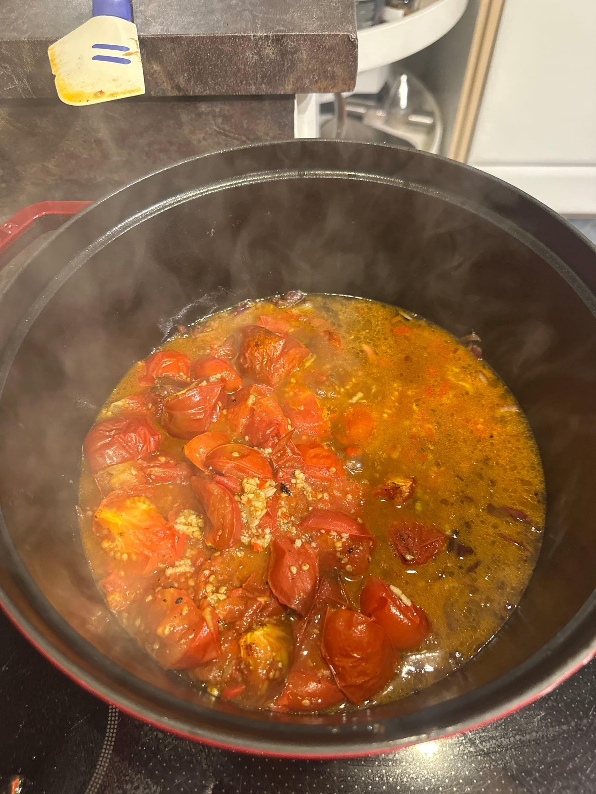
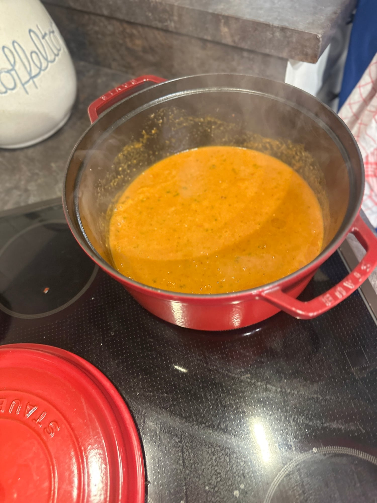
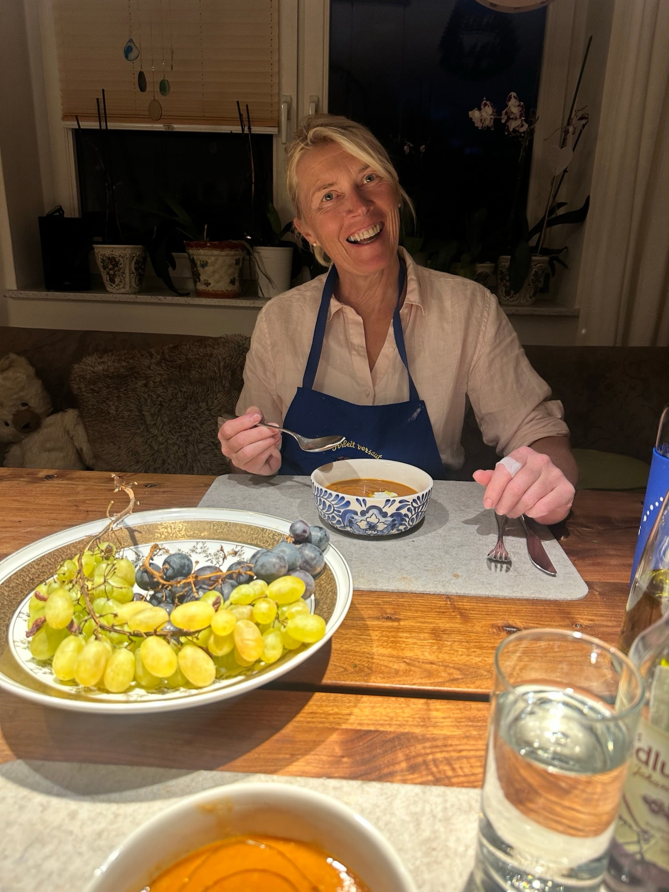

## Zutaten
- {{1 kg}} reife Kirschtomaten an der Rispe (möglichst rote und gelbe)
- {{4}} große Tomaten
- {{1}} rote Chilischote
- {{4}} Knoblauchzehen
- {{2}} kleine rote Zwiebeln
- {{4 EL}} Balsamico-Essig
- {{1 Bund}} Basilikum (klein)
- Olivenöl, Salz, Pfeffer

## Equipment
- Großer Topf, Bratform
- Stabmixer

## Zubereitung
1. **Vorbereiten:** Backofen auf 220 °C vorheizen. Einen großen Topf auf kleine Hitze stellen.
2. **Tomaten rösten:** Kirschtomaten von den Rispen zupfen, bei einigen den Stielansatz dranlassen. Große Tomaten vierteln, alles in eine Bratform geben, mit reichlich Olivenöl beträufeln, salzen und pfeffern. Chili ohne Stiel und Samen dazugeben, {{4}} Knoblauchzehen dazupressen, mischen und im oberen Teil des Ofens 12–15 Min. rösten.
   
3. **Zwiebeln dünsten:** Zwiebeln schälen, grob hacken und mit etwas Olivenöl und 1 kräftigen Prise Salz im großen Topf bei mittlerer Hitze weich dünsten. Balsamico zugießen und einkochen lassen.
4. **Suppe pürieren:** Tomaten aus dem Ofen zu den Zwiebeln geben. Großteil des Basilikums dazugeben und alles im Topf mit dem Stabmixer zu einer stückigen Suppe pürieren *(Vorsicht, die Suppe ist heiß und spritzt!)*. Abschmecken.
   
   
   
   
5. **Servieren:** Suppe in Schalen füllen und mit restlichem Basilikum und etwas Olivenöl garnieren.
   
   

## Tipps
- Ohne Croutons und Crème fraîche: Beides braucht die Suppe nicht, es hat auch nicht dazu gepasst.
