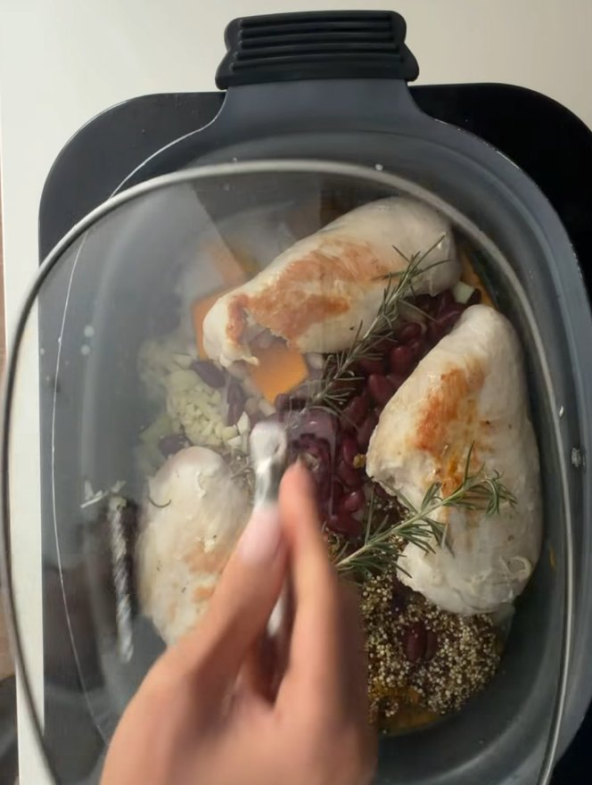
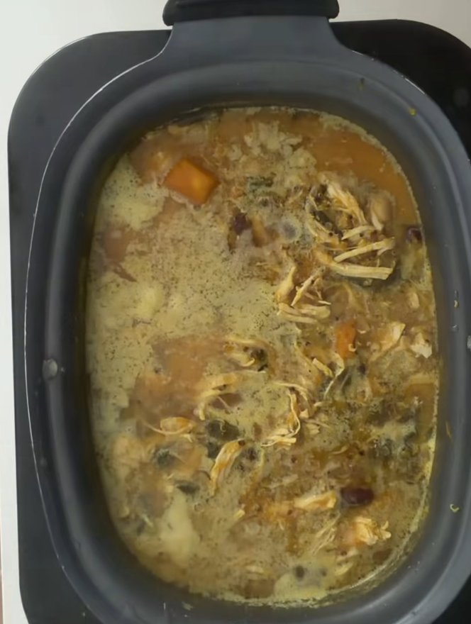

## Zutaten
- {{1 kg}} Hähnchenbrustfilet
- {{1}} Zwiebel, gewürfelt
- {{4}} Knoblauchzehen, gehackt
- {{1}} Stange Lauch, in Ringe geschnitten
- {{3 Tassen}} Kürbis, gewürfelt
- {{1}} große Handvoll Grünkohl
- {{1 TL}} frischer Kurkuma, gehackt
- {{2 TL}} frischer Ingwer, gehackt
- {{1/2 Tasse}} Quinoa, gewaschen
- {{1 Dose}} Cannellini-Bohnen (400 g)
- {{1 Dose}} Kidneybohnen (400 g)
- {{6 Tassen}} Knochenbrühe
- {{2 TL}} Misopaste
- {{1 TL}} Senf
- {{1 TL}} Kreuzkümmel
- {{1 TL}} Zimt
- {{1/2 Tasse}} Kokosjoghurt, ungesüßt
- Frische Petersilie (zum Servieren)
- Salz, Pfeffer, Oregano, Rosmarin, Thymian

## Equipment
- Slow Cooker

## Zubereitung
1. **Hähnchen anbraten:** Hähnchenbrust in einer Pfanne von beiden Seiten goldbraun anbraten.
2. **Slow Cooker befüllen:** Hähnchen mit allen übrigen Zutaten außer Kokosjoghurt und Petersilie in den Slow Cooker geben. Mit Salz, Pfeffer, Oregano, Rosmarin und Thymian würzen.
   
3. **Auf hoher Stufe garen:** Ca. 4 Std. auf hoher Stufe garen.
4. **Hähnchen zerpflücken:** Hähnchen herausnehmen, mit zwei Gabeln zerpflücken und zurück in die Suppe geben.
5. **Auf niedriger Stufe garen:** Weitere ca. 3 Std. auf niedriger Stufe garen.
   
6. **Kokosjoghurt einrühren:** Slow Cooker ausschalten und die Suppe einige Minuten stehen lassen. Dann den Kokosjoghurt einrühren *(nicht in die kochende Suppe geben, sonst flockt er aus!)*.
7. **Servieren:** Mit frischer Petersilie bestreut servieren.

## Tipps
- 1 Tasse entspricht ca. 250 ml.
