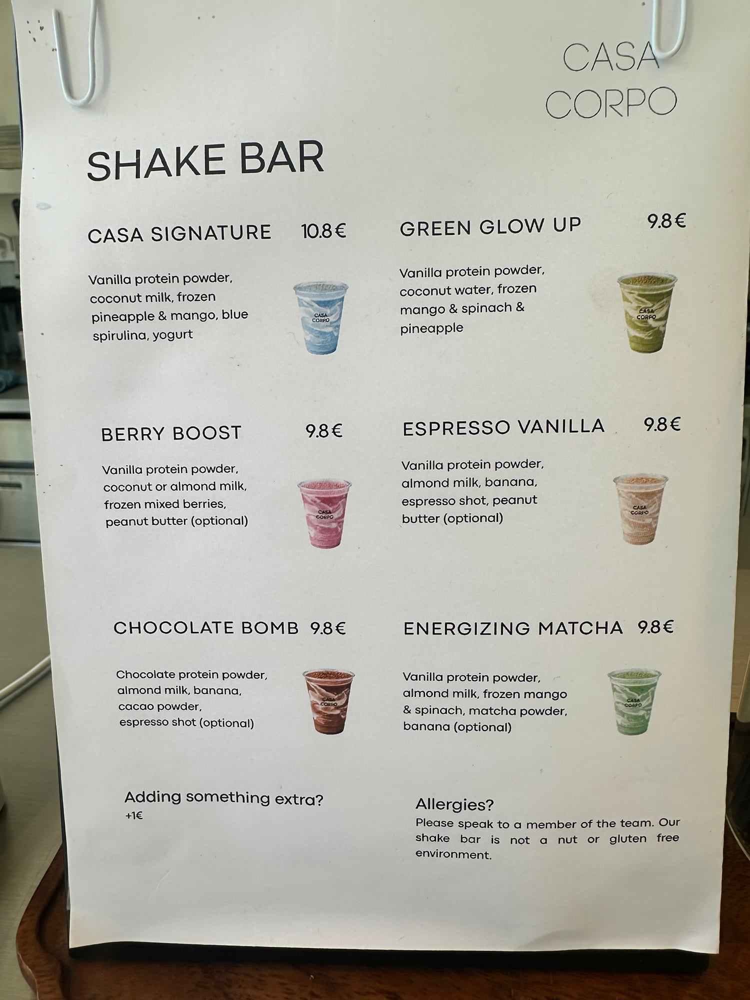

## Zutaten
- {{30 g}} Vanille-Proteinpulver
- {{250 ml}} Kokoswasser
- {{100 g}} TK-Mango
- {{1}} Handvoll Babyspinat (ca. {{30 g}})
- {{80 g}} Ananas, frisch oder tiefgekühlt

## Equipment
- Kenwood Smoothie-to-go-Aufsatz oder Glasmixaufsatz

## Zubereitung
1. **Mixen:** Proteinpulver, Kokoswasser, Mango, Spinat und Ananas in den Mixer geben und ca. 45 Sek. mixen, bis kein Spinat mehr zu sehen ist.
   
2. **Servieren:** In ein großes Glas gießen und sofort trinken.

## Tipps
- Mengen geschätzt.
