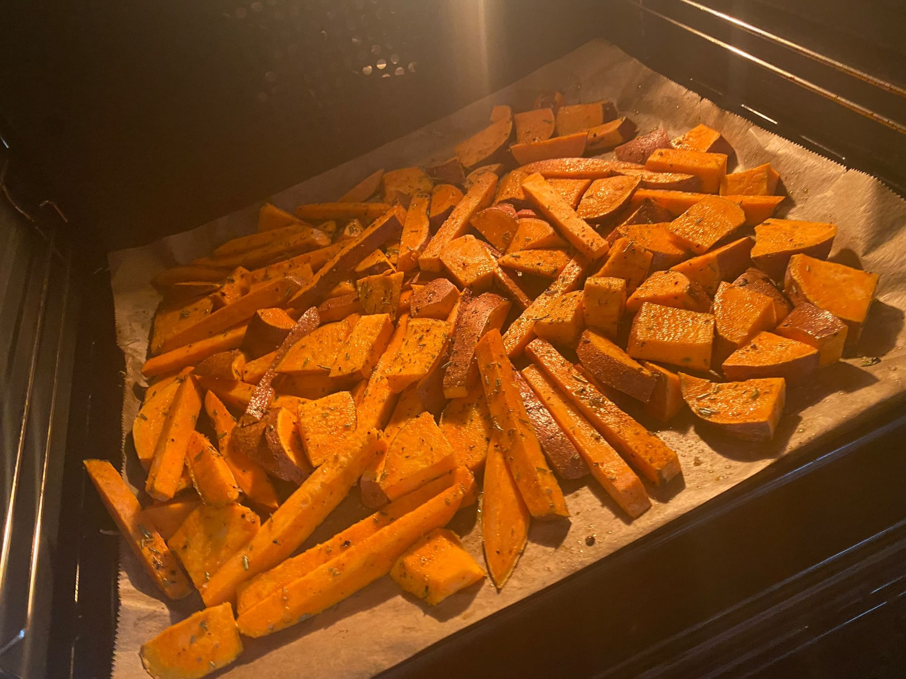
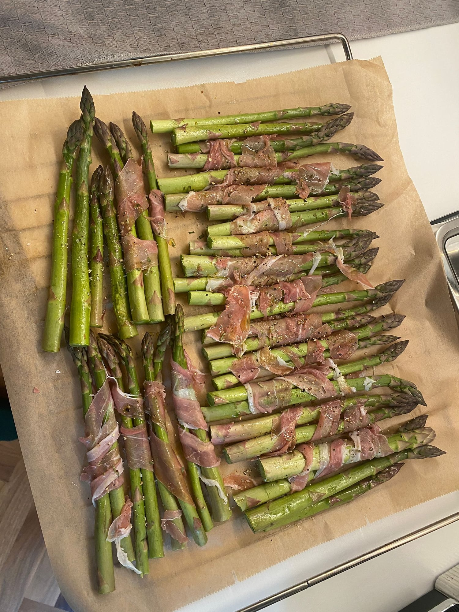

## Zutaten
- {{2}} Süßkartoffeln (ca. 500 g)
- {{1 EL}} Kokosöl, geschmolzen
- {{500 g}} grüner Spargel
- {{8}} Scheiben roher Schinken
- {{2 EL}} Olivenöl
- {{200 g}} gekörnter Frischkäse
- {{1/2}} Zitrone
- {{2 TL}} getrockneter Rosmarin
- Salz, Pfeffer

## Equipment
- Backblech mit Backpapier

## Zubereitung
1. **Ofen vorheizen:** Backofen auf 220 °C Ober-/Unterhitze vorheizen.
2. **Süßkartoffeln rösten:** Süßkartoffeln in Spalten schneiden, mit Kokosöl, {{1 TL}} Rosmarin und Salz mischen, auf dem Blech verteilen und ca. 25 Min. rösten.
   
3. **Spargel einwickeln:** Holzige Enden vom Spargel abschneiden. Spargel in {{8}} Bündel teilen und jedes mit 1 Scheibe Schinken umwickeln. Nach ca. 12 Min. Röstzeit mit aufs Blech legen, mit {{1 EL}} Olivenöl beträufeln und ca. 12 Min. mitbacken.
   
   
4. **Zitronen-Frischkäse anrühren:** Gekörnten Frischkäse mit Zitronenabrieb, Zitronensaft, restlichem Olivenöl, restlichem Rosmarin, Salz und Pfeffer verrühren.
5. **Servieren:** Spargel und Süßkartoffeln mit dem Zitronen-Frischkäse anrichten.

## Tipps
- Mengen geschätzt.
