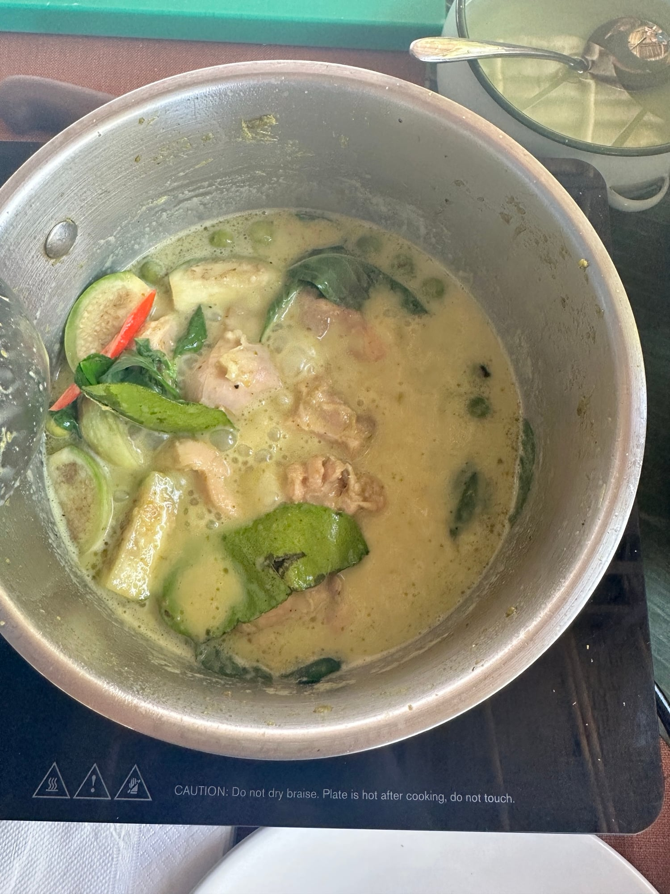

## Zutaten
- {{120 g}} Jasminreis
- {{240 ml}} Wasser (für den Reis)
- {{2 EL}} grüne Currypaste
- {{400 ml}} Kokosmilch
- {{300 g}} Hähnchenbrust, in mundgerechten Stücken
- {{4}} Thai-Auberginen, geviertelt (ersatzweise {{1/2}} Aubergine, gewürfelt)
- {{50 g}} Erbsenauberginen (optional)
- {{4}} Kaffirlimettenblätter
- {{1}} rote Chili, in Streifen
- {{1 TL}} Agavendicksaft
- {{1}} Handvoll Thai-Basilikum
- Kokosöl, Sojasoße

## Equipment
- Topf mit Deckel (für den Reis)
- Wok oder großer Topf

## Zubereitung
1. **Reis kochen:** Reis waschen, mit dem Wasser aufkochen und zugedeckt bei kleiner Hitze ca. 12 Min. garen.
2. **Currypaste anrösten:** {{1 EL}} Kokosöl im Wok erhitzen. Currypaste mit {{3 EL}} Kokosmilch ca. 1 Min. bei mittlerer Hitze anrösten, bis sie duftet.
3. **Hähnchen und Gemüse garen:** Hähnchen kurz mitbraten. Restliche Kokosmilch, Thai-Auberginen, Erbsenauberginen und Kaffirlimettenblätter dazugeben und ca. 10 Min. sanft köcheln lassen, bis das Hähnchen gar ist.
   
4. **Abschmecken:** Mit Sojasoße und Agavendicksaft abschmecken. Chili und Basilikum unterheben.
5. **Servieren:** Curry in Schalen füllen und mit dem Reis servieren.

## Tipps
- Mengen geschätzt.
- Thai-Auberginen und Erbsenauberginen gibt es im Asialaden. Zucchini oder grüne Bohnen gehen auch.
