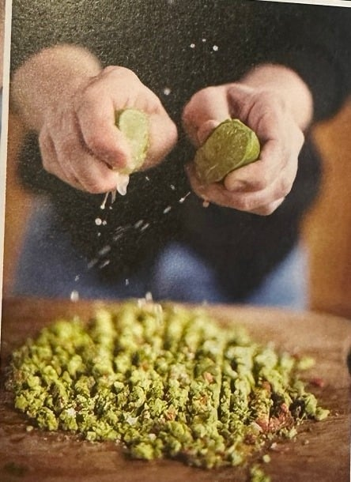

## Zutaten
- {{1}} Handvoll Kirschtomaten in verschiedenen Farben
- {{1}} Handvoll Koriandergrün
- {{1–2}} rote Chilischoten
- {{2}} reife Avocados
- {{2}} Limetten
- {{1/2}} Fenchelknolle
- {{1}} Möhre
- {{1/2}} Bio-Salatgurke
- {{1/2 Packung}} Grissini (ca. 75 g)
- Salz

## Equipment
- Großes Holzbrett

## Zubereitung
1. **Guacamole hacken:** Kirschtomaten auf einem großen Brett zerdrücken. Den oberen Teil des Korianders mit den Chilis (ohne Stiel) fein hacken. Avocados halbieren, entsteinen und das Fruchtfleisch dazudrücken. Salzen, Limettensaft darüberpressen, alles sehr fein hacken und abschmecken.
   
2. **Gemüsesticks schneiden:** Fenchel in Spalten schneiden. Möhre schälen, längs vierteln und in Sticks schneiden, Gurke ebenso. Leicht salzen.
3. **Servieren:** Gemüsesticks neben der Guacamole auf dem Brett anrichten und die Grissini in einem Glas dazustellen.
