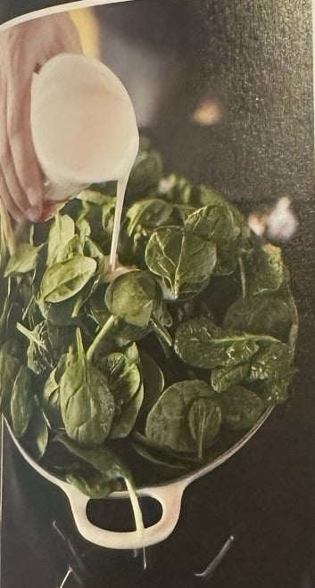
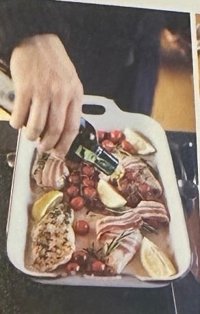
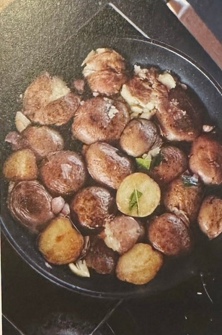
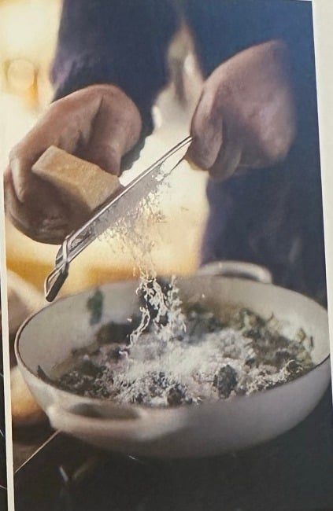
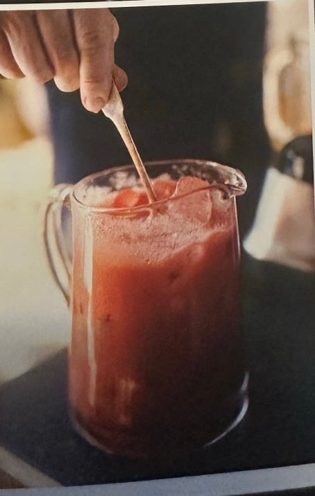
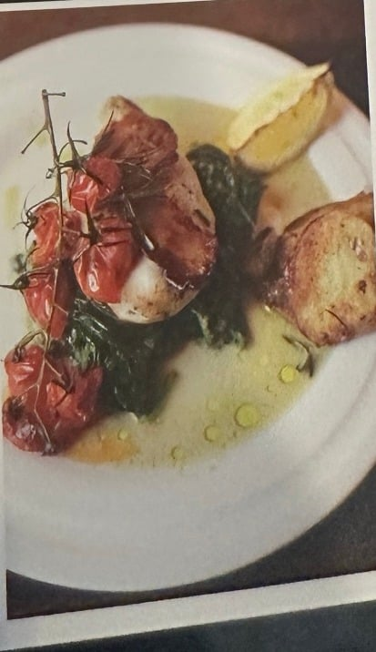

## Zutaten
### Zerdrückte Bratkartoffeln
- {{700 g}} kleine rotschalige oder neue Kartoffeln
- einige Zweige Rosmarin
- einige frische Lorbeerblätter
- {{6}} Knoblauchzehen

### Hähnchen
- {{4}} Hähnchenbrustfilets (je ca. 180 g)
- {{1}} Stück Butter
- {{1}} Bio-Zitrone
- {{300 g}} Kirschtomaten an der Rispe
- {{4}} Scheiben durchwachsener Räucherspeck
- einige Zweige Rosmarin
- getrockneter Oregano, edelsüßes Paprikapulver

### Rahmspinat
- {{1 Bund}} Frühlingszwiebeln
- {{3}} Knoblauchzehen
- einige frische Thymianblättchen
- {{1/4}} Muskatnuss
- {{1}} großes Stück Butter
- {{400 g}} junger Blattspinat
- {{100 g}} Kochsahne
- {{25 g}} Parmesan

### Erdbeer-Slush
- {{400 g}} frische oder TK-Erdbeeren
- einige Minzblätter
- {{1/2}} Zitrone
- Eiswürfel
- Zucker nach Geschmack

### Grundzutaten
- Olivenöl, Salz, Pfeffer

## Equipment
- Wasserkocher
- Mittelgroßer Topf, große Pfanne, breiter flacher Topf
- Große Bratform
- Backpapier
- Standmixer und große Glaskanne

## Zubereitung
1. **Vorbereiten:** Backofengrill auf höchste Stufe vorheizen. Wasserkocher füllen und einschalten.
2. **Kartoffeln kochen:** Kartoffeln gründlich waschen, größere längs halbieren, neue Kartoffeln ganz lassen. Mit 1 Prise Salz in einen mittelgroßen Topf geben, mit kochendem Wasser bedecken und zugedeckt ca. 12–14 Min. sprudelnd kochen, bis sie gar sind.
3. **Spinat ansetzen:** Frühlingszwiebeln putzen, in feine Ringe schneiden und mit einem Schuss Olivenöl bei mittlerer Hitze in einen breiten flachen Topf geben. {{3}} Knoblauchzehen hineinpressen, etwas kochendes Wasser zugießen, Thymian dazugeben, die Muskatnuss darüberreiben und die Butter zugeben. Ca. 3 Min. einkochen lassen, gelegentlich umrühren.
4. **Hähnchen anbraten:** Je eine kräftige Prise Oregano, Paprikapulver, Salz und Pfeffer auf ein großes Stück Backpapier streuen und mit etwas Olivenöl beträufeln. Butter mit etwas Olivenöl in einer großen Pfanne bei hoher Hitze erhitzen. Hähnchenbrustfilets in den Gewürzen wenden und von beiden Seiten in ca. 4–5 Min. goldgelb anbraten.
5. **Spinat zusammenfallen lassen:** Spinat waschen, portionsweise zu den Frühlingszwiebeln geben und zusammenfallen lassen. Behutsam umrühren, damit nichts ansetzt.
   
6. **Unter den Grill:** Zitrone vierteln und mit den Tomaten in eine große Bratform legen. Hähnchen samt Bratflüssigkeit dazugeben und den Speck auf die Filets legen. Rosmarinzweige kurz in der Pfanne wenden, in die Form legen und alles ca. 14 Min. unter den Grill schieben.
   
7. **Kartoffeln zerdrücken:** Kartoffeln abgießen und 1–2 Min. ausdampfen lassen. Rosmarinnadeln und Lorbeer mit einigen Schuss Olivenöl in die leere Pfanne geben, Kartoffeln daraufschütten, mit Olivenöl beträufeln, salzen und {{6}} Knoblauchzehen darüberpressen. Bei hoher Hitze mit einem kleinen Deckel so fest andrücken, dass sie aufplatzen. Ca. 3 Min. bräunen, wenden, erneut andrücken und bis zum Servieren noch 1–2 Mal wiederholen.
   
8. **Spinat fertigstellen:** Sahne zugießen, Hitze reduzieren, Parmesan fein hineinreiben und gut umrühren.
   
9. **Erdbeer-Slush mixen:** Erdbeeren waschen, putzen und mit einigen Eiswürfeln, der Minze und dem Saft der halben Zitrone in den Standmixer geben. Mit Wasser bedecken und mixen. Eine Glaskanne zur Hälfte mit Eiswürfeln füllen, Slush abschmecken, nach Bedarf süßen und hineingießen.
   
10. **Servieren:** Hähnchen aus dem Ofen nehmen und die Garprobe machen. Mit dem Spinat, den Kartoffeln und dem Slush servieren.
   
