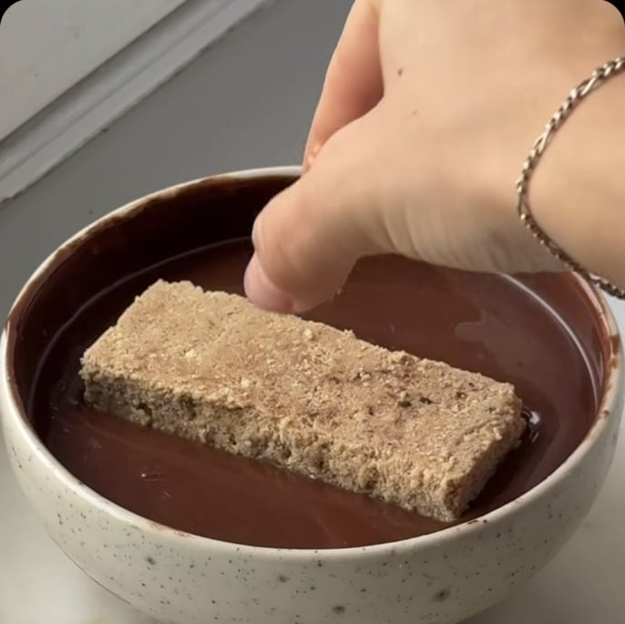
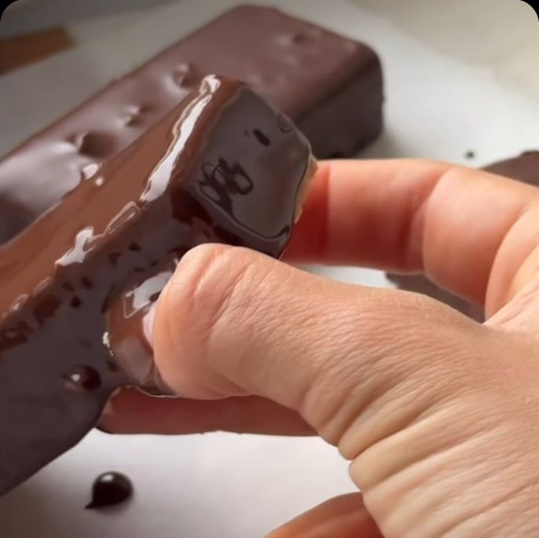
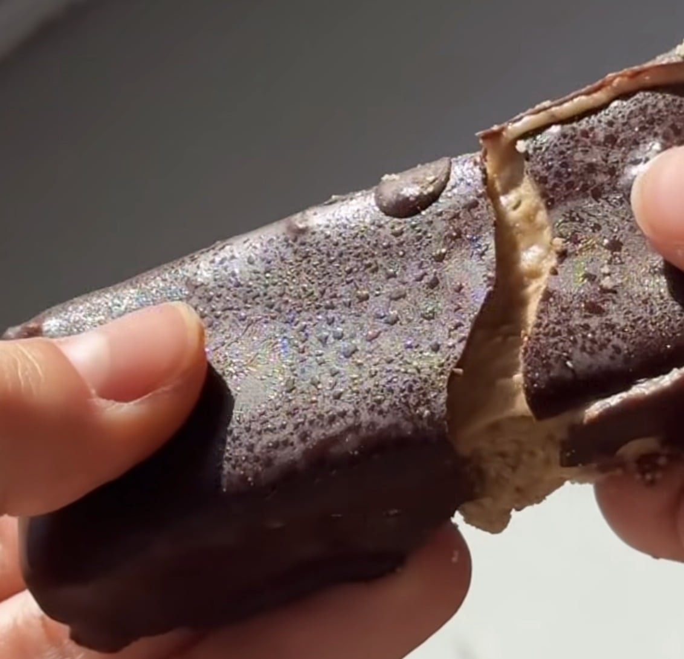

## Zutaten
### Basis
- {{60 g}} Hafermehl
- {{40 g}} veganes Vanille-Proteinpulver
- {{10 g}} Flohsamenschalen
- {{30 g}} Haselnussmus
- {{50 ml}} Agavendicksaft (oder {{2}} Datteln)
- ca. {{2 EL}} Mandeldrink
### Creme
- {{50 g}} Haselnussmus
- {{30 ml}} Agavendicksaft (oder Datteln)
- ca. {{1 EL}} Mandeldrink
- {{1 TL}} Kollagen (optional, für mehr Cremigkeit)
### Überzug
- {{100 g}} Zartbitterschokolade (mind. 70 %)

## Equipment
- Riegel-Silikonform oder Form mit Backpapier
- Schüsseln

## Zubereitung
1. **Basis:** Hafermehl, Proteinpulver, Flohsamenschalen, Haselnussmus, Agavendicksaft und einen Schluck Mandeldrink zu einer einheitlichen Masse verarbeiten.
2. **Einfrieren:** Masse in die Riegelform drücken und ins Gefrierfach stellen.
3. **Creme:** Haselnussmus, Agavendicksaft, Mandeldrink und nach Belieben Kollagen glatt rühren, auf den kalten Boden streichen und mind. 1 Std. einfrieren.
4. **Glasieren:** Schokolade schmelzen und die Riegel darin rundum glasieren.
   
   
5. **Servieren:** Schokolade fest werden lassen und die Riegel direkt aus dem Gefrierfach genießen.
   

## Tipps
- Im Gefrierfach halten sich die Riegel mehrere Wochen.
- Menge der Schokolade geschätzt.
