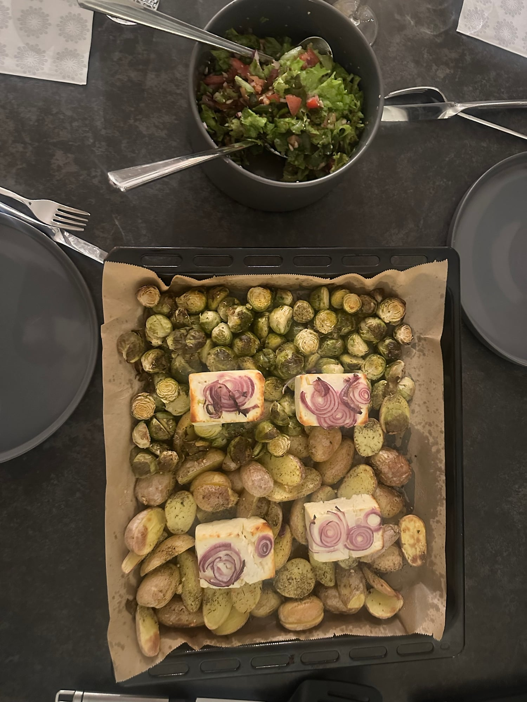
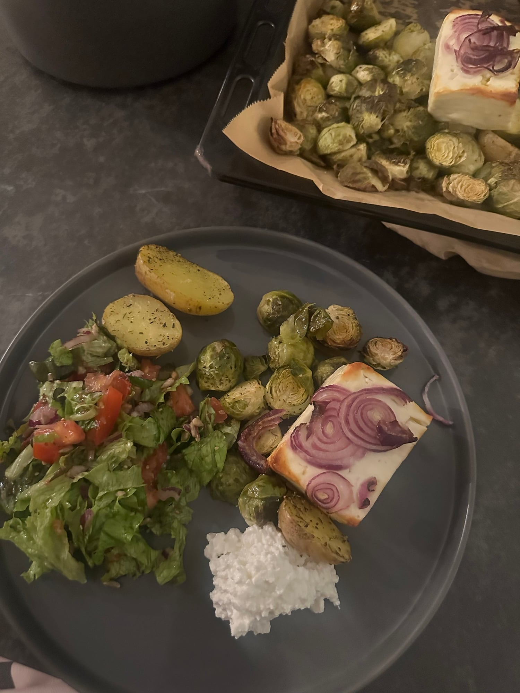

## Zutaten
### Blech
- {{1 kg}} kleine Kartoffeln (Drillinge)
- {{600 g}} Rosenkohl
- {{400 g}} Hirtenkäse
- {{1}} rote Zwiebel, in Ringe geschnitten
- {{1 TL}} getrockneter Oregano
- {{1 TL}} getrockneter Thymian

### Salat
- {{1}} Kopf Blattsalat
- {{3}} Tomaten
- {{1/2}} rote Zwiebel
- {{2 EL}} Sonnenblumenkerne
- {{1/2}} Zitrone, Saft

### Dazu
- {{200 g}} gekörnter Frischkäse
- Olivenöl, Salz, Pfeffer

## Equipment
- Backblech mit Backpapier
- Salatschüssel

## Zubereitung
1. **Vorbereiten:** Backofen auf 200 °C Ober-/Unterhitze vorheizen. Kartoffeln halbieren, Rosenkohl putzen und halbieren.
2. **Gemüse rösten:** Kartoffeln und Rosenkohl auf dem Blech mit ca. {{3 EL}} Olivenöl, Oregano, Thymian, Salz und Pfeffer mischen und ca. 20 Min. rösten.
3. **Hirtenkäse dazu:** Hirtenkäse in {{4}} Stücke schneiden, auf das Gemüse legen, mit Zwiebelringen belegen und mit etwas Olivenöl beträufeln. Weitere ca. 15–20 Min. backen, bis der Käse leicht gebräunt ist.
   
4. **Salat:** Salat zupfen, Tomaten würfeln, Zwiebel fein schneiden. Mit Sonnenblumenkernen, Zitronensaft, Olivenöl, Salz und Pfeffer mischen.
5. **Servieren:** Gemüse und Hirtenkäse mit dem Salat und je einem Klecks gekörntem Frischkäse auf Tellern anrichten.
   

## Tipps
- Mengen geschätzt.
