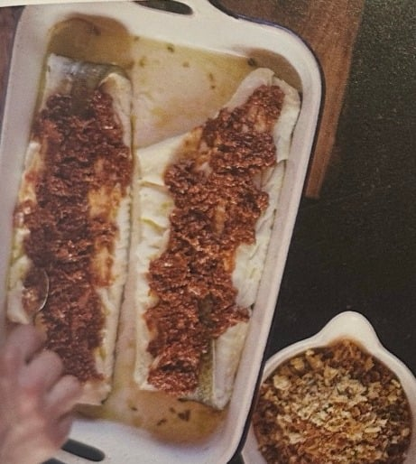
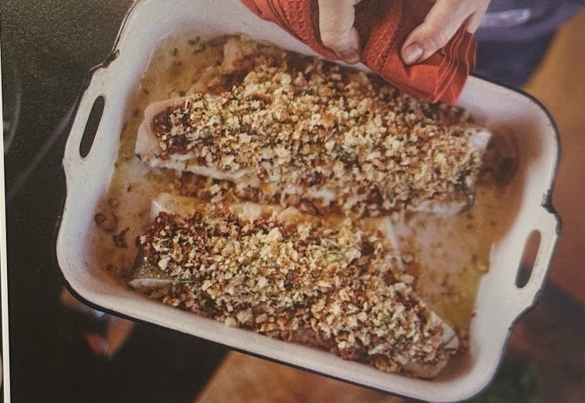
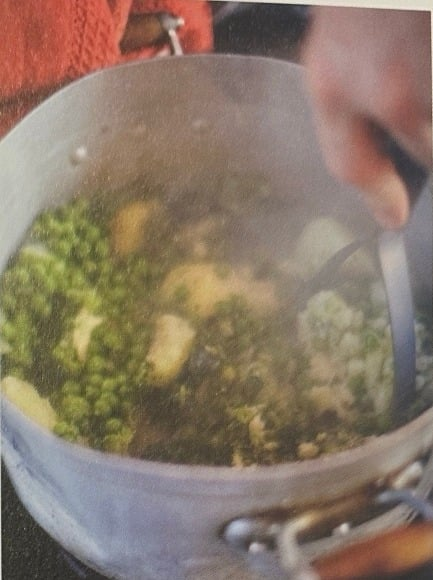

## Zutaten
### Erbsenmus
- {{4}} mittelgroße mehligkochende Kartoffeln
- {{1}} Brokkoli
- {{500 g}} TK-Erbsen
- {{1}} großes Stück Butter
- {{1 EL}} Minzsauce (Fertigprodukt)

### Kabeljau
- {{1 TL}} Fenchelsamen
- {{2}} Kabeljaufilets mit Haut (je ca. 600 g, geschuppt und entgrätet)
- {{200 g}} helles Krustenbrot
- {{4}} Knoblauchzehen
- {{1/2 Dose}} Sardellenfilets in Öl (kleine Dose, 30 g)
- {{150 g}} getrocknete Tomaten in Öl
- {{1 Bund}} Basilikum (klein)
- {{1}} rote Chilischote
- {{40 g}} Parmesan
- {{1}} Bio-Zitrone
- Balsamico-Essig
- einige Zweige Rosmarin und Thymian

### Sauce Tartare
- {{1 Bund}} glatte Petersilie (klein)
- {{3}} Cornichons
- {{1 TL}} kleine Kapern (gehäuft)
- {{1/2 Dose}} Sardellenfilets in Öl (kleine Dose, 30 g)
- {{1}} Bio-Zitrone
- {{200 g}} Mayonnaise
- edelsüßes Paprikapulver

### Warmer Salat
- {{6}} Scheiben Pancetta (ersatzweise durchwachsener Bauchspeck)
- {{2}} Knoblauchzehen
- {{5 EL}} Balsamico-Essig
- {{100 g}} Brunnenkresse
- {{100 g}} Rucola

### Grundzutaten
- Olivenöl, Salz, Pfeffer

## Equipment
- Wasserkocher
- Großer Topf, Pfanne
- Große Bratform
- Küchenmaschine mit Messer
- Kartoffelstampfer

## Zubereitung
1. **Vorbereiten:** Backofengrill auf höchste Stufe vorheizen. Wasserkocher füllen und einschalten.
2. **Kartoffeln und Brokkoli kochen:** Kartoffeln schälen, ca. 2 cm groß würfeln, salzen und im großen Topf mit kochendem Wasser bedeckt bei mittlerer Hitze zugedeckt garen. Den holzigen Teil vom Brokkolistrunk abschneiden, den Rest in Scheiben schneiden und zu den Kartoffeln geben. Röschen in gleich große Stücke teilen und beiseitelegen.
3. **Kabeljau vorgrillen:** Einige Schuss Olivenöl in eine große Bratform gießen, Fenchelsamen, Salz und Pfeffer hineinstreuen und die Filets darin wenden. Auf die Hautseite drehen, mit Olivenöl beträufeln und ca. 5 Min. in der Ofenmitte grillen.
4. **Brösel mahlen:** Brot grob würfeln und mit {{2}} Knoblauchzehen und einigen Tropfen Sardellenöl in der Küchenmaschine zu Bröseln mahlen. In eine Schüssel füllen.
5. **Tomatenpaste mixen:** Sardellen und getrocknete Tomaten abtropfen lassen. Mit {{2}} Knoblauchzehen, Basilikum, Chili (ohne Stiel, nach Belieben ohne Samen) und Parmesan in die Küchenmaschine geben. Zitronenschale darüberreiben, Saft dazupressen, einige Spritzer Balsamico zugeben und alles zu einer Paste verarbeiten.
6. **Kruste überbacken:** Fisch aus dem Ofen nehmen, dick mit der Paste bestreichen und die Brösel darüberstreuen. Rosmarin und Thymian mit Olivenöl benetzen, auf die Filets legen und ca. 10 Min. in der Ofenmitte goldbraun und knusprig überbacken.
   
   
7. **Erbsen dazugeben:** Erbsen und Brokkoliröschen zu den Kartoffeln geben und zugedeckt weitergaren.
   
8. **Pancetta braten:** Pancetta in einer Pfanne bei mittlerer Hitze knusprig braten, regelmäßig wenden.
9. **Sauce Tartare mixen:** Schüssel der Küchenmaschine ausspülen. Petersilie, Cornichons, Kapern und die restlichen Sardellen samt Öl kurz pürieren. Schale von {{1/2}} Zitrone fein abreiben, Saft auspressen und mit etwas Olivenöl zugeben, bis eine recht glatte Sauce entsteht. In eine Schüssel füllen, Mayonnaise unterrühren, mit Zitronensaft abschmecken, mit 1 Prise Paprikapulver bestreuen und mit Olivenöl beträufeln.
10. **Dressing machen:** Sobald die Pancetta knusprig ist, Hitze reduzieren und {{2}} Knoblauchzehen in die Pfanne pressen. Vom Herd nehmen, mit dem Balsamico ablöschen, etwas Olivenöl zugießen und die Pancetta grob zerbröckeln.
11. **Erbsenmus stampfen:** Gemüse abgießen, einige Minuten ausdampfen lassen und zurück in den Topf geben. Butter, einen kräftigen Schuss Olivenöl und die Minzsauce zugeben, salzen, pfeffern und nur grob zerstampfen *(ca. zehn Stöße genügen)*.
12. **Servieren:** Brunnenkresse und Rucola erst im letzten Moment im warmen Dressing durchheben. Kabeljau mit Erbsenmus, Sauce Tartare und Salat servieren.

## Tipps
- Dazu passt ein gut gekühlter Weißwein.
