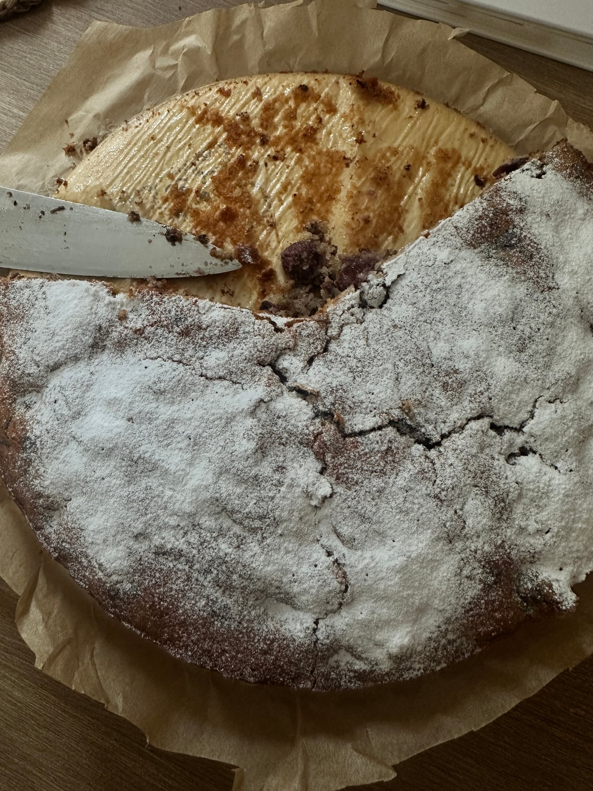

## Zutaten
- {{1}} Glas Sauerkirschen (ca. {{350 g}} abgetropft)
- {{100 g}} Kokosöl, geschmolzen, plus etwas für die Form
- {{4}} Eier
- {{100 g}} Kokosblütenzucker
- {{200 g}} gemahlene Mandeln
- {{100 g}} Dinkelmehl
- {{2 TL}} Backpulver
- {{1}} Prise Salz

## Equipment
- Springform (26 cm)
- Handrührgerät oder Küchenmaschine

## Zubereitung
1. **Vorbereiten:** Ofen auf 180 °C Ober-/Unterhitze vorheizen. Springform mit etwas Kokosöl einfetten oder mit Backpapier auslegen. Kirschen gut abtropfen lassen.
2. **Teig rühren:** Eier mit Kokosblütenzucker ca. 3 Min. schaumig schlagen, dann das geschmolzene Kokosöl einrühren.
3. **Trockene Zutaten unterheben:** Mandeln, Dinkelmehl, Backpulver und Salz mischen und kurz unter die Eimasse rühren.
4. **Belegen:** Teig in die Form streichen und die Kirschen gleichmäßig darauf verteilen.
5. **Backen:** Ca. 40–45 Min. backen, bis ein Holzstäbchen sauber herauskommt. In der Form abkühlen lassen.
   
6. **Servieren:** In {{12}} Stücke schneiden und servieren.

## Tipps
- Mengen geschätzt.
