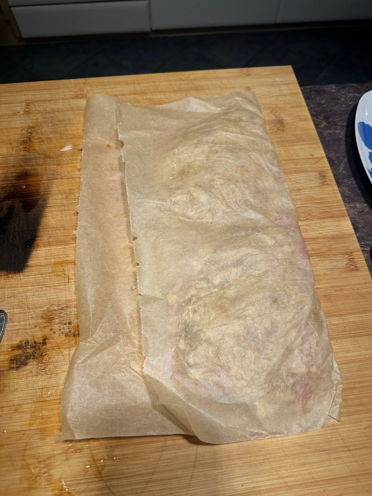
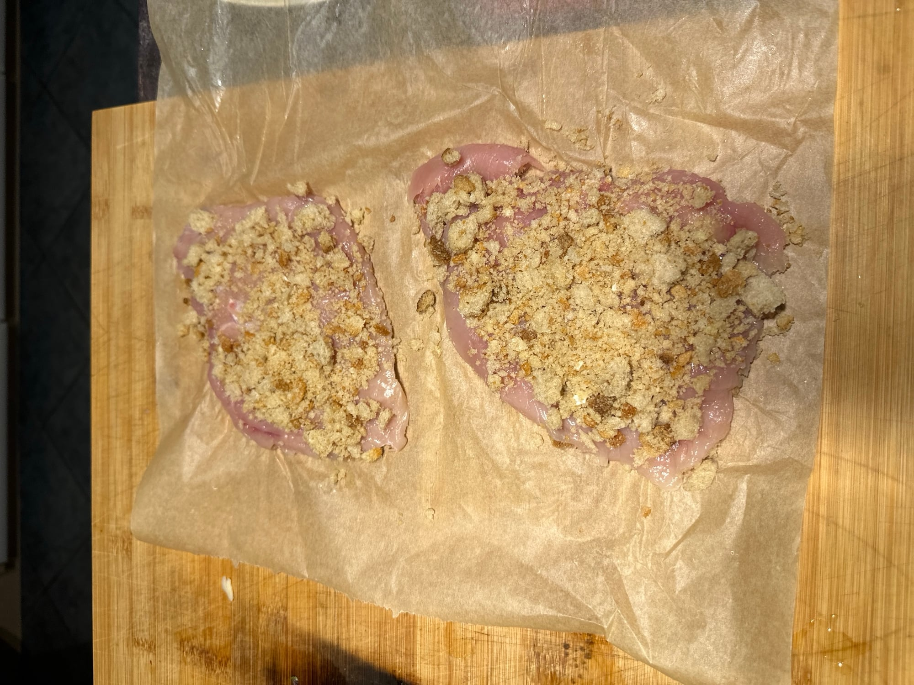
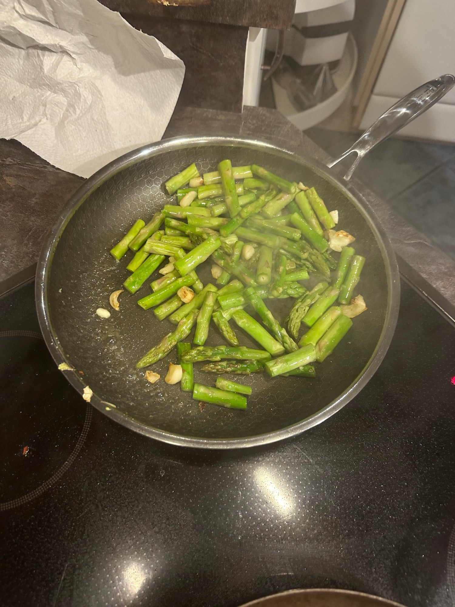

## Zutaten
### Hähnchen
- {{2}} Hähnchenbrustfilets ohne Haut (à ca. 120 g)
- {{2}} dicke Scheiben Vollkornbrot mit Körnern (à ca. 75 g)
- {{1}} Knoblauchzehe
- {{1}} Zitrone

### Spargelsalat
- {{250 g}} grüner Spargel
- {{1}} Knoblauchzehe
- {{1}} rote Chilischote
- {{50 g}} Rucola
- {{50 g}} Babyspinat
- {{50 g}} gemischter Blattsalat

### Grundzutaten
- Olivenöl, Meersalz, Pfeffer

## Equipment
- Küchenmaschine oder Mixer
- Backpapier
- Zwei Pfannen

## Zubereitung
1. **Brösel machen:** Brot in die Küchenmaschine zupfen, {{1}} Knoblauchzehe schälen und dazugeben, alles zu relativ feinen Bröseln verarbeiten.
2. **Spargel vorbereiten:** Vom Spargel die holzigen Enden abbrechen und die Stangen in ca. 4 cm lange Stücke schneiden. Chili in feine Ringe schneiden.
3. **Hähnchen plattieren:** Hähnchenbrustfilets zwischen zwei Bögen Backpapier legen und mit dem Boden einer großen Pfanne flach klopfen, bis sie nur noch ca. 1 cm dick sind.
   
4. **Panieren:** Das Fleisch in den Bröseln wenden und die Brösel gut andrücken. Backpapier wieder auflegen und die Filets noch einmal klopfen, damit sie etwas flacher werden und die Brösel gut haften.
   
5. **Hähnchen braten:** {{1 EL}} Olivenöl in einer Pfanne bei mittlerer Hitze erhitzen und das Hähnchen von jeder Seite ca. 3 Min. braten, bis es goldbraun, knusprig und durchgegart ist.
6. **Spargel braten:** Gleichzeitig in einer zweiten Pfanne etwas Olivenöl erhitzen und den Spargel bei mittlerer bis hoher Hitze ca. 5 Min. braten. {{1}} Knoblauchzehe dazupressen, kurz mitbraten und salzen.
   
7. **Salat anmachen:** Rucola, Spinat und Blattsalat mit dem Saft von {{1/2}} Zitrone, etwas Olivenöl, Salz und Pfeffer mischen. Spargel und Chiliringe daraufgeben.
8. **Servieren:** Hähnchen nach Belieben in Streifen schneiden, mit Meersalz und Pfeffer würzen und mit dem Spargelsalat anrichten. Die restliche Zitrone in Spalten schneiden und dazugeben.

## Tipps
- Der Spargelsalat ist eine eigene Ergänzung zum Buchrezept, dort gibt es nur Rucola mit Zitronensaft.
