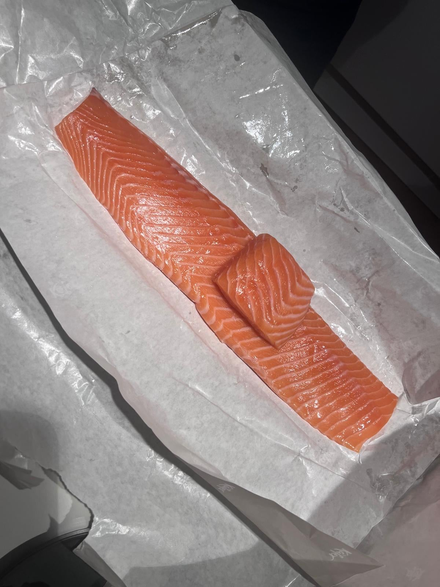
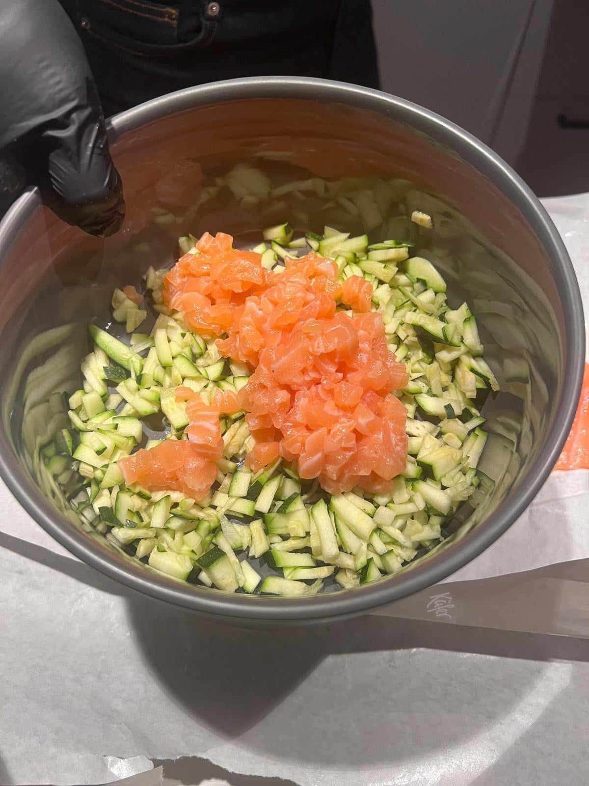
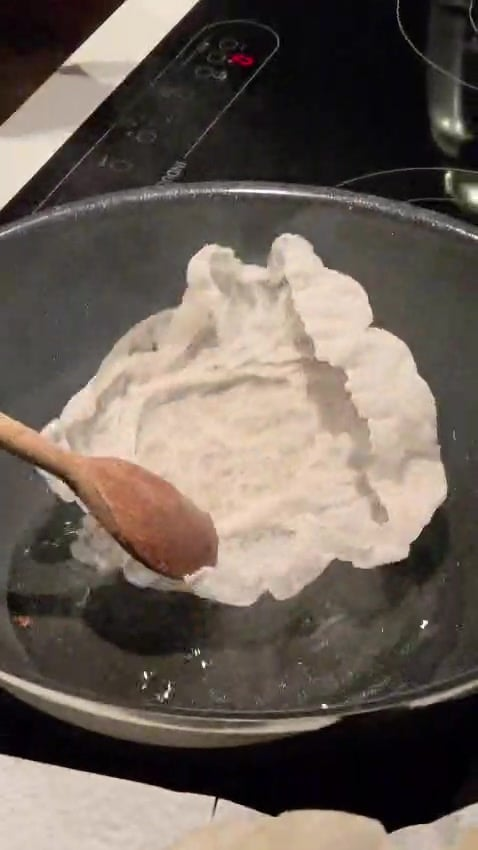
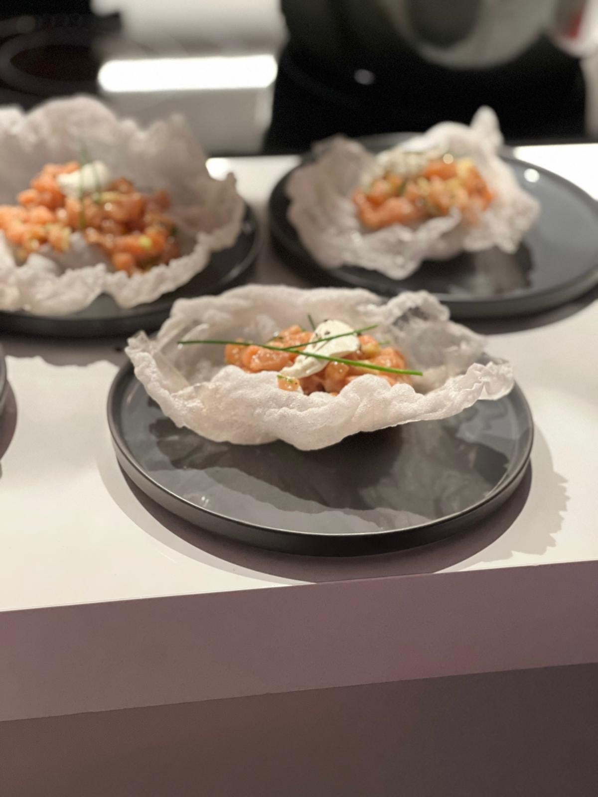

## Zutaten
- {{400 g}} Lachs in Sashimi-Qualität, ohne Haut
- {{1}} kleine Zucchini
- {{1/2}} Zitrone, Saft
- {{4}} Blätter Reispapier
- {{4 TL}} Crème fraîche (optional)
- {{1/2 Bund}} Schnittlauch (optional)
- Neutrales Öl zum Frittieren, Olivenöl, Salz, Pfeffer

## Equipment
- Scharfes Messer
- Schüssel
- Pfanne
- Küchenpapier

## Zubereitung
1. **Lachs würfeln:** Lachs mit einem scharfen Messer in kleine Würfel schneiden und kalt stellen. *(Nur sehr frischen Lachs in Sashimi-Qualität verwenden und bis zum Servieren kühlen!)*
   
2. **Tatar mischen:** Zucchini fein würfeln und mit dem Lachs mischen. Mit Zitronensaft, etwas Olivenöl, Salz und Pfeffer abschmecken.
   
3. **Reispapier frittieren:** Öl ca. 2 cm hoch in einer Pfanne stark erhitzen. Je ein trockenes Reispapierblatt hineinlegen, es poppt in wenigen Sekunden auf. Mit einem Kochlöffel zu einem Schiffchen formen und auf Küchenpapier abtropfen lassen.
   
4. **Anrichten:** Tatar in die Reispapier-Schiffchen geben, nach Wunsch mit je 1 TL Crème fraîche und Schnittlauchhalmen garnieren und sofort servieren.
   

## Tipps
- Mengen geschätzt.
- Die Reispapier-Chips erst kurz vor dem Servieren füllen, damit sie knusprig bleiben.
