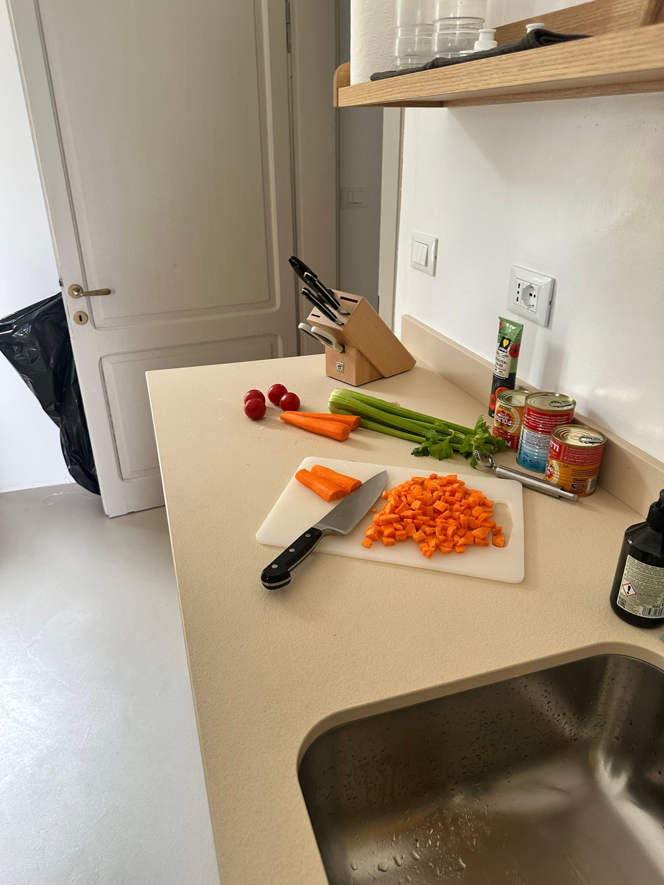
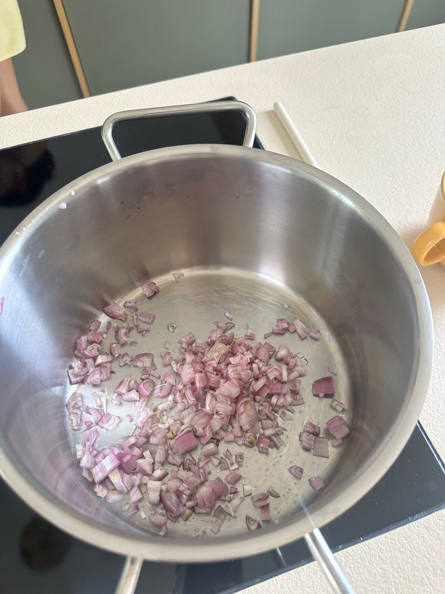
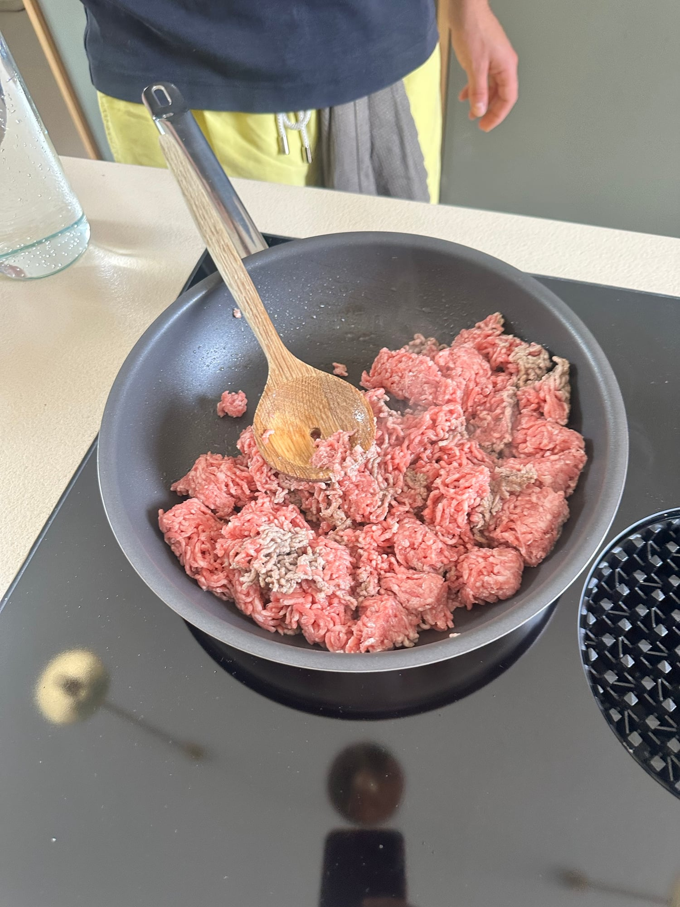
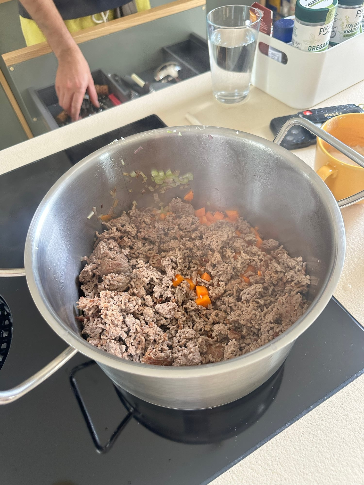
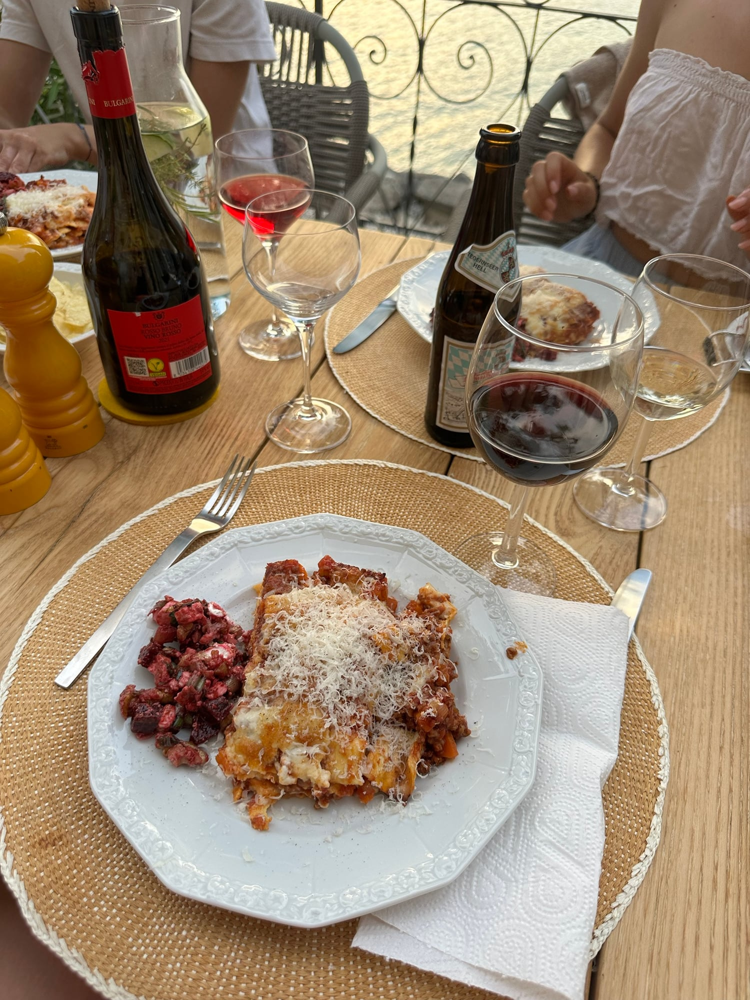
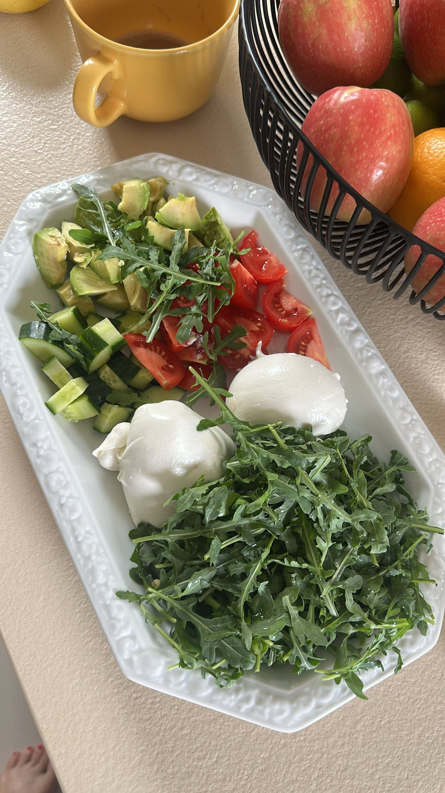

## Zutaten
### Ragù
- {{2}} Karotten, gewürfelt
- {{2}} Stangen Staudensellerie, fein gewürfelt
- {{3}} Schalotten, fein gewürfelt
- {{800 g}} Rinderhackfleisch
- {{2 EL}} Tomatenmark
- {{2 Dosen}} stückige Tomaten (à 400 g)
- {{1 TL}} getrockneter Oregano
- {{1 TL}} italienische Kräuter

### Béchamel
- {{50 g}} Butter
- {{50 g}} Mehl
- {{750 ml}} Milch
- Muskatnuss

### Schichten
- {{250 g}} Lasagneplatten (ohne Vorkochen)
- {{2}} Kugeln Mozzarella (à 125 g), gezupft
- {{50 g}} Parmesan, frisch gerieben
- Olivenöl, Salz, Pfeffer

## Equipment
- Großer Topf
- Pfanne
- Kleiner Topf
- Auflaufform (ca. 20 × 30 cm)

## Zubereitung
1. **Gemüse schneiden:** Karotten, Staudensellerie und Schalotten würfeln.
   
2. **Anschwitzen:** Schalotten im großen Topf in Olivenöl glasig dünsten, dann Karotten und Sellerie ca. 5 Min. mitdünsten.
   
3. **Hack anbraten:** Hackfleisch in der Pfanne in Olivenöl krümelig anbraten und zum Gemüse in den Topf geben.
   
   
4. **Ragù köcheln:** Tomatenmark kurz mitrösten, Tomaten, Oregano und italienische Kräuter dazugeben. Mit Salz und Pfeffer würzen und bei kleiner Hitze ca. 30–40 Min. köcheln lassen.
5. **Béchamel:** Ofen auf 180 °C Ober-/Unterhitze vorheizen. Butter im kleinen Topf schmelzen, Mehl einrühren, nach und nach Milch dazugießen und unter Rühren ca. 5 Min. eindicken lassen. Mit Salz, Pfeffer und Muskat abschmecken.
6. **Schichten und Backen:** In der Form abwechselnd Ragù, Lasagneplatten und Béchamel schichten, mit Ragù und Béchamel abschließen. Mozzarella darauf verteilen und ca. 40 Min. backen, bis die Oberfläche goldbraun ist.
7. **Servieren:** Ca. 10 Min. ruhen lassen, in Stücke schneiden und mit Parmesan bestreuen.
   
   

## Tipps
- Mengen geschätzt.
- Dazu passen ein Teller mit Rucola, Burrata, Tomaten, Gurke und Avocado oder ein Rote-Bete-Salat.
