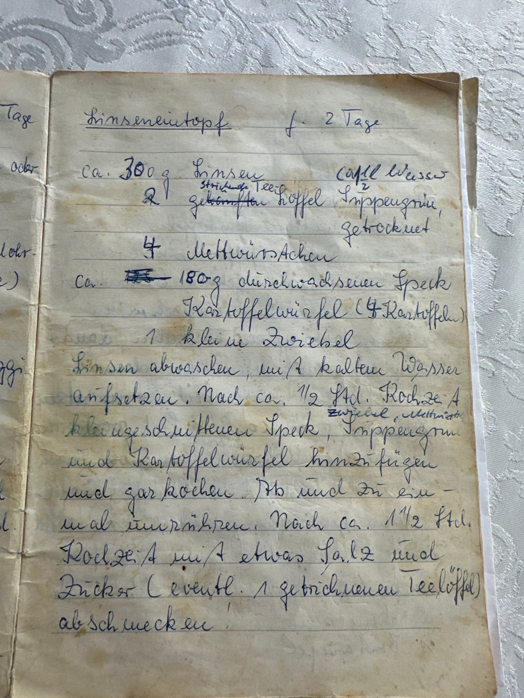

## Zutaten
- ca. {{300 g}} Linsen
- ca. {{1,5 l}} Wasser
- {{180 g}} durchwachsener Speck, klein geschnitten
- {{1}} kleine Zwiebel, gewürfelt
- {{4}} Mettwürstchen
- {{2 TL}} getrocknetes Suppengrün (gestrichen)
- {{4}} Kartoffeln, gewürfelt
- {{1 TL}} Zucker (gestrichen, nach Belieben)
- Salz

## Equipment
- Großer Topf

## Zubereitung
1. **Linsen aufsetzen:** Linsen abwaschen und mit dem kalten Wasser aufsetzen.
2. **Zutaten dazu:** Nach ca. 1/2 Std. Kochzeit Speck, Zwiebel, Mettwürstchen, Suppengrün und Kartoffelwürfel dazugeben.
3. **Garkochen:** Alles garkochen und ab und zu umrühren.
4. **Abschmecken und servieren:** Nach ca. 1 1/2 Std. Kochzeit mit etwas Salz und nach Belieben Zucker abschmecken und servieren.
   

## Tipps
- Handgeschrieben von Oma Elda, im Original „für 2 Tage“.
- Man kann auch {{500 g}} Linsen nehmen, dann etwas mehr Wasser dazugeben.
- Statt Zucker geht auch 1 TL Agavendicksaft.
