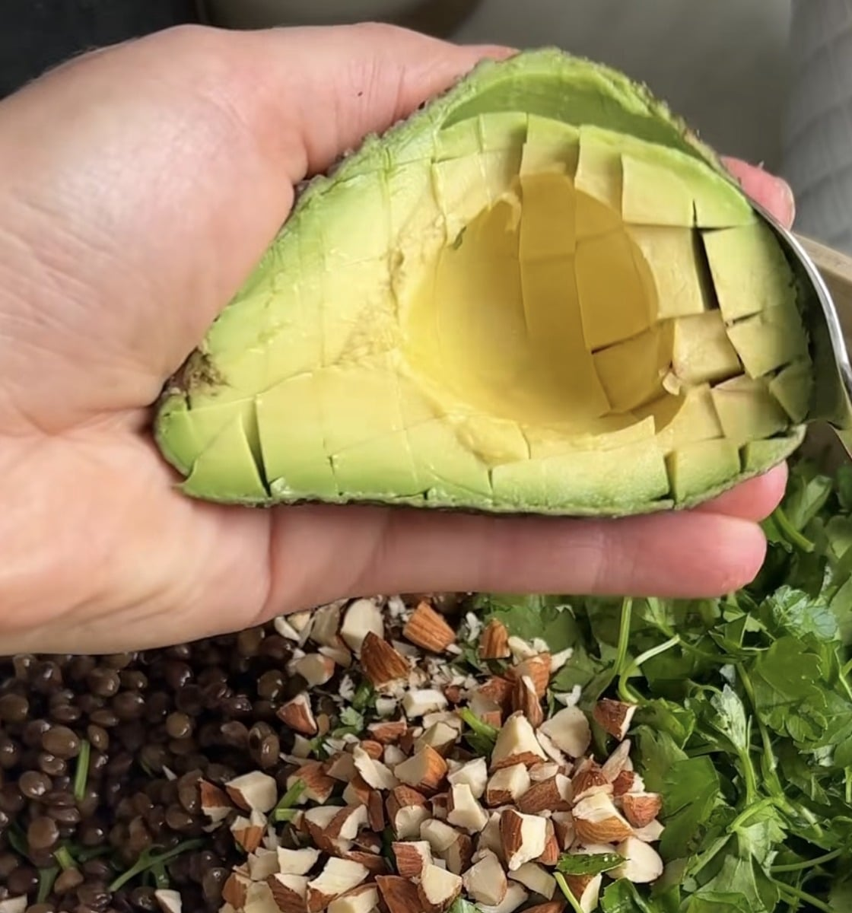

## Zutaten
- {{1}} Zucchini
- {{250 g}} vorgegarte Beluga-Linsen
- {{1 Bund}} glatte Petersilie
- {{30 g}} Mandeln
- {{1}} reife Avocado
- {{1/2}} Granatapfel
- {{1}} Zitrone
- Olivenöl, Salz, Pfeffer

## Zubereitung
1. **Zucchini braten:** Zucchini in ca. 1,5 cm dicke Scheiben schneiden und in einer Pfanne mit etwas Olivenöl bei mittlerer Hitze von jeder Seite ca. 3–4 Min. goldbraun braten. Salzen und pfeffern.
2. **Salat vorbereiten:** Linsen abspülen. Petersilie grob zupfen, Mandeln grob hacken, Avocado würfeln und die Granatapfelkerne herauslösen.
   
3. **Dressing:** Zitronensaft mit ca. {{3 EL}} Olivenöl, Salz und Pfeffer verrühren.
4. **Servieren:** Linsen, Petersilie, Mandeln und Avocado mit dem Dressing mischen. Zucchini und Granatapfelkerne darauf verteilen.

## Tipps
- Mengen geschätzt.
