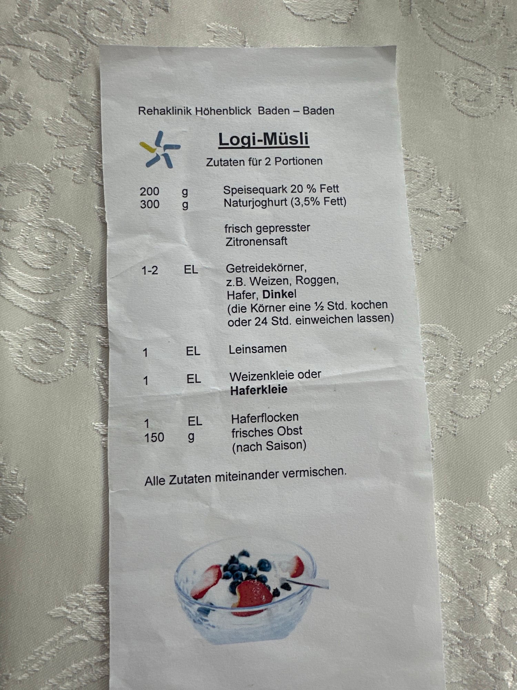

## Zutaten
- {{1–2 EL}} Getreidekörner (z. B. Weizen, Roggen, Hafer, Dinkel)
- {{200 g}} Speisequark (20 % Fett)
- {{300 g}} Naturjoghurt (3,5 % Fett)
- Frisch gepresster Zitronensaft
- {{1 EL}} Leinsamen
- {{1 EL}} Weizen- oder Haferkleie
- {{1 EL}} Haferflocken
- {{150 g}} frisches Obst (nach Saison)

## Equipment
- Topf (für die Körner)
- Schüssel

## Zubereitung
1. **Körner vorbereiten:** Getreidekörner ca. 1/2 Std. kochen oder 24 Std. in Wasser einweichen.
2. **Verrühren:** Quark und Joghurt mit etwas Zitronensaft glatt rühren.
3. **Mischen:** Körner, Leinsamen, Kleie und Haferflocken unterrühren.
4. **Servieren:** Obst klein schneiden, unterheben oder darauf verteilen und servieren.
   

## Tipps
- Aus Oma Eldas Rezeptsammlung.
- Die Körner lassen sich gut auf Vorrat kochen und halten sich im Kühlschrank ein paar Tage.
