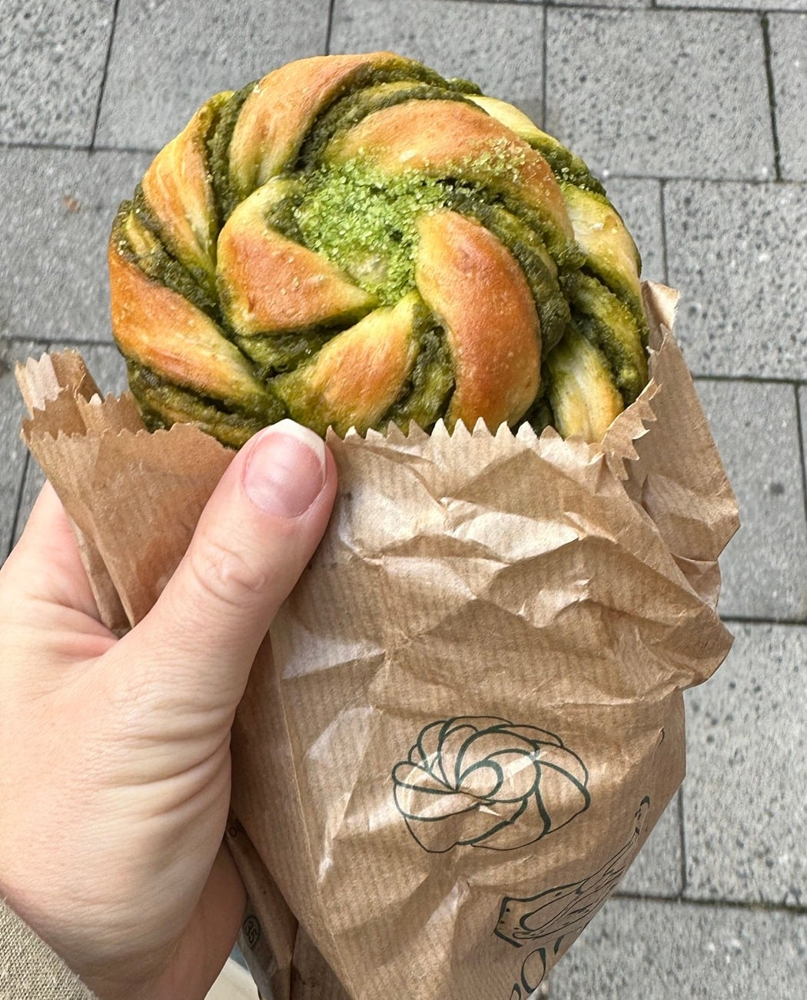

## Zutaten
### Teig
- {{150 ml}} Milch, lauwarm
- {{1 Päckchen}} Trockenhefe
- {{2 EL}} Agavendicksaft
- {{300 g}} Dinkelmehl (Type 630)
- {{1}} Ei
- {{40 g}} Kokosöl, geschmolzen
- {{1 Prise}} Salz

### Füllung
- {{40 g}} Kokosöl, weich
- {{60 g}} gemahlene Mandeln
- {{2 EL}} Agavendicksaft
- {{2 TL}} Matcha

### Topping
- {{1 EL}} Kokosblütenzucker
- {{1/2 TL}} Matcha

## Equipment
- Nudelholz
- Backblech mit Backpapier

## Zubereitung
1. **Hefe ansetzen:** Milch, Hefe und Agavendicksaft verrühren und ca. 5 Min. stehen lassen.
2. **Teig kneten:** Mehl, Ei, Kokosöl und Salz dazugeben und ca. 5 Min. zu einem glatten Teig kneten. Abgedeckt ca. 1 Std. an einem warmen Ort gehen lassen.
3. **Füllung rühren:** Kokosöl, Mandeln, Agavendicksaft und Matcha zu einer streichfähigen Paste verrühren.
4. **Ausrollen und füllen:** Teig zu einem Rechteck von ca. 30 × 40 cm ausrollen, eine Hälfte mit der Füllung bestreichen und die andere Hälfte darüberklappen.
5. **Knoten formen:** Teig in {{8}} Streifen schneiden, jeden Streifen verdrehen und zu einem Knoten schlingen. Auf das Blech setzen, abgedeckt ca. 20 Min. gehen lassen und den Ofen auf 180 °C Ober-/Unterhitze vorheizen.
6. **Backen:** Ca. 15–18 Min. goldbraun backen.
   
7. **Servieren:** Kokosblütenzucker und Matcha mischen, die noch warmen Knoten damit bestreuen und servieren.

## Tipps
- Mengen geschätzt.
