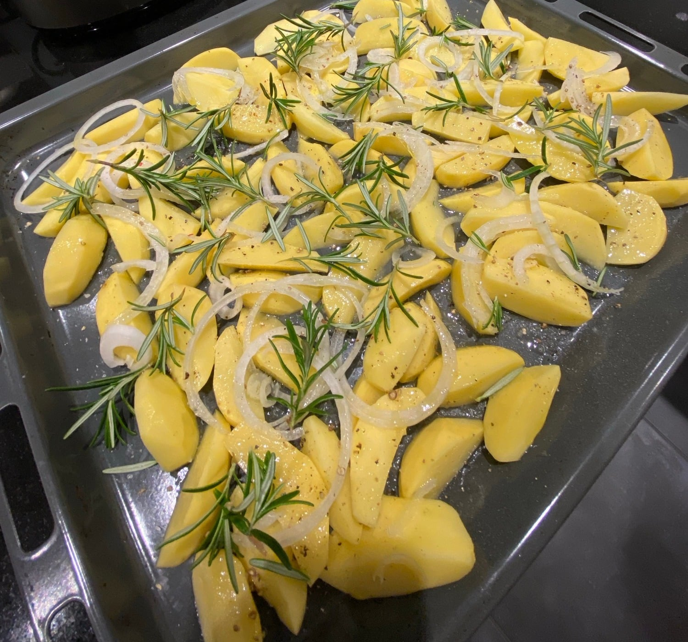

## Zutaten
- {{1,2 kg}} festkochende Kartoffeln
- {{2}} Zwiebeln, in Ringen
- {{4 EL}} Olivenöl
- {{4}} Zweige Rosmarin
- {{600 g}} Hirtenkäse (3 Packungen)
- {{2 TL}} getrocknete Kräuter (z. B. Kräuter der Provence)
- Salz, Pfeffer

## Equipment
- Backblech

## Zubereitung
1. **Vorheizen:** Ofen auf 200 °C Ober-/Unterhitze vorheizen.
2. **Kartoffeln vorbereiten:** Kartoffeln schälen und in Spalten schneiden. Mit Zwiebelringen, {{3 EL}} Olivenöl, Salz und Pfeffer auf dem Blech mischen und den Rosmarin darüber verteilen.
   
3. **Vorbacken:** Ca. 25 Min. backen, bis die Kartoffeln leicht Farbe bekommen.
4. **Hirtenkäse dazugeben:** Hirtenkäse in große Stücke schneiden, zwischen die Kartoffeln legen, mit den Kräutern bestreuen und mit dem übrigen Olivenöl beträufeln. Weitere ca. 20 Min. backen, bis der Käse weich ist und die Kartoffeln goldbraun sind.
5. **Servieren:** Direkt vom Blech servieren.

## Tipps
- Dazu passt ein grüner Salat.
- Mengen geschätzt.
