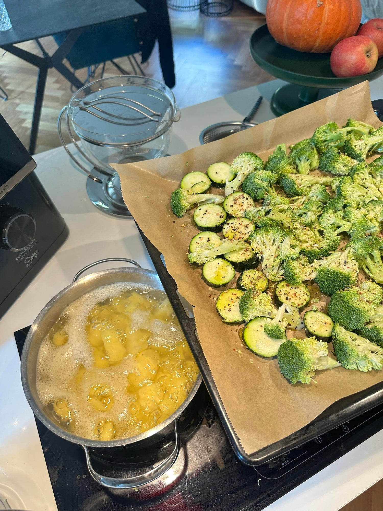
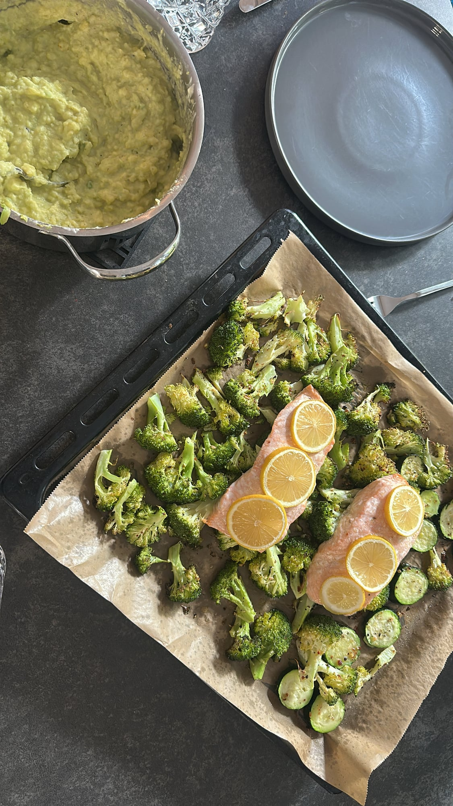
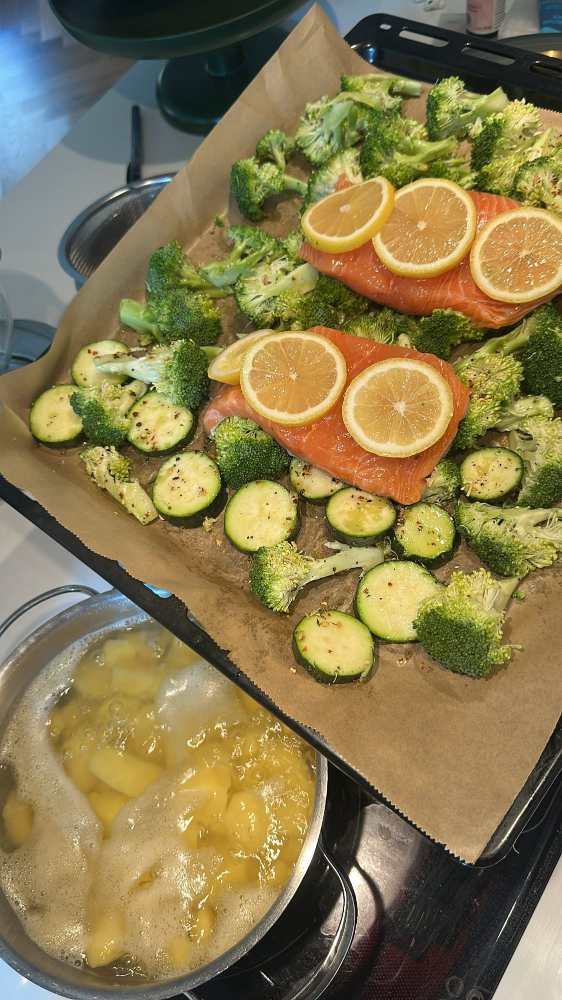
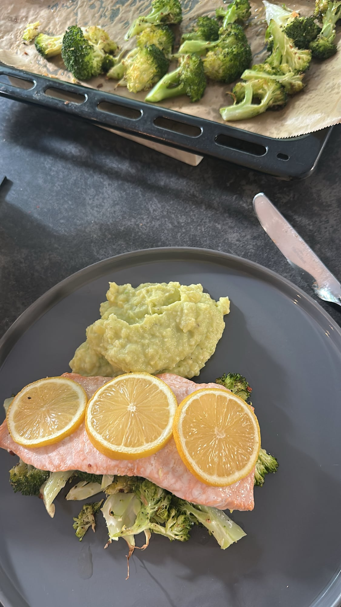

## Zutaten
### Stampf
- {{600 g}} mehligkochende Kartoffeln
- {{1}} reife Avocado
- {{2 EL}} griechischer Joghurt oder Crème fraîche light
- {{1/2}} Zitrone, Saft

### Blech
- {{1}} Brokkoli (ca. 400 g)
- {{1}} Zucchini
- {{2}} Lachsfilets (à ca. 150 g)
- {{1}} Zitrone, in Scheiben
- Olivenöl, Salz, Pfeffer, Chiliflocken

## Equipment
- Backblech mit Backpapier
- Topf
- Kartoffelstampfer

## Zubereitung
1. **Vorbereiten:** Backofen auf 200 °C Ober-/Unterhitze vorheizen. Kartoffeln schälen, würfeln und in Salzwasser ca. 15–20 Min. weich kochen.
2. **Gemüse aufs Blech:** Brokkoli in Röschen teilen, Zucchini in Scheiben schneiden. Auf dem Blech mit {{1 EL}} Olivenöl, Salz, Pfeffer und Chiliflocken mischen und ca. 10 Min. vorbacken.
   
3. **Lachs dazulegen:** Lachs salzen und pfeffern, zwischen das Gemüse legen und mit Zitronenscheiben belegen. Ca. 12–15 Min. weiterbacken, bis der Lachs gerade gar ist.
   
4. **Stampf:** Kartoffeln abgießen und kurz ausdampfen lassen. Avocado, Joghurt und Zitronensaft dazugeben und alles grob stampfen. Mit Salz und Pfeffer abschmecken.
   
5. **Servieren:** Gemüse auf Teller verteilen, Lachs darauflegen und den Stampf danebengeben.
   

## Tipps
- Mengen geschätzt.
- Im Original kommt Crème fraîche in den Stampf. Griechischer Joghurt oder Crème fraîche light machen ihn leichter, die Avocado sorgt trotzdem für Cremigkeit.
