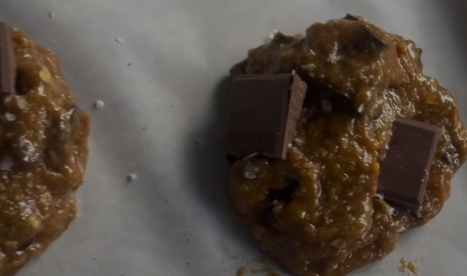

## Zutaten
- {{1 Tasse}} Kokosblütenzucker
- {{3/4 Tasse}} Olivenöl
- {{1}} Ei
- {{1}} Eigelb
- {{2 TL}} Vanilleextrakt
- {{1 Tasse}} Hafermehl
- {{1/2 Tasse}} Mandelmehl
- {{1/3 Tasse}} Speisestärke
- {{1/4 TL}} Natron
- {{1/2 TL}} Salz
- {{225–255 g}} Zartbitterschokolade, grob gehackt
- Meersalzflocken (optional)

## Equipment
- Backblech mit Backpapier
- Schneebesen

## Zubereitung
1. **Teig anrühren:** Kokosblütenzucker, Olivenöl, Ei, Eigelb und Vanille verquirlen.
2. **Mehl unterrühren:** Hafermehl, Mandelmehl, Speisestärke, Natron und Salz dazugeben und nur so lange rühren, bis alles verbunden ist.
3. **Schokolade unterheben:** Gehackte Schokolade unterheben.
4. **Kühlen:** Teig über Nacht oder mind. 2 Std. kalt stellen. *(Diesen Schritt nicht überspringen, sonst laufen die Cookies breit!)*
5. **Backen:** Ofen auf 180 °C vorheizen. Teig zu {{12}} Kugeln formen, mit Abstand aufs Blech setzen und ca. 10–12 Min. backen, bis die Ränder fest und die Mitte noch weich ist.
   
6. **Servieren:** Auf dem Blech abkühlen lassen und mit Meersalzflocken bestreuen.

## Tipps
- Stückzahl geschätzt.
- Die Kühlzeit ist in der Dauer nicht enthalten.
