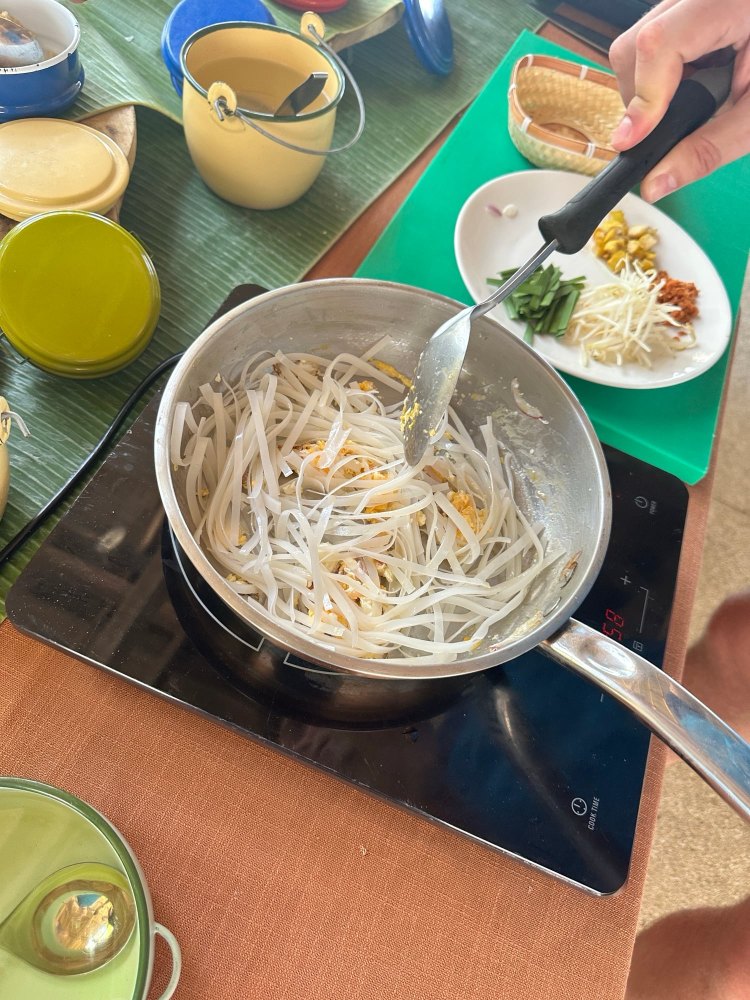

## Zutaten
- {{150 g}} breite Reisnudeln
- {{2 EL}} Tamarindenpaste
- {{2 EL}} Sojasoße
- {{1 EL}} Agavendicksaft
- {{1 TL}} Chiliflocken
- {{200 g}} fester Tofu, gewürfelt
- {{2}} Knoblauchzehen, gehackt
- {{2}} Eier
- {{150 g}} Sojasprossen
- {{1/2 Bund}} Schnittknoblauch oder Frühlingszwiebeln, in 4 cm langen Stücken
- {{2 EL}} geröstete Erdnüsse, gehackt
- {{1}} Limette, in Spalten
- Kokosöl

## Equipment
- Wok oder große Pfanne

## Zubereitung
1. **Nudeln einweichen:** Reisnudeln ca. 15 Min. in lauwarmem Wasser einweichen und abgießen.
2. **Soße anrühren:** Tamarindenpaste, Sojasoße, Agavendicksaft und Chiliflocken verrühren.
3. **Tofu braten:** {{2 EL}} Kokosöl im Wok erhitzen. Tofu darin ca. 5 Min. goldbraun braten, Knoblauch kurz mitbraten.
4. **Nudeln und Ei:** Nudeln und Soße dazugeben und unter Rühren ca. 2 Min. braten. Nudeln zur Seite schieben, Eier in die freie Stelle schlagen, kurz stocken lassen und unterheben.
   
5. **Sprossen untermischen:** Sojasprossen und Schnittknoblauch dazugeben und ca. 1 Min. mitbraten, sie sollen knackig bleiben.
6. **Servieren:** Mit Erdnüssen bestreuen und mit Limettenspalten servieren.

## Tipps
- Mengen geschätzt.
- Statt Fischsoße wird Sojasoße verwendet, so bleibt das Gericht vegetarisch.
