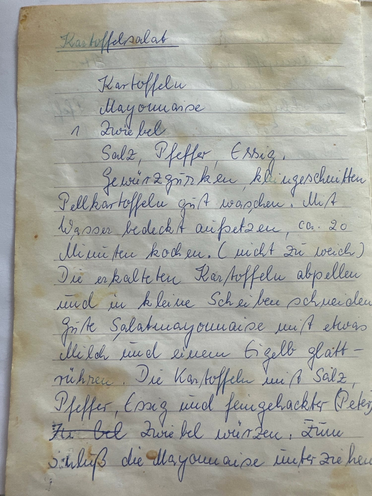
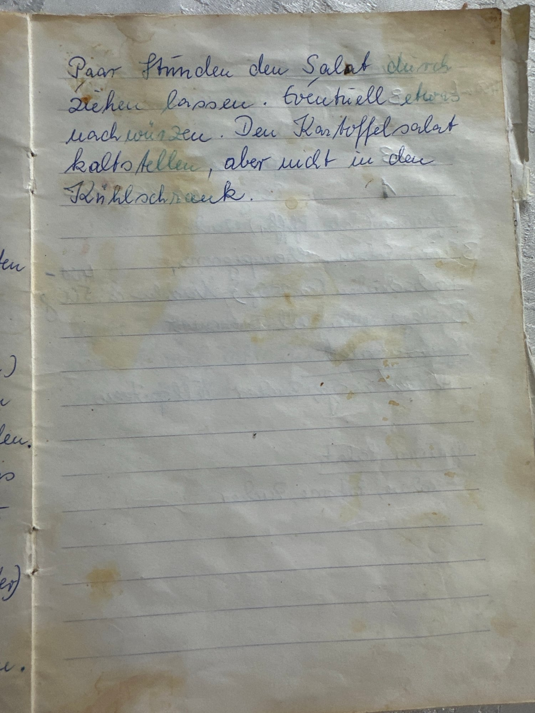

## Zutaten
- {{1,5 kg}} festkochende Kartoffeln
- {{4–5}} Eier
- {{200 g}} Gewürzgurken, klein geschnitten
- {{200 g}} Kochschinken, gewürfelt
- {{200 g}} Fleischwurst, gewürfelt
- {{1/2 Bund}} krause Petersilie, fein gehackt
- {{250 g}} Salatmayonnaise (z. B. Miracle Whip light)
- {{100 ml}} Gurkenwasser (aus dem Glas)
- {{2 EL}} Weißweinessig
- {{2 EL}} Öl
- {{2–3 EL}} Wasser
- Salz, Pfeffer

## Equipment
- Großer Topf
- Kleiner Topf
- Große Schüssel

## Zubereitung
1. **Kartoffeln kochen:** Kartoffeln gut waschen, mit Wasser bedeckt aufsetzen und ca. 20 Min. kochen *(nicht zu weich!)*. Abgießen und erkalten lassen.
2. **Eier kochen:** Eier ca. 10 Min. hart kochen, abschrecken und pellen. {{3–4}} Eier klein schneiden, den Rest für die Garnitur vierteln.
3. **Schneiden:** Kartoffeln pellen und in kleine Stücke schneiden.
4. **Mayonnaise anrühren:** Salatmayonnaise mit Gurkenwasser, Weißweinessig, Öl und etwas Wasser glatt rühren, mit Salz und Pfeffer abschmecken.
5. **Anmachen:** Kartoffeln mit Salz, Pfeffer und Petersilie würzen. Gewürzgurken, Schinken, Fleischwurst und die klein geschnittenen Eier dazugeben und zum Schluss die Mayonnaise unterziehen.
   
   
6. **Durchziehen lassen:** Salat ein paar Stunden durchziehen lassen und eventuell nachwürzen. Kalt stellen, aber nicht in den Kühlschrank.
7. **Servieren:** Mit den Eivierteln und etwas Petersilie garnieren und servieren.

## Tipps
- Nach Oma Eldas handgeschriebenem Rezept, so wie Papa ihn macht; Mengen geschätzt.
- Oma hat die Mayonnaise mit etwas Milch und einem Eigelb glatt gerührt.
