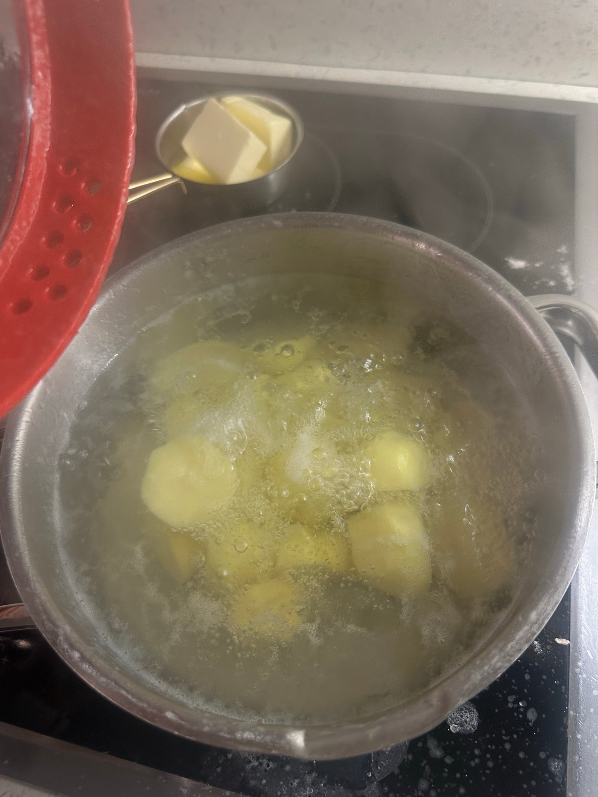
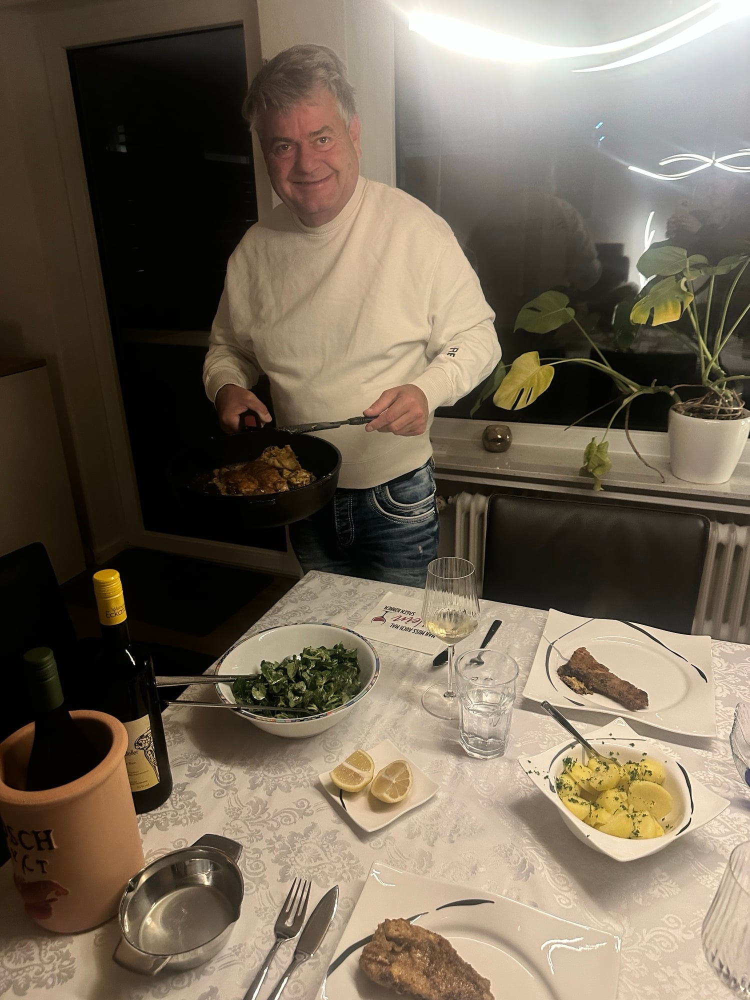
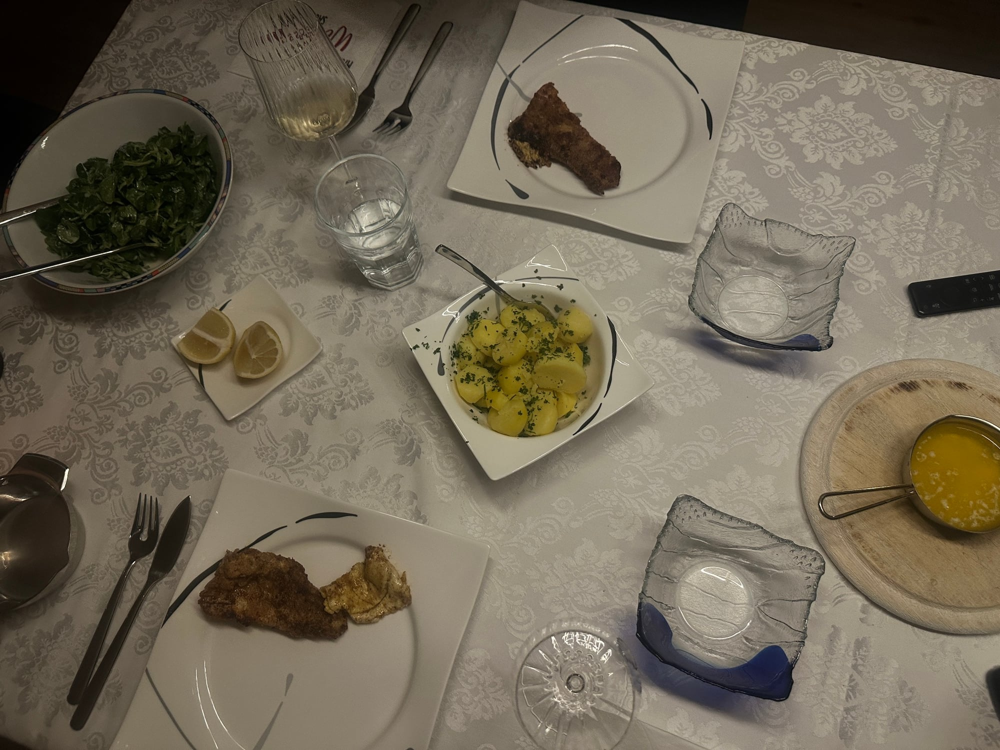
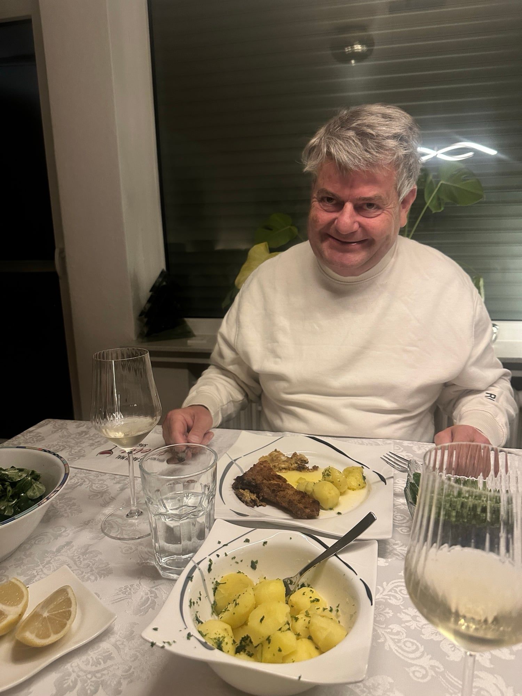
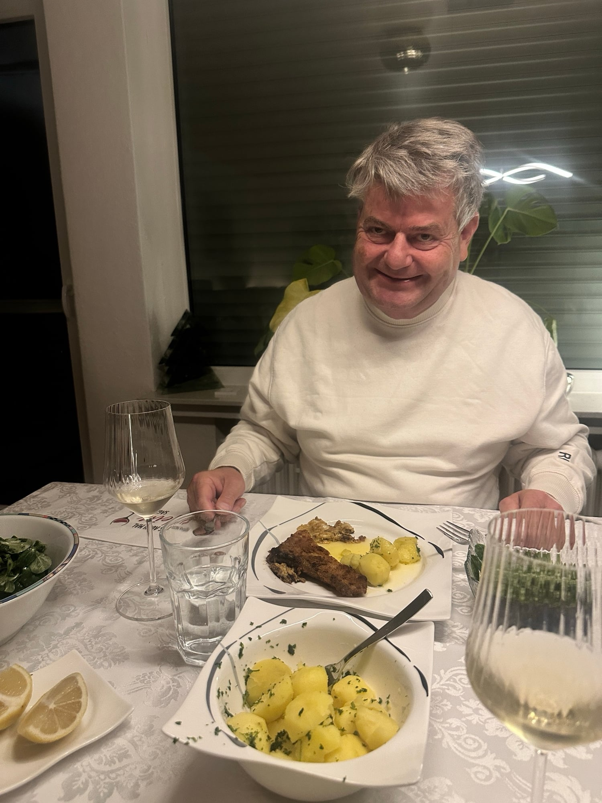

## Zutaten
### Kartoffeln
- {{600 g}} Kartoffeln, geschält
- {{1/2 Bund}} glatte Petersilie, fein gehackt
### Feldsalat
- {{100 g}} Feldsalat, gewaschen
- {{2 EL}} Joghurt
- {{1 EL}} Olivenöl
- {{1 EL}} Essig
- {{1 TL}} Senf
### Zander
- {{2}} Zanderfilets (à ca. 200 g)
- {{2 EL}} Mehl
- {{80 g}} Butter
- {{1}} Zitrone, in Spalten
- Öl zum Braten, Salz, Pfeffer

## Equipment
- Topf
- Große Pfanne
- Kleiner Topf für die Butter

## Zubereitung
1. **Kartoffeln kochen:** Kartoffeln in Salzwasser ca. 20 Min. gar kochen.
   
2. **Salat anmachen:** Joghurt, Olivenöl, Essig und Senf verrühren, mit Salz und Pfeffer abschmecken und kurz vor dem Essen über den Feldsalat geben.
   
3. **Zander braten:** Filets trocken tupfen, salzen, pfeffern und im Mehl wenden. In heißem Öl mit etwas Butter bei mittlerer Hitze von jeder Seite ca. 3–4 Min. goldbraun braten.
   
   
4. **Butter zerlassen:** Übrige Butter in einem kleinen Topf schmelzen. Kartoffeln abgießen und mit der Petersilie und etwas Butter schwenken.
   
5. **Servieren:** Zander mit Petersilienkartoffeln, zerlassener Butter, Zitronenspalten und Feldsalat servieren.
   
   
   
   

## Tipps
- Mit Zander, den Papa selbst gefangen hat.
- Mengen geschätzt.
