## Zutaten
- {{400 g}} Fenchel-Salsiccia (Salsiccia al finocchio)
- {{4}} Zweige Thymian
- {{2 Dosen}} stückige oder passierte Tomaten (à 400 g)
- {{500 g}} Mezze Paccheri oder Calamarata, bronzegezogen
- {{4 l}} Wasser
- Olivenöl, Salz, Pfeffer

## Equipment
- Große Pfanne
- Großer Topf

## Zubereitung
1. **Salsiccia anbraten:** Salsiccia aus der Haut drücken und in einer großen Pfanne mit etwas Olivenöl krümelig anbraten. Thymianzweige dazugeben und ca. 5 Min. mitbraten.
   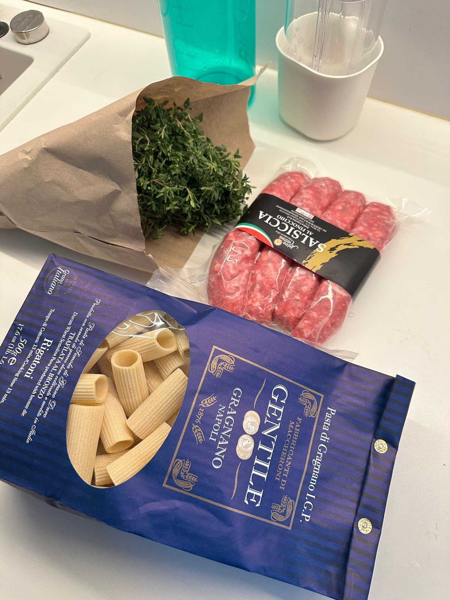
   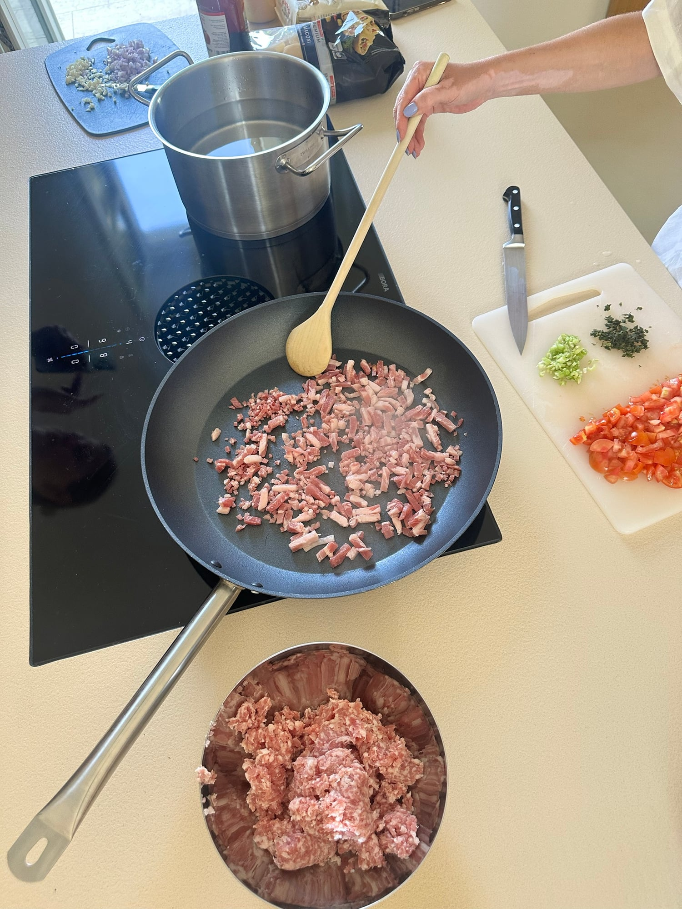
   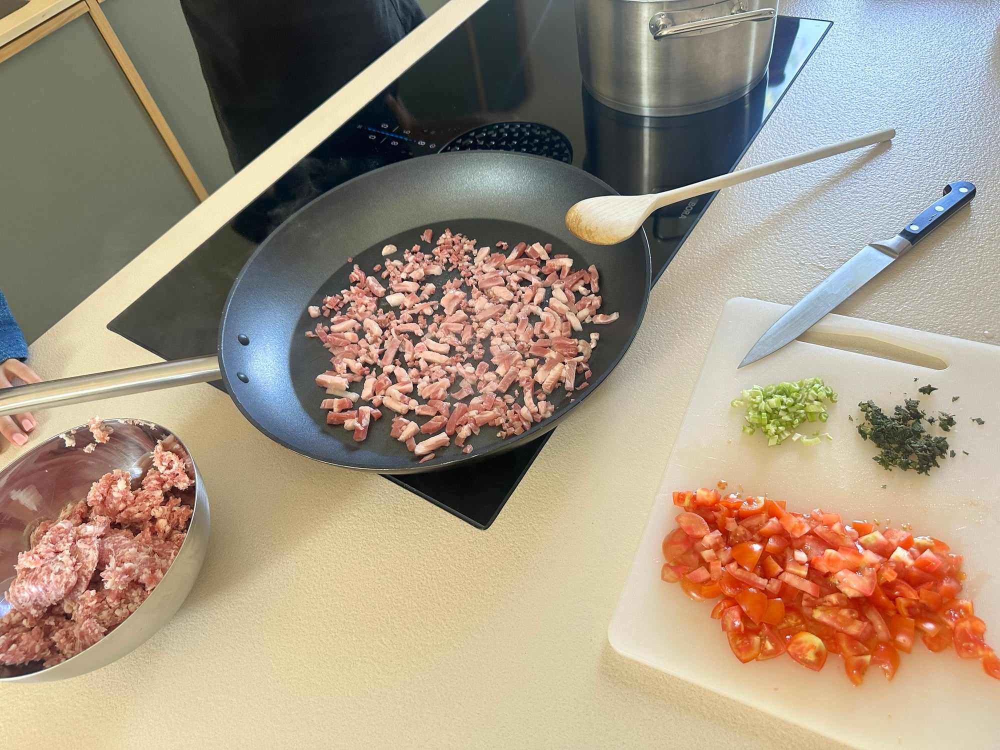
2. **Sugo köcheln:** Tomaten dazugeben und das Sugo bei kleiner Hitze ca. 15 Min. köcheln lassen. Mit Salz und Pfeffer abschmecken, die Thymianzweige herausnehmen.
   
   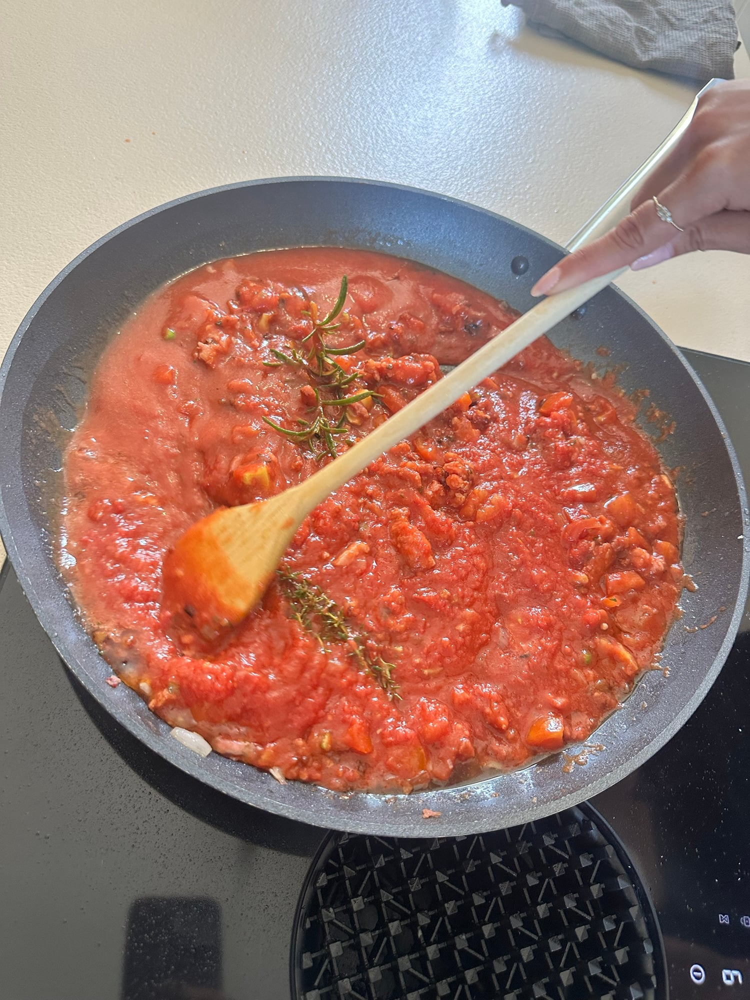
3. **Pasta kochen:** Wasser mit reichlich Salz aufkochen und die Pasta nach Packungsangabe al dente kochen. Etwas Nudelwasser aufheben.
   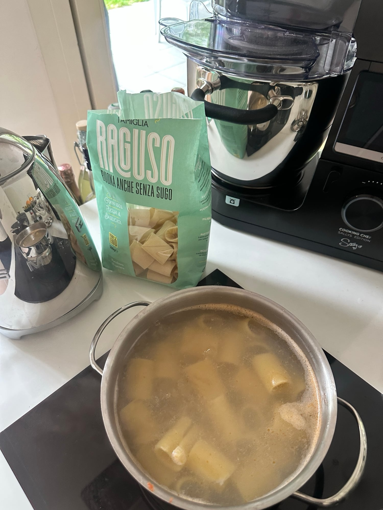
   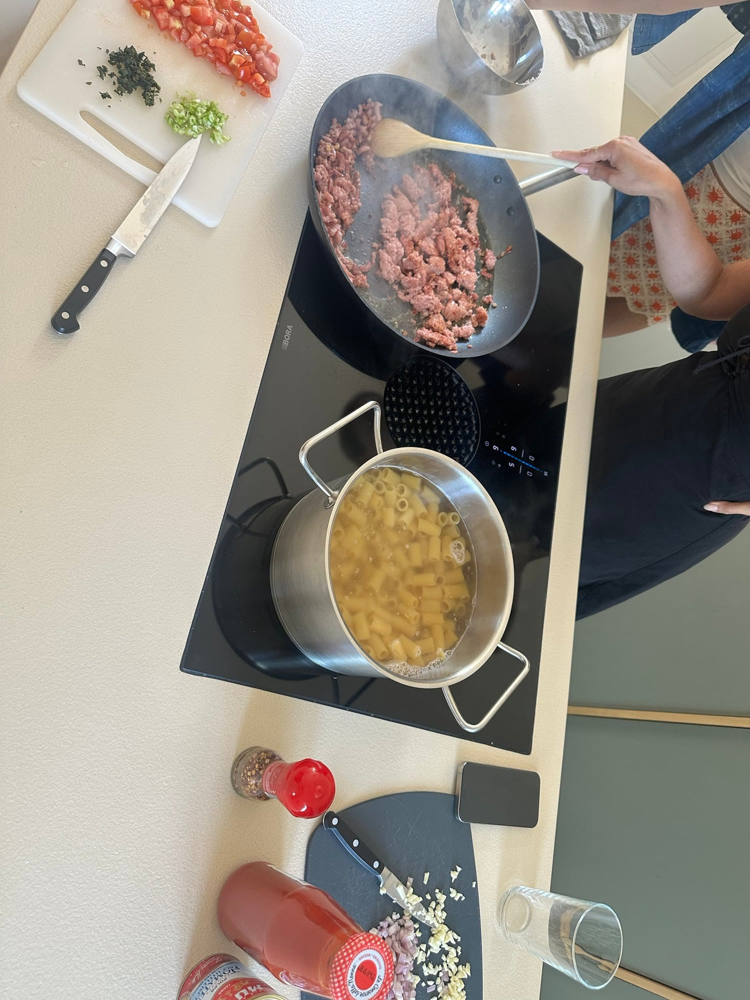
   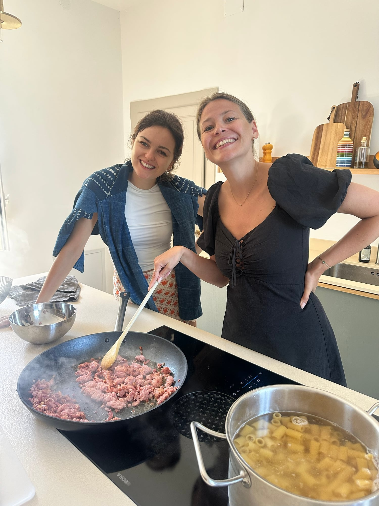
   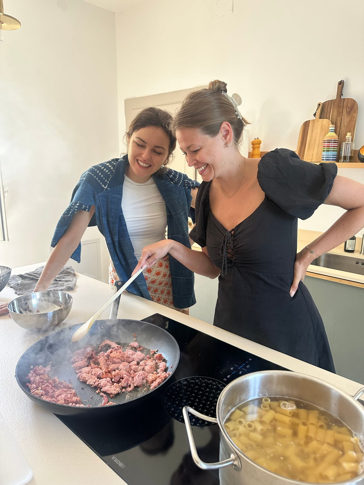
4. **Mischen:** Pasta abgießen und mit dem Sugo mischen, bei Bedarf mit etwas Nudelwasser cremiger machen.
   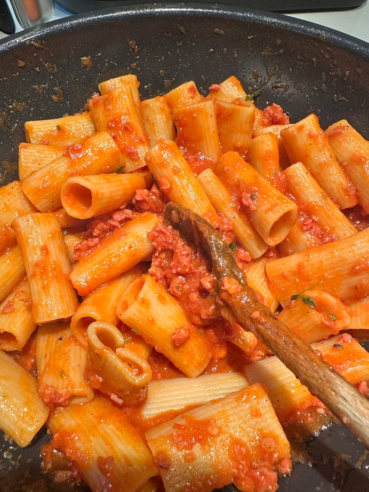
5. **Servieren:** Auf Teller verteilen und mit frischem Thymian garnieren.
   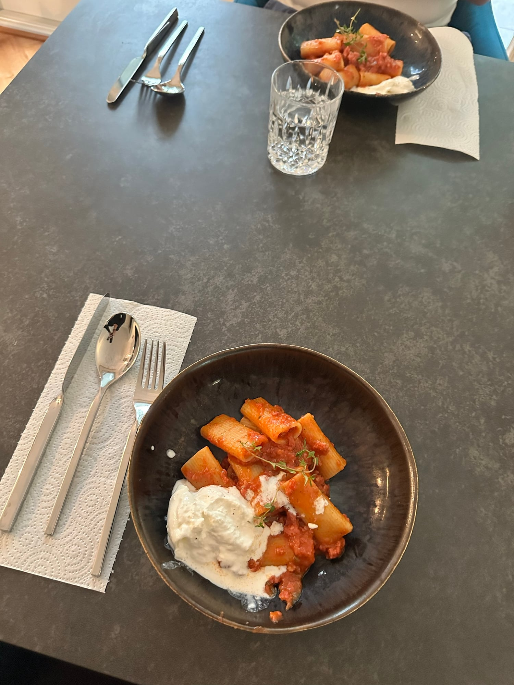
   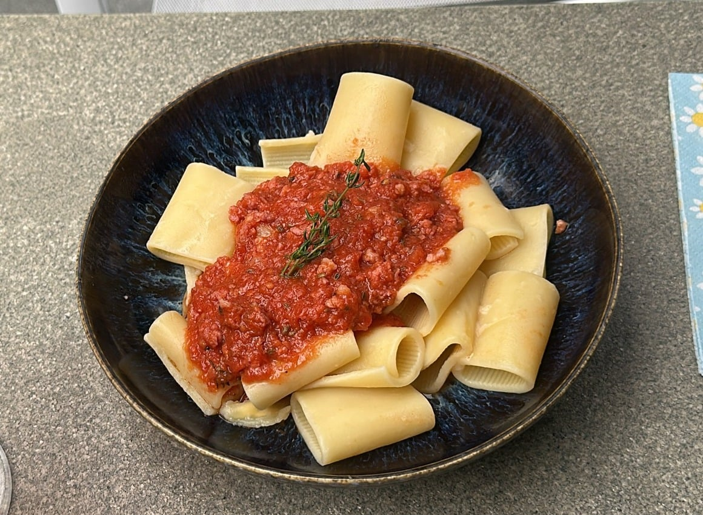

## Tipps
- Mengen geschätzt.
- Paccheri (wie auf dem Foto) gehen auch. Etwas kleiner und genauso gut sind Mezze Paccheri oder Calamarata (Ringe).
- Bronzegezogene Pasta hat eine raue Oberfläche, an der das Sugo besser haftet.
