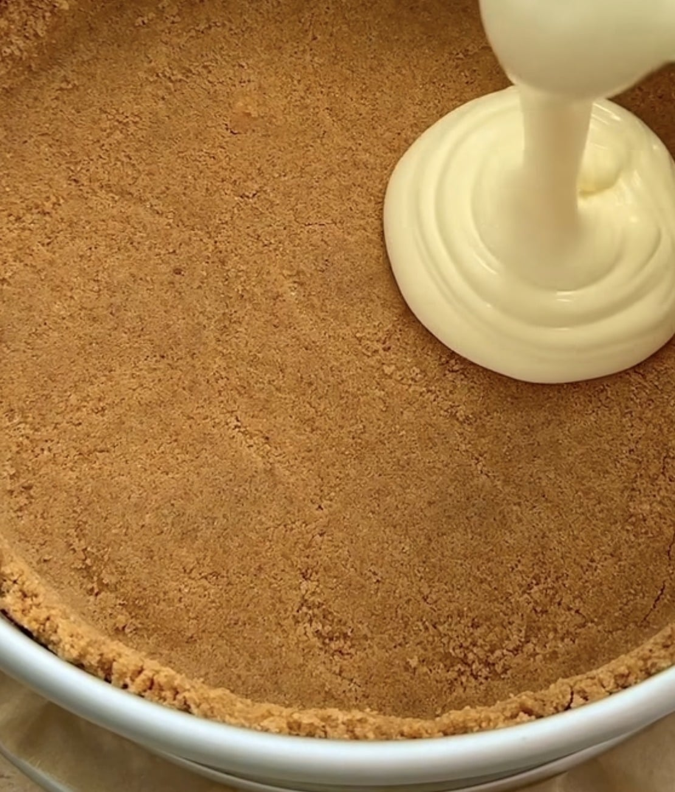
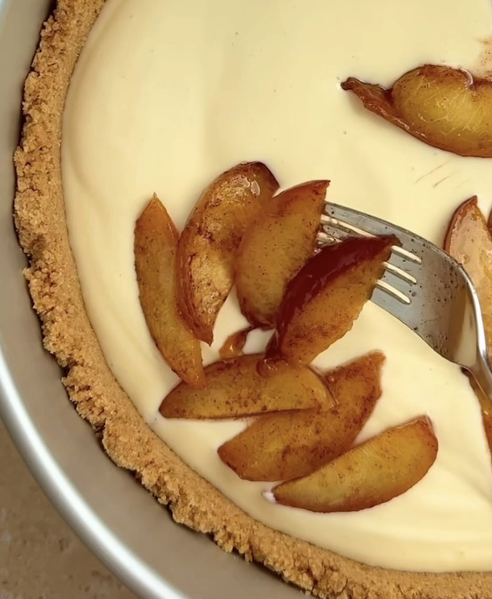
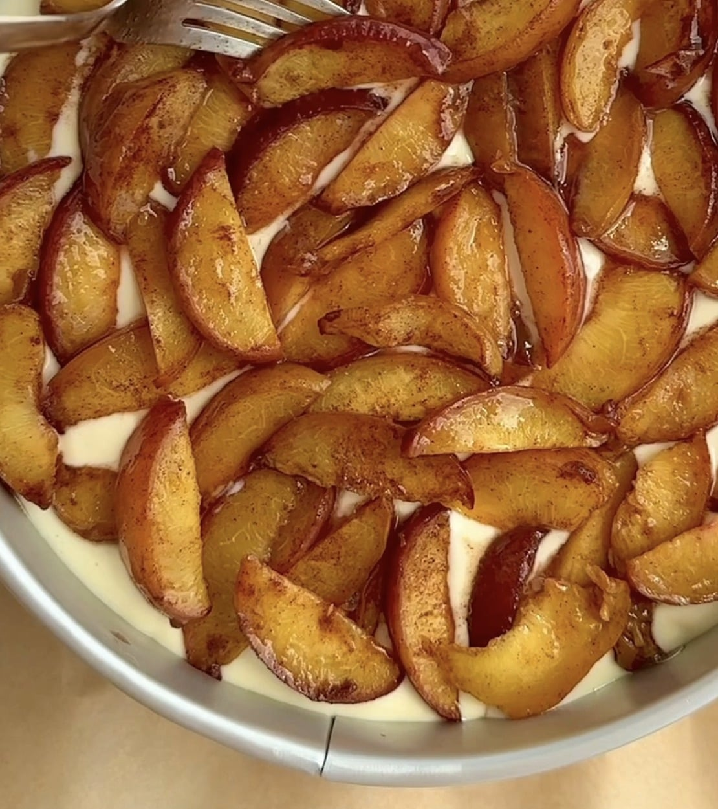
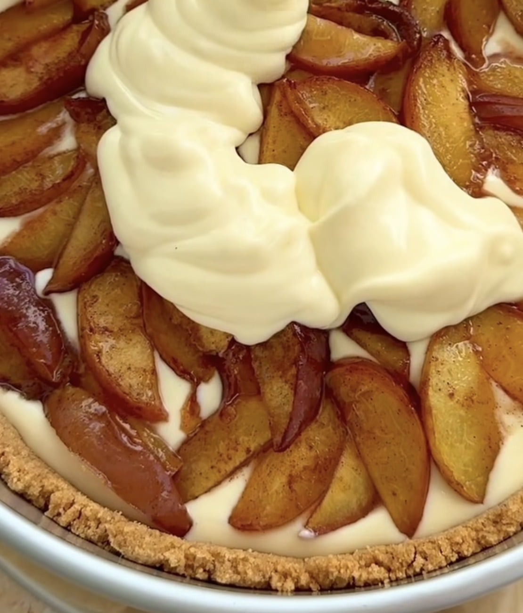

## Zutaten
### Boden
- {{200 g}} Butterkekse
- {{80 g}} Butter, geschmolzen

### Pfirsiche
- {{4}} reife Pfirsiche, in Spalten geschnitten
- {{1 EL}} Butter
- {{2 EL}} Agavendicksaft
- {{1 TL}} Zimt

### Füllung
- {{600 g}} Doppelrahmfrischkäse, zimmerwarm
- {{100 g}} Agavendicksaft
- {{200 g}} Schmand
- {{3}} Eier
- {{1 EL}} Speisestärke
- {{1 TL}} Vanilleextrakt

### Crumble
- {{100 g}} Mehl
- {{60 g}} Kokosblütenzucker
- {{70 g}} kalte Butter, in Stücken
- {{1/2 TL}} Zimt

## Equipment
- Springform (24 cm)
- Backpapier
- Pfanne

## Zubereitung
1. **Vorbereiten:** Ofen auf 160 °C Ober-/Unterhitze vorheizen. Boden der Springform mit Backpapier auslegen.
2. **Boden:** Butterkekse fein zerbröseln, mit der geschmolzenen Butter mischen und als Boden mit kleinem Rand in die Form drücken. Ca. 10 Min. vorbacken.
3. **Füllung:** Frischkäse, Agavendicksaft und Schmand glatt rühren. Eier einzeln kurz unterrühren, dann Speisestärke und Vanille. *(Nicht zu lange rühren, sonst reißt der Kuchen beim Backen!)* Die Hälfte der Füllung auf den Boden gießen.
   
4. **Pfirsiche:** Butter in einer Pfanne schmelzen, Pfirsichspalten mit Agavendicksaft und Zimt ca. 5 Min. karamellisieren. Etwas abkühlen lassen und auf der Füllung verteilen.
   
   
5. **Restliche Füllung:** Übrige Füllung über die Pfirsiche gießen und glatt streichen.
   
6. **Crumble:** Mehl, Kokosblütenzucker, Zimt und kalte Butter mit den Fingern zu Streuseln verkneten und über den Kuchen streuen.
7. **Backen:** Ca. 60–70 Min. backen, bis die Mitte nur noch leicht wackelt. Im ausgeschalteten Ofen bei leicht geöffneter Tür 1 Std. ruhen lassen.
8. **Kühlen und Servieren:** Mindestens 4 Std. oder über Nacht kühlen, dann aus der Form lösen und in {{12}} Stücke schneiden.

## Tipps
- Mengen geschätzt.
- Statt frischer Pfirsiche gehen auch abgetropfte Dosenpfirsiche.
