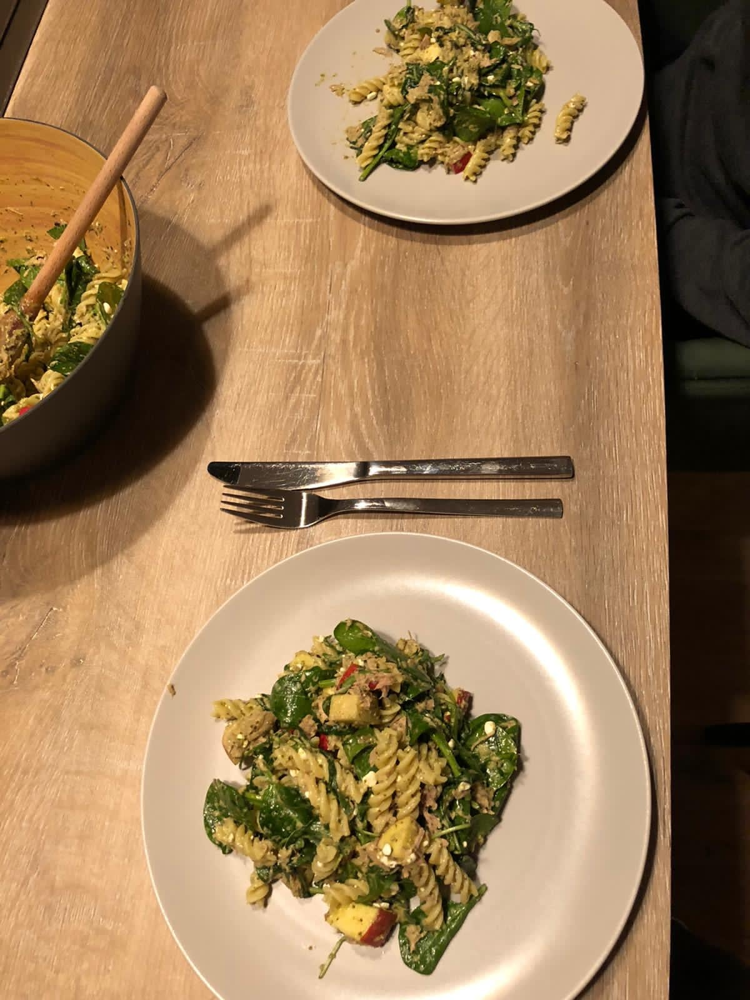

## Zutaten
- {{250 g}} Vollkorn-Fusilli
- {{1}} roter Apfel
- {{1/2}} Zitrone
- {{100 g}} grünes Pesto
- {{2 Dosen}} Thunfisch naturell (je ca. 150 g Abtropfgewicht)
- {{100 g}} Babyspinat
- {{50 g}} Rucola
- {{150 g}} gekörnter Frischkäse
- Salz, Pfeffer

## Equipment
- Topf
- Große Schüssel

## Zubereitung
1. **Nudeln kochen:** Fusilli in Salzwasser nach Packungsangabe bissfest kochen, abgießen und kalt abschrecken.
2. **Apfel schneiden:** Apfel entkernen und würfeln, mit etwas Zitronensaft beträufeln.
3. **Pesto anrühren:** Pesto mit restlichem Zitronensaft, Salz und Pfeffer verrühren.
4. **Mischen:** Nudeln, Apfel, abgetropften Thunfisch, Spinat, Rucola und Pesto in der Schüssel mischen. Gekörnten Frischkäse unterheben.
   
5. **Servieren:** Auf Teller verteilen und gleich servieren.

## Tipps
- Mengen geschätzt.
- Hält sich abgedeckt 1–2 Tage im Kühlschrank, gut zum Mitnehmen.
