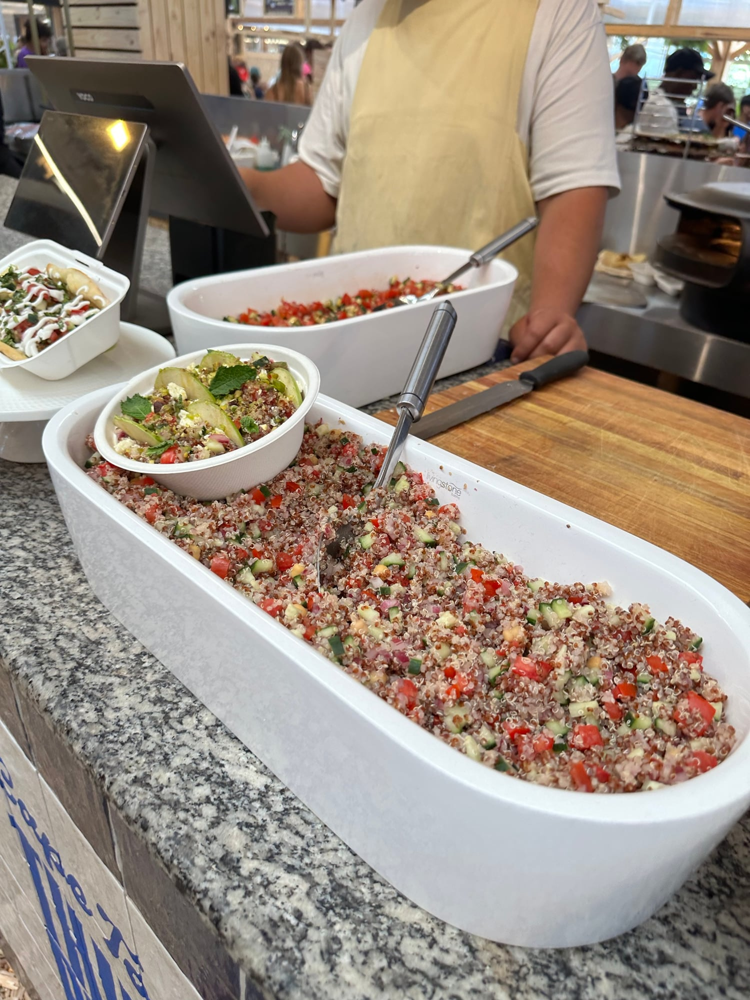

## Zutaten
- {{300 g}} Quinoa
- {{600 ml}} Wasser
- {{1 Dose}} Kichererbsen (ca. 240 g Abtropfgewicht)
- {{1}} Salatgurke, gewürfelt
- {{250 g}} Kirschtomaten, geviertelt
- {{1}} rote Paprika, gewürfelt
- {{1 Bund}} Petersilie, gehackt
- {{1/2 Bund}} Minze, gehackt
- {{2}} Zitronen
- {{6 EL}} Olivenöl
- {{1 TL}} Agavendicksaft
- {{1 TL}} Senf
- {{250 g}} Hirtenkäse, zerbröselt (oder Mini-Mozzarella)
- {{1/2}} Granatapfel
- Salz, Pfeffer

## Equipment
- Topf mit Deckel
- Große Schüssel
- Backblech

## Zubereitung
1. **Quinoa kochen:** Quinoa in einem Sieb heiß abspülen, mit dem Wasser und 1 Prise Salz aufkochen und zugedeckt bei niedriger Hitze ca. 15 Min. garen. Auf einem Blech ausbreiten und abkühlen lassen.
2. **Gemüse schneiden:** Kichererbsen abgießen und abspülen. Gurke, Tomaten und Paprika schneiden, Kräuter hacken.
3. **Dressing anrühren:** Zitronensaft, Olivenöl, Agavendicksaft und Senf verrühren und kräftig mit Salz und Pfeffer abschmecken.
4. **Mischen:** Quinoa mit Kichererbsen, Gemüse, Kräutern und Dressing mischen.
   
5. **Servieren:** Granatapfelkerne herauslösen und mit dem Hirtenkäse über den Salat streuen.

## Tipps
- Mengen geschätzt.
- Mit {{2 Dosen}} Thunfisch wird daraus eine sättigende Hauptmahlzeit.
- Lässt sich am Vortag vorbereiten; Kräuter, Käse und Granatapfel erst kurz vor dem Servieren untermischen.
