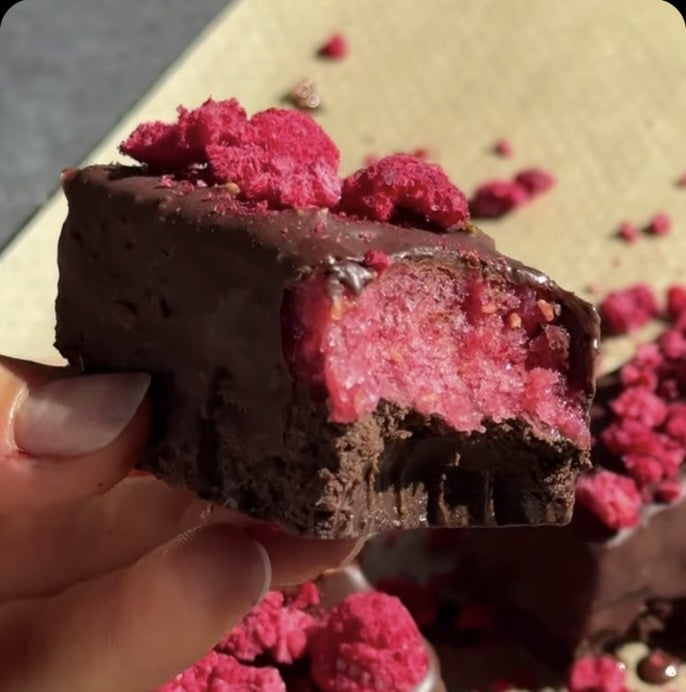
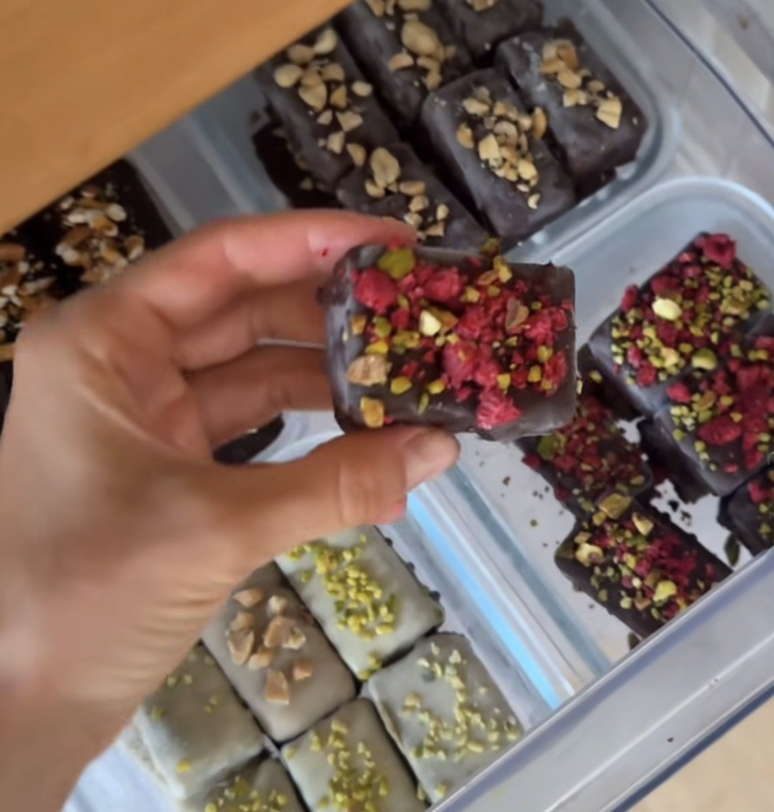

## Zutaten
### Brownie-Boden
- {{30 g}} Hafermehl
- {{20 g}} Kakaopulver
- {{30 g}} veganes Schoko-Proteinpulver
- {{10 g}} Flohsamenschalen
- {{20 g}} Haselnussmus
- ca. {{100 ml}} Sojajoghurt oder Apfelmark
### Himbeerschicht und Überzug
- {{200 g}} gefrorene Himbeeren
- {{100 g}} Zartbitterschokolade (mind. 70 %)
- {{10 g}} gefriergetrocknete Himbeeren

## Equipment
- Riegel-Silikonform
- Kenwood Smoothie-to-go-Aufsatz oder Glasmixaufsatz

## Zubereitung
1. **Boden:** Hafermehl, Kakao, Proteinpulver, Flohsamenschalen und Haselnussmus mischen und so viel Sojajoghurt einrühren, dass ein gut formbarer, nicht zu klebriger Teig entsteht. In die Riegelform drücken.
2. **Himbeerschicht:** Gefrorene Himbeeren cremig mixen, auf den Boden streichen und ca. 2 Std. einfrieren.
3. **Überziehen:** Schokolade schmelzen, Riegel aus der Form lösen und darin überziehen. Sofort mit zerbröselten gefriergetrockneten Himbeeren bestreuen.
4. **Servieren:** Kurz fest werden lassen und gefroren genießen.
   
   

## Tipps
- Statt Himbeeren gehen auch andere gefrorene Beeren.
- Mengen für Schokolade und Topping geschätzt.
