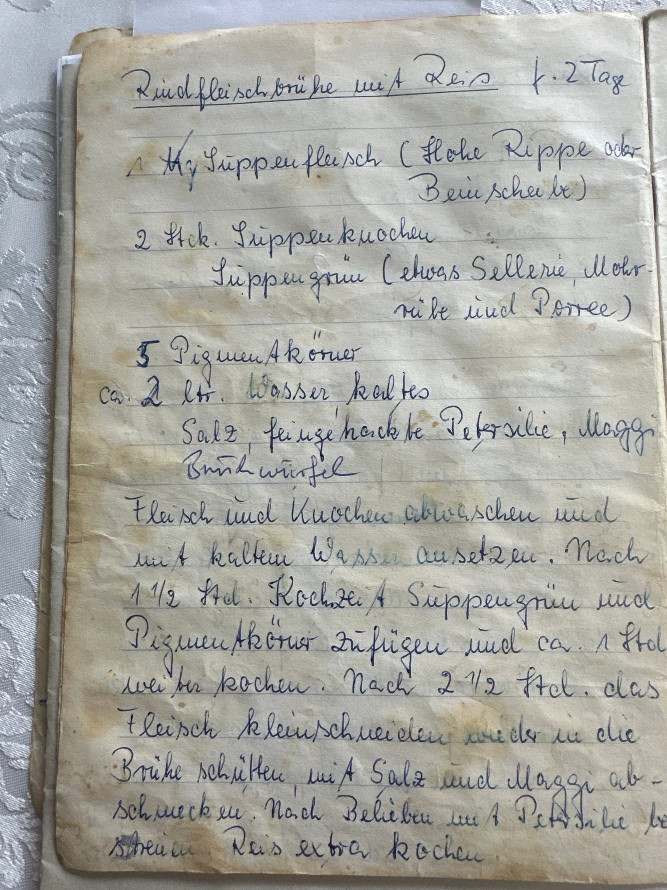

## Zutaten
### Brühe
- {{1 kg}} Suppenfleisch (Hohe Rippe oder Beinscheibe)
- {{2}} Suppenknochen
- ca. {{2 l}} kaltes Wasser
- {{1 Bund}} Suppengrün (etwas Sellerie, Möhre und Porree)
- {{5}} Pimentkörner
- {{1}} Brühwürfel
- {{1/2 Bund}} Petersilie, fein gehackt
- Salz, Maggi

### Reis
- {{200 g}} Reis
- {{400 ml}} Wasser (für den Reis)

## Equipment
- Großer Suppentopf
- Topf mit Deckel (für den Reis)

## Zubereitung
1. **Aufsetzen:** Fleisch und Knochen abwaschen und mit dem kalten Wasser aufsetzen. Den Brühwürfel dazugeben und ca. 1 1/2 Std. kochen.
2. **Suppengrün dazu:** Suppengrün putzen, klein schneiden und mit den Pimentkörnern dazugeben. Ca. 1 Std. weiterkochen.
3. **Reis kochen:** Reis extra mit dem Wasser und 1 Prise Salz aufkochen und zugedeckt bei kleiner Hitze ca. 15 Min. garen.
4. **Fleisch schneiden:** Nach ca. 2 1/2 Std. das Fleisch herausnehmen, klein schneiden und wieder in die Brühe geben. Knochen entfernen. Mit Salz und Maggi abschmecken.
5. **Servieren:** Reis in Teller geben, Brühe mit Fleisch darüber schöpfen und mit Petersilie bestreuen.
   

## Tipps
- Handgeschrieben von Oma Elda, im Original „für 2 Tage“.
- Reismenge und Portionen sind geschätzt.
