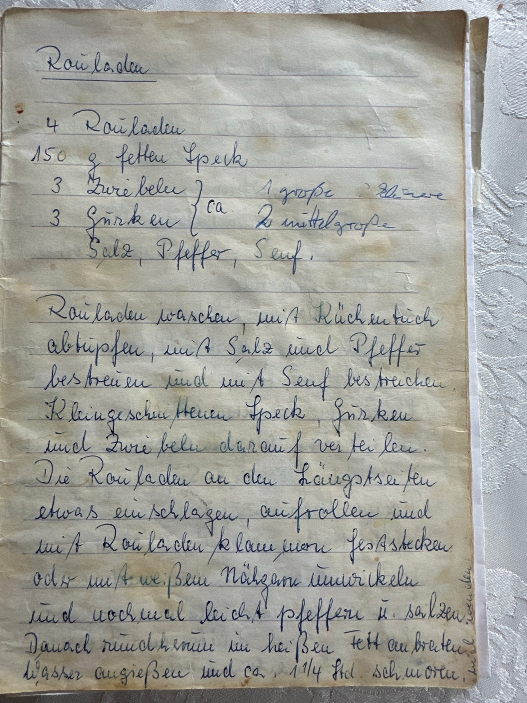

## Zutaten
- {{4}} Rinderrouladen
- {{150 g}} fetter Speck, klein geschnitten
- {{3}} Zwiebeln (oder 1 große), klein geschnitten
- {{3}} Gewürzgurken (oder 2 mittelgroße), klein geschnitten
- ca. {{500 ml}} Wasser
- Senf, Fett zum Anbraten, Salz, Pfeffer

## Equipment
- Rouladennadeln oder weißes Nähgarn
- Bräter mit Deckel

## Zubereitung
1. **Würzen:** Rouladen waschen, mit Küchenpapier trocken tupfen, mit Salz und Pfeffer bestreuen und mit Senf bestreichen.
2. **Belegen:** Speck, Gurken und Zwiebeln darauf verteilen.
3. **Aufrollen:** Rouladen an den Längsseiten etwas einschlagen, aufrollen und mit Rouladennadeln feststecken oder mit weißem Nähgarn umwickeln. Nochmal leicht salzen und pfeffern.
4. **Anbraten und schmoren:** Rouladen rundherum im heißen Fett anbraten. Wasser angießen und ca. 1 1/4 Std. schmoren, dabei ab und zu wenden.
5. **Servieren:** Nadeln oder Garn entfernen und die Rouladen mit der Soße servieren.
   

## Tipps
- Handgeschrieben von Oma Elda.
- Die Wassermenge steht nicht im Original: Es sollte den Boden des Bräters gut bedecken und beim Schmoren bei Bedarf nachgegossen werden.
