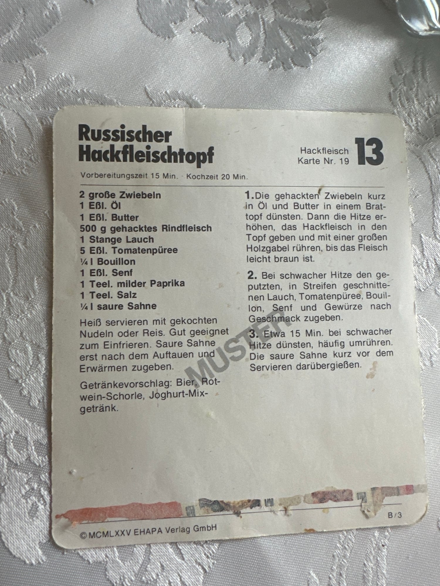

## Zutaten
- {{2}} große Zwiebeln, gehackt
- {{1 EL}} Öl
- {{1 EL}} Butter
- {{500 g}} Rinderhackfleisch
- {{1}} Stange Lauch
- {{5 EL}} Tomatenmark
- {{250 ml}} Brühe
- {{1 EL}} Senf
- {{1 TL}} edelsüßes Paprikapulver
- {{1 TL}} Salz
- {{250 ml}} saure Sahne

## Equipment
- Bräter oder großer Topf
- Große Holzgabel

## Zubereitung
1. **Zwiebeln dünsten:** Zwiebeln in Öl und Butter im Bräter kurz dünsten.
2. **Hackfleisch anbraten:** Hitze erhöhen, Hackfleisch dazugeben und mit einer großen Holzgabel rühren, bis das Fleisch leicht braun ist.
3. **Schmoren:** Lauch putzen und in Streifen schneiden. Bei schwacher Hitze Lauch, Tomatenmark, Brühe, Senf, Paprika und Salz dazugeben und ca. 15 Min. dünsten, dabei häufig umrühren.
4. **Servieren:** Die saure Sahne kurz vor dem Servieren darübergießen. Heiß mit gekochten Nudeln oder Reis servieren.
   

## Tipps
- Gut zum Einfrieren geeignet. Die saure Sahne erst nach dem Auftauen und Erwärmen dazugeben.
- Rezeptkarte aus Oma Eldas Sammlung (EHAPA Verlag, 1975).
