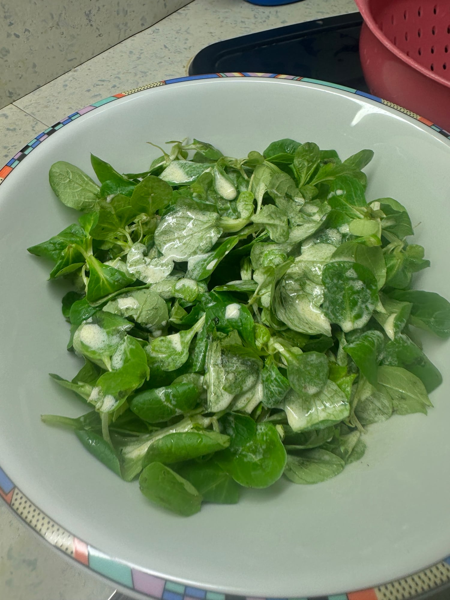
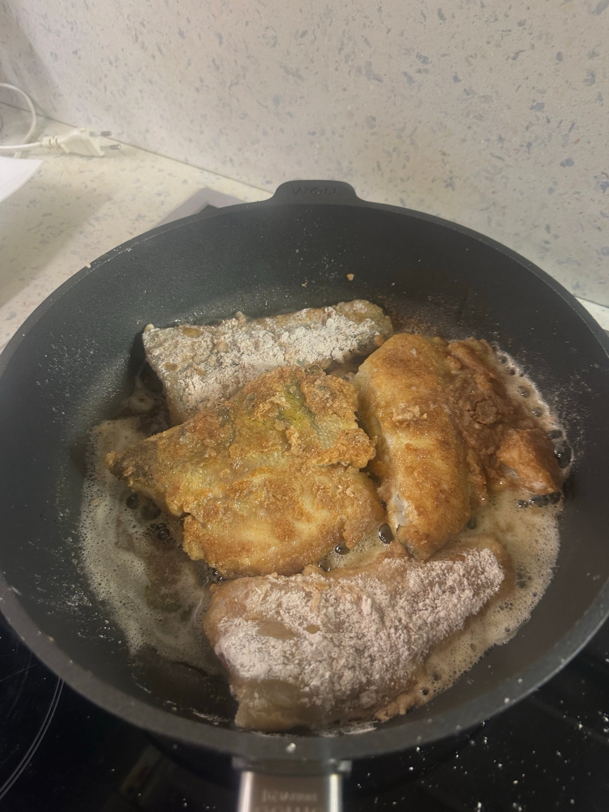
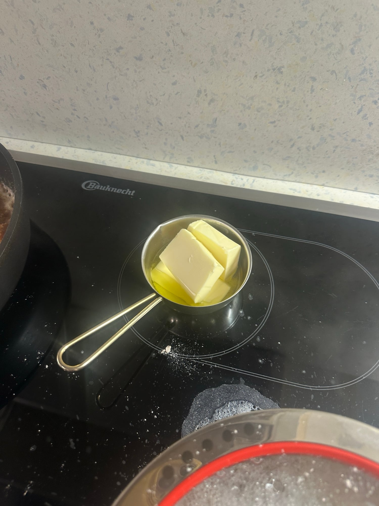
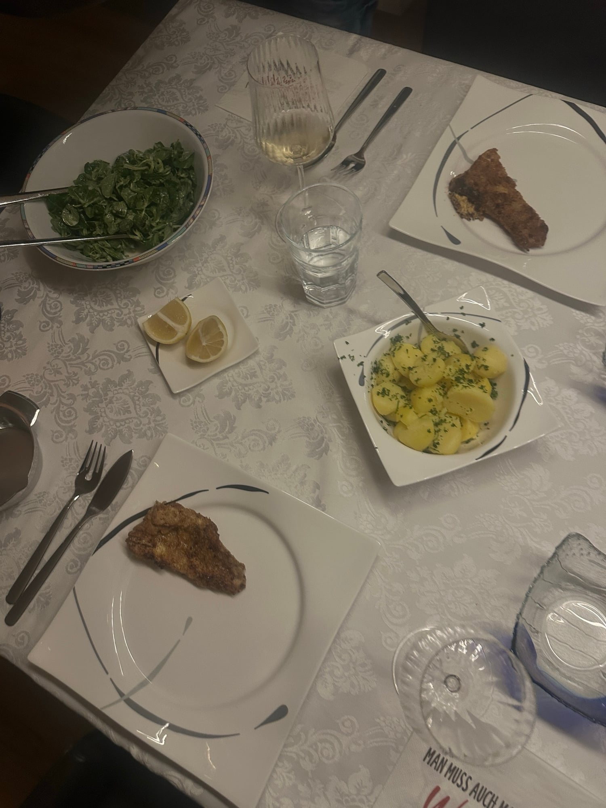

## Zutaten
### Kartoffeln
- {{600 g}} Kartoffeln, geschält
- {{1/2 Bund}} glatte Petersilie, fein gehackt
### Kopfsalat
- {{1}} Kopfsalat (oder Eisbergsalat), gewaschen und gezupft
- {{50 ml}} Sahne
- {{2 EL}} Wasser
- {{1 TL}} Zucker
- {{1 EL}} Olivenöl (nach Belieben)
### Zander
- {{2}} Zanderfilets mit Haut (à ca. 200 g)
- {{2 EL}} Olivenöl zum Braten
- {{40 g}} Butter oder {{2 EL}} Olivenöl mit dem Saft von {{1/2}} Zitrone
- {{1}} Zitrone, in Spalten
- Salz, Pfeffer

## Equipment
- Topf
- Große Pfanne
- Kleiner Topf für die Butter

## Zubereitung
1. **Kartoffeln kochen:** Kartoffeln in Salzwasser ca. 20 Min. gar kochen.
   
2. **Salat anmachen:** Sahne, Wasser, Zucker und nach Belieben Olivenöl verrühren und mit Salz und Pfeffer abschmecken. Kurz vor dem Essen über den Salat geben.
   
3. **Zander braten:** Filets trocken tupfen, salzen und pfeffern. Im heißen Olivenöl bei mittlerer Hitze zuerst auf der Hautseite ca. 4 Min. knusprig braten, wenden und ca. 1–2 Min. fertig garen.
   
   
4. **Butter oder Zitronenöl:** Butter in einem kleinen Topf zerlassen oder Olivenöl mit Zitronensaft verrühren. Kartoffeln abgießen und mit der Petersilie und etwas davon schwenken.
   
5. **Servieren:** Zander mit Petersilienkartoffeln, zerlassener Butter oder Zitronenöl, Zitronenspalten und Salat servieren.
   
   
   

## Tipps
- Mit Zander, den Papa selbst gefangen hat.
- Am besten passt Kopfsalat, Eisbergsalat geht auch. Feldsalat (wie auf den Fotos) war nur okay.
- Olivenöl mit Zitrone statt Butter ist Janitas Healthy-Variante.
- Papa wendet den Zander in Mehl und brät ihn in viel Fett. Was auf den Fotos wie ein Spiegelei aussieht, ist der Rest der Panade.
- Statt Zucker im Dressing geht auch ein Spritzer Agavendicksaft.
- Mengen geschätzt.
