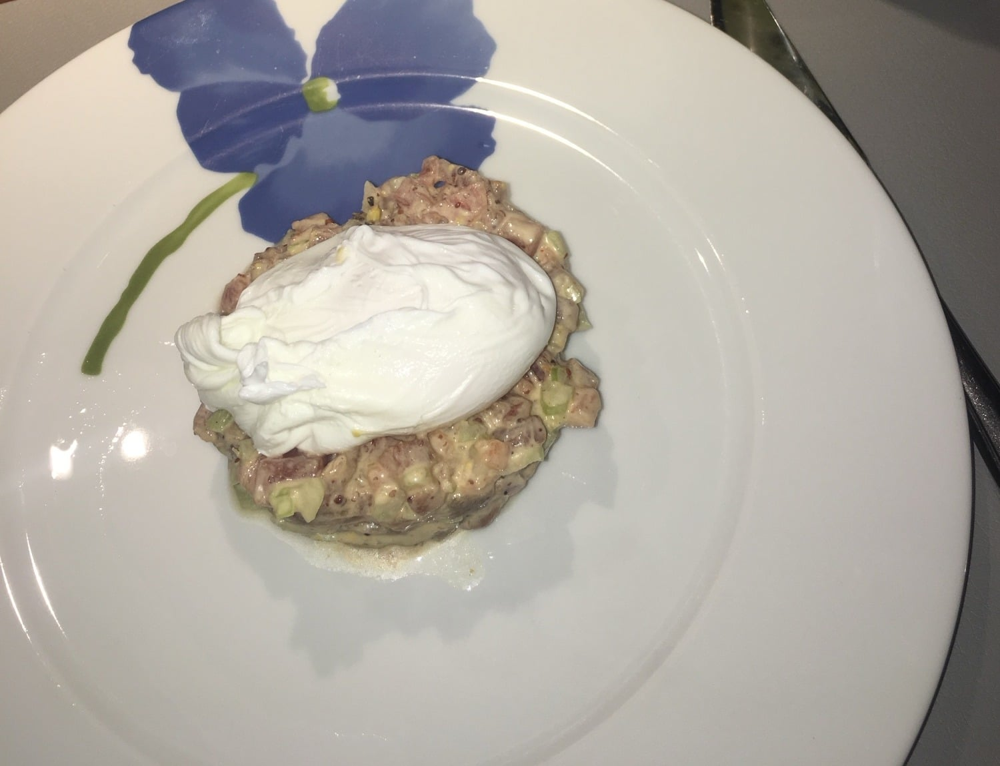

## Zutaten
### Mayo
- {{1}} Eigelb (sehr frisch)
- {{1 TL}} Dijon-Senf
- {{100 ml}} neutrales Öl
- {{1}} Spritzer Zitronensaft
- {{1 TL}} Sesamöl
- {{1 TL}} Sojasoße
- {{1 EL}} Crème fraîche
- Togarashi

### Tatar
- {{250 g}} Thunfisch in Sushi-Qualität
- {{1}} Stange Staudensellerie, fein gewürfelt
- {{2}} Eier
- {{1 EL}} Essig (für das Pochierwasser)
- Salz

## Equipment
- Hohe Schüssel und Schneebesen oder Pürierstab
- Topf
- Servierring (ca. 8 cm)

## Zubereitung
1. **Mayo rühren:** Eigelb und Senf verrühren. Öl erst tropfenweise, dann in dünnem Strahl unterschlagen, bis eine dicke Mayo entsteht.
2. **Abschmecken:** Mayo mit Zitronensaft, Sesamöl, Sojasoße, Crème fraîche und Togarashi abschmecken.
3. **Tatar mischen:** Thunfisch in feine Würfel schneiden und mit dem Sellerie und ca. {{4 EL}} Mayo mischen. Mit Salz und Togarashi abschmecken und kalt stellen.
4. **Eier pochieren:** Wasser mit dem Essig aufkochen und die Hitze reduzieren, bis es nur noch siedet. Eier einzeln in einen Strudel gleiten lassen und ca. 3–4 Min. pochieren.
5. **Servieren:** Tatar mit dem Servierring auf Tellern anrichten, Ring abziehen und je ein pochiertes Ei daraufsetzen.
   

## Tipps
- Die übrige Mayo hält sich abgedeckt im Kühlschrank ca. 2 Tage.
- Mengen geschätzt.
