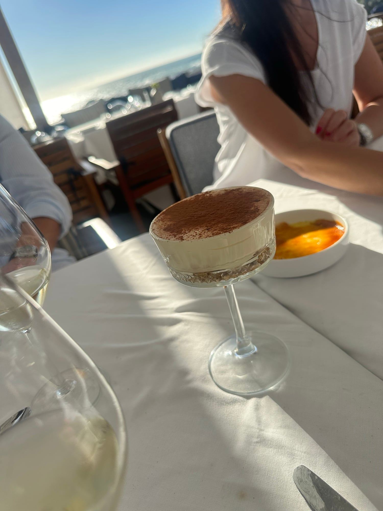

## Zutaten
- {{80 g}} zarte Haferflocken
- {{100 ml}} Espresso, abgekühlt
- {{100 g}} Mascarpone
- {{400 g}} Skyr
- {{3 EL}} Agavendicksaft
- {{1 TL}} Vanilleextrakt
- {{1 EL}} Kakaopulver (ungesüßt)

## Equipment
- Pfanne
- 4 Dessertgläser
- Kleines Sieb

## Zubereitung
1. **Boden:** Haferflocken in einer Pfanne ohne Fett ca. 3 Min. goldbraun rösten, auf die Gläser verteilen und mit Espresso beträufeln.
2. **Creme:** Mascarpone, Skyr, Agavendicksaft und Vanille glatt rühren und auf den Boden geben.
3. **Kühlen:** Mind. 2 Std. kalt stellen.
4. **Servieren:** Kakao kurz vor dem Servieren dick darübersieben.
   

## Tipps
- Mengen geschätzt.
- Ohne Zucker und ohne Löffelbiskuits, der Boden ist aus gerösteten Haferflocken.
