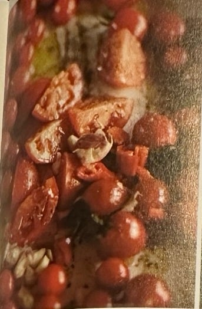
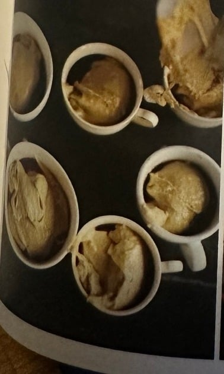
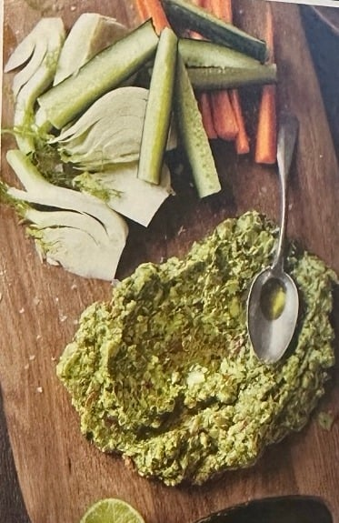
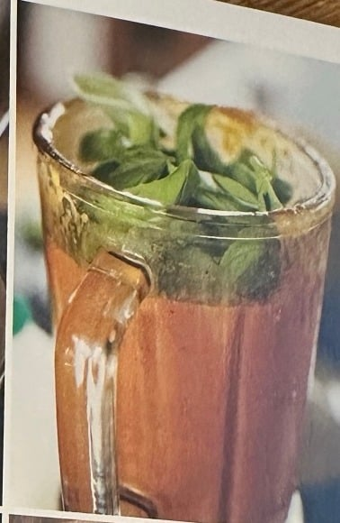
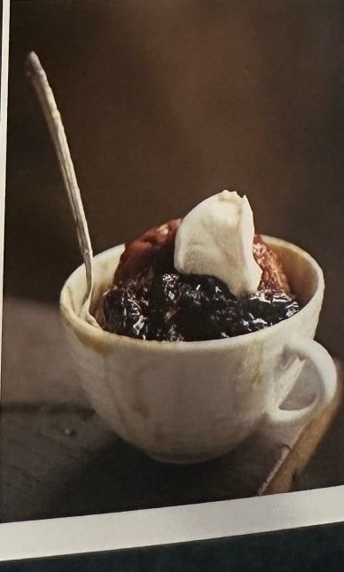

## Zutaten
### Tomatensuppe und Croutons
- {{1 kg}} reife Kirschtomaten an der Rispe (möglichst rote und gelbe)
- {{4}} große Tomaten
- {{1}} rote Chilischote
- {{4}} Knoblauchzehen
- {{1}} Ciabatta
- {{2}} kleine rote Zwiebeln
- {{4 EL}} Balsamico-Essig
- {{1 Bund}} Basilikum (klein)
- Crème fraîche (zum Servieren)

### Guacamole-Gemüse-Platte
- {{1}} Handvoll Kirschtomaten in verschiedenen Farben
- {{1}} Handvoll Koriandergrün
- {{1–2}} rote Chilischoten
- {{2}} reife Avocados
- {{2}} Limetten
- {{1/2}} Fenchelknolle
- {{1}} Möhre
- {{1/2}} Bio-Salatgurke
- {{1/2 Packung}} Grissini (ca. 75 g)

### Pflaumen-Soufflé
- {{4 EL}} Trockenpflaumensaft
- {{250 g}} Trockenpflaumen ohne Stein
- {{100 g}} Mehl
- {{50 g}} weicher brauner Zucker
- {{50 g}} weiche Butter
- {{1 TL}} gemahlener Ingwer (gehäuft)
- knapp {{1/2 TL}} Natron
- {{1}} Ei
- {{75 ml}} Milch
- Crème fraîche und heller Zuckerrübensirup (Golden Syrup), zum Servieren

### Grundzutaten
- Olivenöl, Salz, Pfeffer

## Equipment
- Mikrowellengeeignete Kaffee- oder Teetassen (eine pro Person)
- Großer Topf, Bratform, Backblech
- Küchenmaschine mit Messer
- Standmixer
- Großes Holzbrett
- Mikrowelle

## Zubereitung
1. **Vorbereiten:** Backofen auf 220 °C vorheizen. Einen großen Topf auf kleine Hitze stellen.
2. **Tomaten rösten:** Kirschtomaten von den Rispen zupfen, bei einigen den Stielansatz dranlassen. Große Tomaten vierteln, alles in eine Bratform geben, mit reichlich Olivenöl beträufeln, salzen und pfeffern. Chili ohne Stiel und Samen dazugeben, {{4}} Knoblauchzehen dazupressen, mischen und im oberen Teil des Ofens 12–15 Min. rösten.
   
3. **Croutons backen:** Ciabatta auf einem Backblech in {{8}} Stücke teilen, mit Olivenöl beträufeln, salzen und auf der unteren Schiene aufbacken. Wenn sie goldgelb und knusprig sind, den Ofen ausschalten und das Brot darin warm halten.
4. **Zwiebeln dünsten:** Zwiebeln schälen, grob hacken und mit etwas Olivenöl und 1 kräftigen Prise Salz im großen Topf bei mittlerer Hitze weich dünsten. Balsamico zugießen und einkochen lassen.
5. **Soufflés vorbereiten:** In jede Tasse 1 EL Pflaumensaft gießen und die Trockenpflaumen verteilen. Mehl, Zucker, Butter, Ingwer und Natron in der Küchenmaschine mischen, Ei und Milch zugeben und glatt mixen. Auf die Tassen verteilen und beiseitestellen.
   
6. **Guacamole hacken:** Kirschtomaten auf einem großen Brett zerdrücken. Den oberen Teil des Korianders mit den Chilis (ohne Stiel) fein hacken. Avocados halbieren, entsteinen und das Fruchtfleisch dazudrücken. Salzen, Limettensaft darüberpressen, alles sehr fein hacken und abschmecken.
   
7. **Gemüsesticks schneiden:** Fenchel in Spalten schneiden. Möhre schälen, längs vierteln und in Sticks schneiden, Gurke ebenso. Leicht salzen, neben der Guacamole anrichten und die Grissini in einem Glas dazustellen.
   
8. **Suppe mixen:** Tomaten aus dem Ofen zu den Zwiebeln geben. Mit dem Großteil des Basilikums in zwei Durchgängen im Standmixer zu einer stückigen Suppe mixen *(Deckel mit einem Küchentuch abdecken, die Suppe ist heiß!)*. In eine Schüssel gießen und abschmecken.
   
   
   
   
9. **Soufflés garen:** Kurz vor dem Essen die Tassen ca. 6 Min. auf höchster Stufe in der Mikrowelle garen.
10. **Servieren:** In jede Suppenschale 1–2 Croutons legen und Suppe daraufschöpfen, mit Crème fraîche, Basilikum und etwas Olivenöl garnieren. Die Soufflés mit einem Klecks Crème fraîche und etwas Sirup servieren.
   
   
