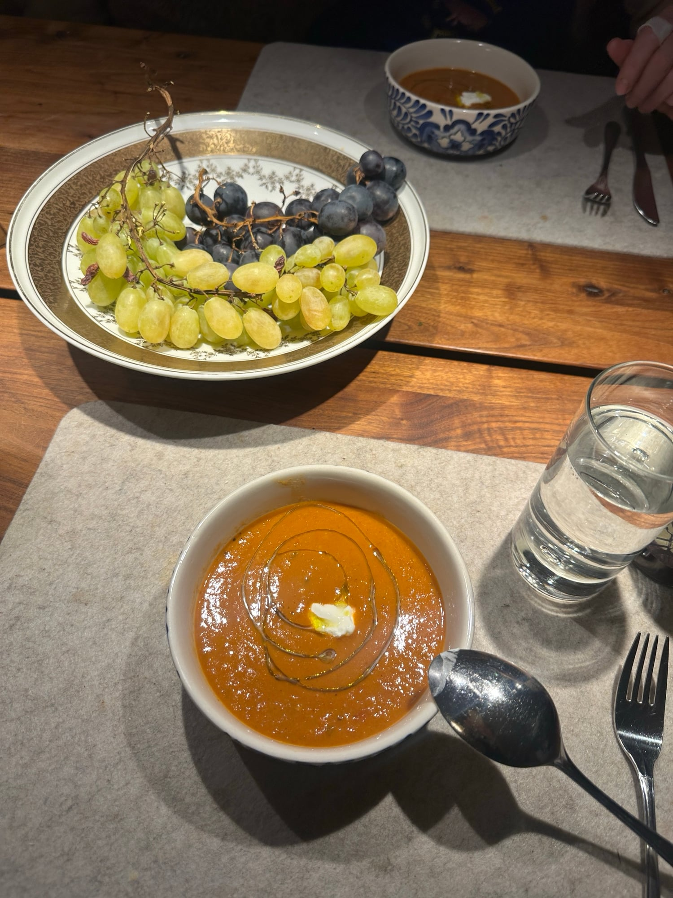

## Zutaten
- {{1 kg}} reife Kirschtomaten an der Rispe (möglichst rote und gelbe)
- {{4}} große Tomaten
- {{1}} rote Chilischote
- {{4}} Knoblauchzehen
- {{1}} Ciabatta
- {{2}} kleine rote Zwiebeln
- {{4 EL}} Balsamico-Essig
- {{1 Bund}} Basilikum (klein)
- Crème fraîche (zum Servieren)
- Olivenöl, Salz, Pfeffer

## Equipment
- Großer Topf, Bratform, Backblech
- Standmixer

## Zubereitung
1. **Vorbereiten:** Backofen auf 220 °C vorheizen. Einen großen Topf auf kleine Hitze stellen.
2. **Tomaten rösten:** Kirschtomaten von den Rispen zupfen, bei einigen den Stielansatz dranlassen. Große Tomaten vierteln, alles in eine Bratform geben, mit reichlich Olivenöl beträufeln, salzen und pfeffern. Chili ohne Stiel und Samen dazugeben, {{4}} Knoblauchzehen dazupressen, mischen und im oberen Teil des Ofens 12–15 Min. rösten.
   
3. **Croutons backen:** Ciabatta auf einem Backblech in {{8}} Stücke teilen, mit Olivenöl beträufeln, salzen und auf der unteren Schiene aufbacken. Wenn sie goldgelb und knusprig sind, den Ofen ausschalten und das Brot darin warm halten.
4. **Zwiebeln dünsten:** Zwiebeln schälen, grob hacken und mit etwas Olivenöl und 1 kräftigen Prise Salz im großen Topf bei mittlerer Hitze weich dünsten. Balsamico zugießen und einkochen lassen.
5. **Suppe mixen:** Tomaten aus dem Ofen zu den Zwiebeln geben. Mit dem Großteil des Basilikums in zwei Durchgängen im Standmixer zu einer stückigen Suppe mixen *(Deckel mit einem Küchentuch abdecken, die Suppe ist heiß!)*. In eine Schüssel gießen und abschmecken.
   
   
   
   
6. **Servieren:** In jede Suppenschale 1–2 Croutons legen und Suppe daraufschöpfen, mit Crème fraîche, Basilikum und etwas Olivenöl garnieren.
   
   
