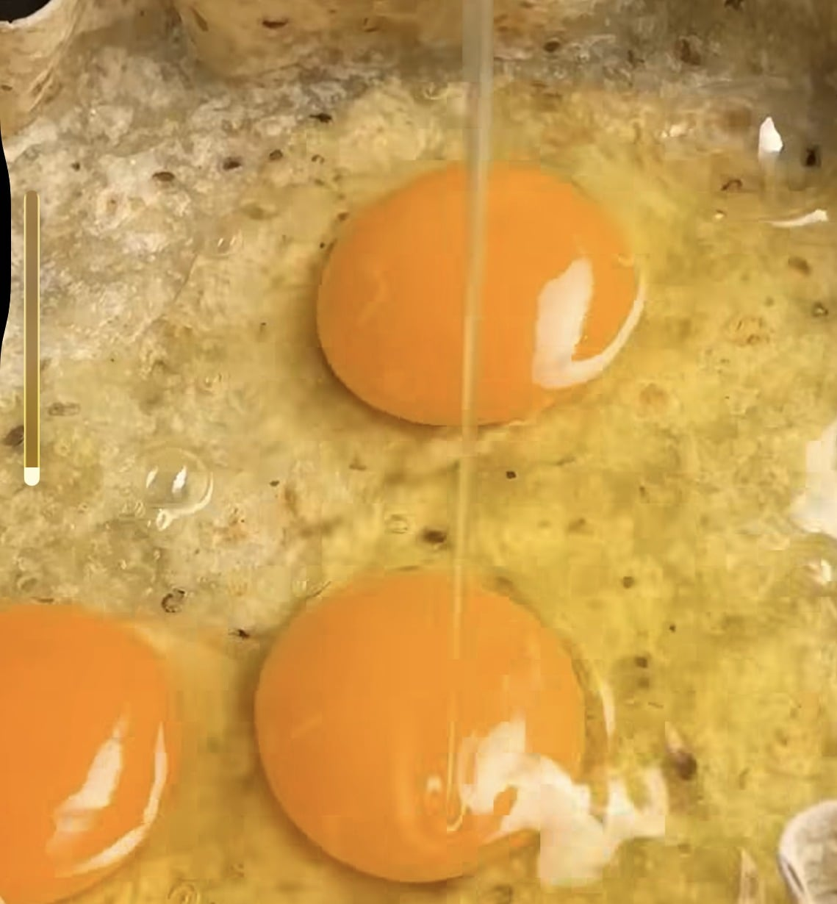
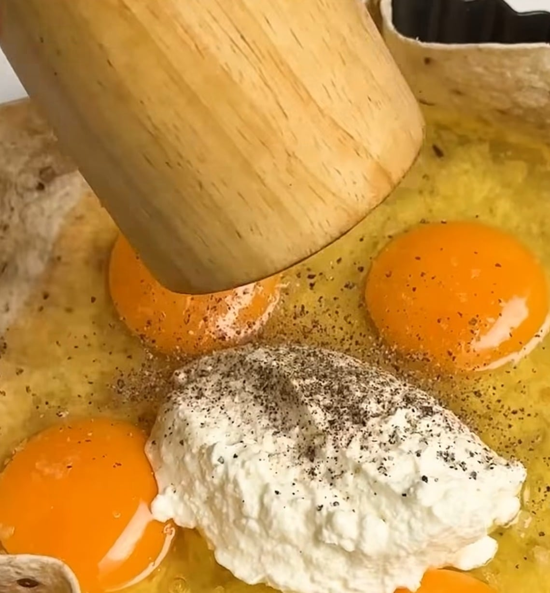
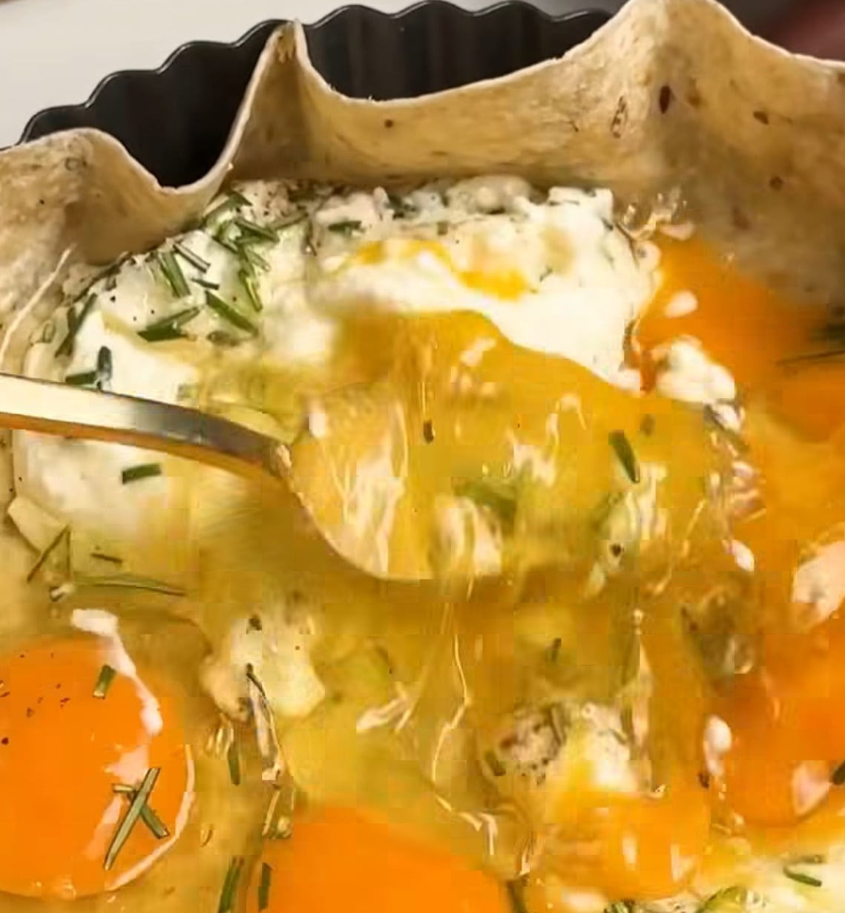
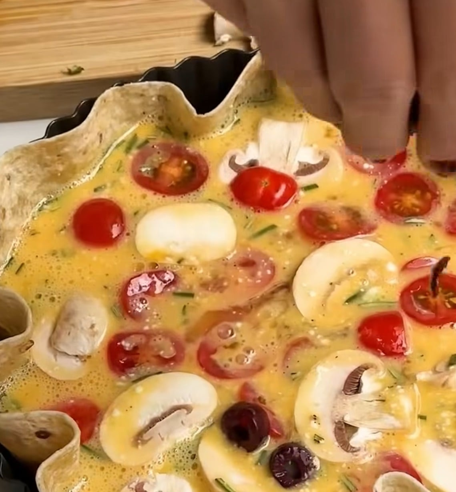
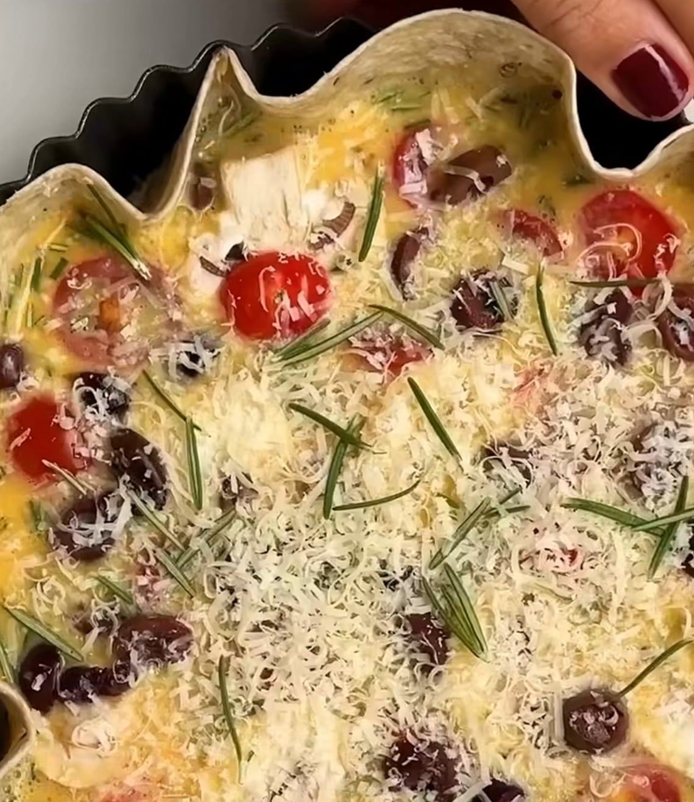

## Zutaten
- {{1}} großer Vollkorn-Wrap
- {{5}} Eier
- {{150 g}} Ricotta
- {{2}} Zweige Rosmarin
- {{1/2 Bund}} Schnittlauch
- {{150 g}} Kirschtomaten
- {{100 g}} Champignons
- {{40 g}} schwarze Oliven, entsteint
- {{30 g}} Parmesan
- Olivenöl, Salz, Pfeffer

## Equipment
- Tarteform (ca. 24 cm)

## Zubereitung
1. **Ofen vorheizen:** Backofen auf 180 °C Ober-/Unterhitze vorheizen.
2. **Wrap in die Form legen:** Den Wrap in die Tarteform drücken, sodass der Rand wellig hochsteht. Mit etwas Olivenöl beträufeln und die Eier hineinschlagen.
   
3. **Ricotta dazugeben:** Ricotta in die Mitte geben, mit Salz und Pfeffer würzen.
   
4. **Verquirlen:** Rosmarinnadeln und Schnittlauch fein hacken, dazugeben und alles direkt in der Form mit einer Gabel verquirlen.
   
5. **Belegen:** Kirschtomaten halbieren, Champignons in Scheiben schneiden, Oliven halbieren und alles auf der Eimasse verteilen.
   
6. **Backen:** Parmesan darüberreiben und die Quiche ca. 25 Min. backen, bis die Eimasse gestockt und goldbraun ist.
   
7. **Servieren:** Kurz abkühlen lassen und in Stücke schneiden.

## Tipps
- Mengen geschätzt.
