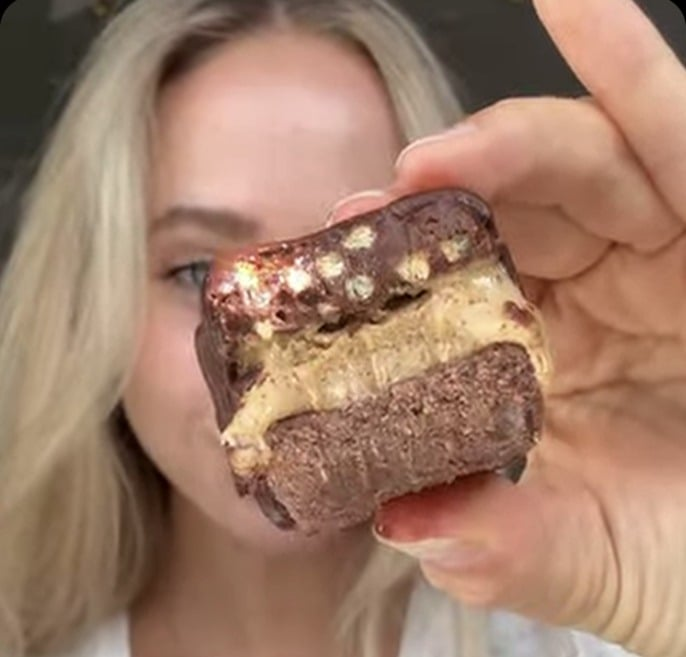
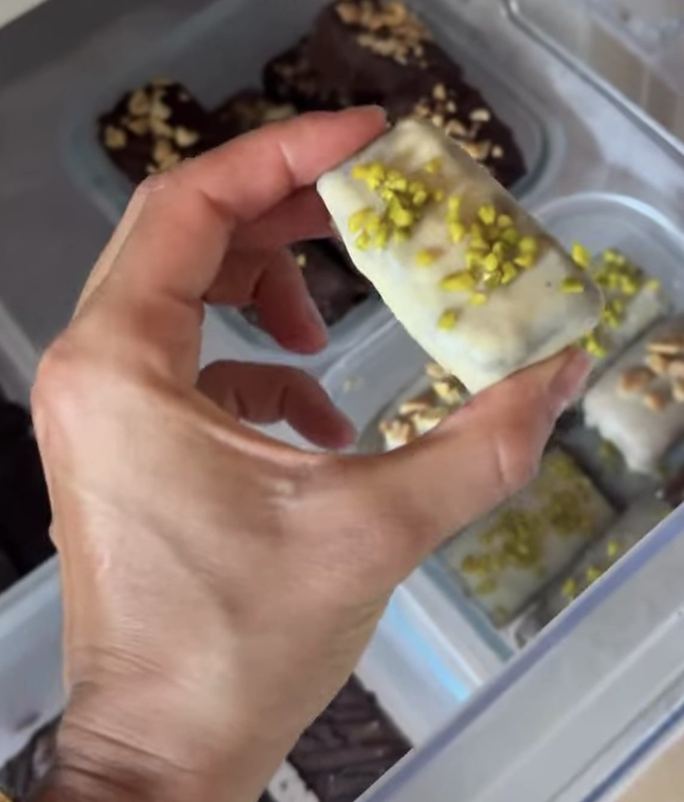
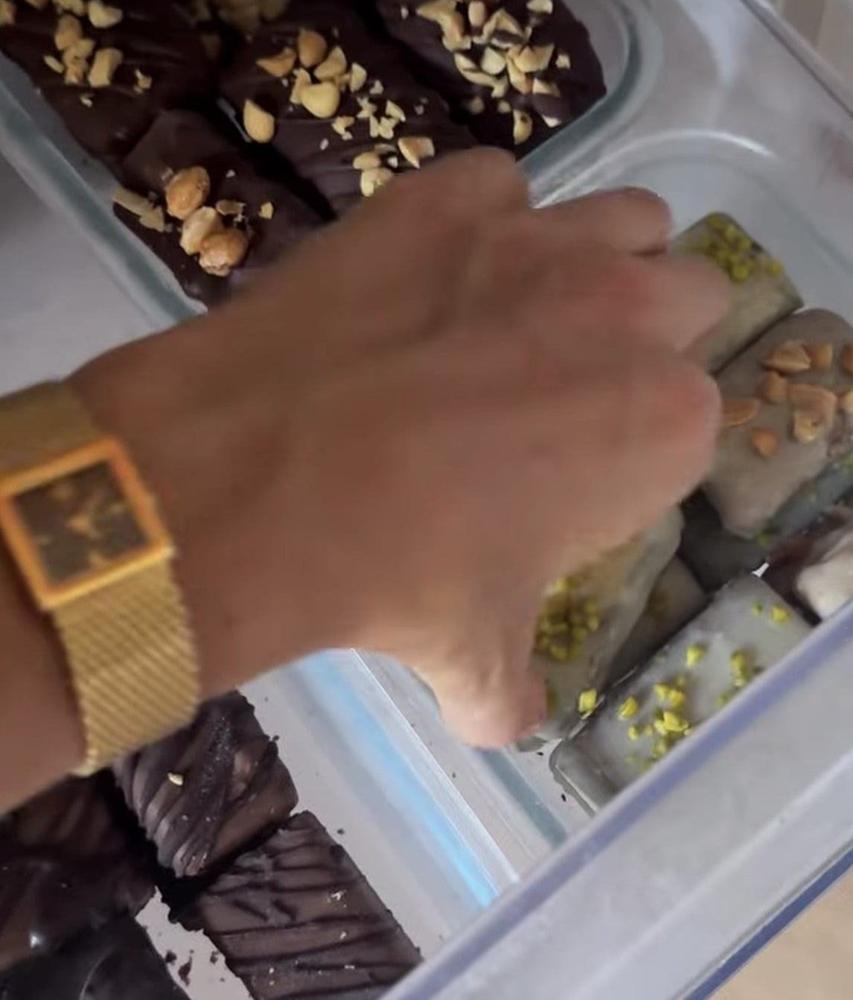

## Zutaten
### Boden
- {{30 g}} veganes Schoko-Proteinpulver (oder {{40 g}} Hafermehl)
- {{10 g}} Kakaopulver
- {{20 g}} Haselnussmus
- {{10 g}} Flohsamenschalen
- {{50 ml}} Pflanzendrink
### Karamellschicht
- {{50 g}} Mandel- oder Cashewmus
- {{50 ml}} Mandeldrink
- {{50 ml}} Agavendicksaft
### Crunch und Überzug
- {{150 g}} Zartbitterschokolade (mind. 70 %)
- {{20 g}} Puffreis oder Crispies

## Equipment
- Riegel-Silikonform
- Schüsseln

## Zubereitung
1. **Boden:** Proteinpulver, Kakao, Haselnussmus, Flohsamenschalen und Pflanzendrink zu einem formbaren Teig verrühren und in die Riegelform drücken.
2. **Karamell:** Mandelmus, Mandeldrink und Agavendicksaft glatt rühren, auf den Boden streichen und ca. 30 Min. einfrieren.
3. **Crunch:** Ein Drittel der Schokolade schmelzen, mit dem Puffreis mischen, auf die Karamellschicht streichen und ca. 1 Std. einfrieren.
4. **Überziehen:** Riegel aus der Form lösen, restliche Schokolade schmelzen und die Riegel darin rundum überziehen.
5. **Servieren:** Fest werden lassen und direkt aus dem Gefrierfach genießen.
   
   
   

## Tipps
- Für eine dickere Karamellschicht mit mehr Eiweiß {{30 g}} veganes Vanille-Proteinpulver und {{50 ml}} Mandeldrink extra einrühren.
- Im Gefrierfach halten sich die Riegel mehrere Wochen.
- Mengen für Crunch und Überzug geschätzt.
