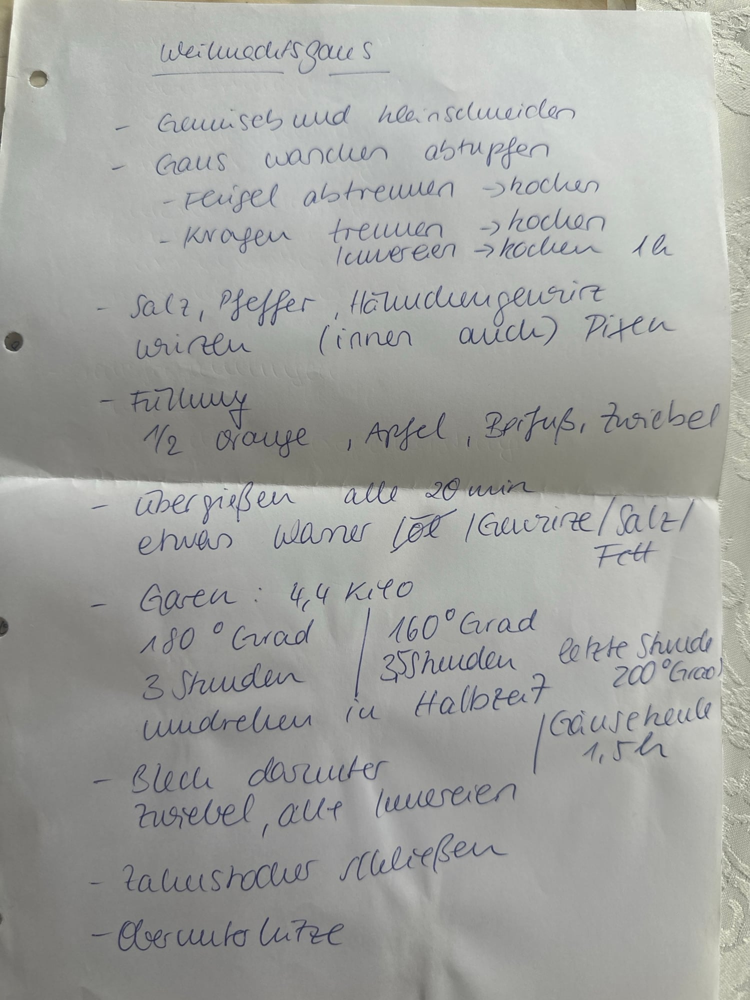

## Zutaten
- {{1}} Gans (ca. 4,4 kg) mit Innereien
- {{1}} Bund Suppengemüse, klein geschnitten
### Füllung
- {{1/2}} Orange, in Stücke geschnitten
- {{1}} Apfel, in Stücke geschnitten
- {{1}} Zwiebel, geviertelt
- {{2–3}} Zweige Beifuß
### Für das Blech
- {{1}} Zwiebel, grob geschnitten
- Hähnchengewürz, Salz, Pfeffer, etwas Fett

## Equipment
- Topf
- Backofen mit Rost und Blech
- Zahnstocher

## Zubereitung
1. **Gemüse vorbereiten:** Suppengemüse waschen und klein schneiden.
2. **Gans vorbereiten:** Gans waschen und trocken tupfen. Flügel und Kragen abtrennen und mit den Innereien und dem Gemüse in Wasser ca. 1 Std. kochen.
3. **Würzen:** Gans innen und außen mit Salz, Pfeffer und Hähnchengewürz würzen und die Haut rundherum mit einer Gabel einstechen.
4. **Füllen:** Orange, Apfel, Zwiebel und Beifuß in die Gans füllen und die Öffnung mit Zahnstochern verschließen.
5. **Ofen vorbereiten:** Ofen auf 180 °C Ober-/Unterhitze vorheizen. Die Gans auf den Rost legen, darunter ein Blech mit der Zwiebel und den übrigen Innereien schieben.
6. **Garen:** Gans bei 180 °C ca. 3 Std. garen (oder bei 160 °C ca. 3 1/2 Std.), nach der Hälfte der Zeit umdrehen. In der letzten Stunde auf 200 °C hochschalten.
7. **Übergießen:** Dabei alle 20 Min. mit etwas Wasser, Gewürzen, Salz und Fett vom Blech übergießen.
8. **Servieren:** Zahnstocher entfernen, die Gans tranchieren und servieren.
   

## Tipps
- Handgeschrieben von Oma Elda; die Garzeiten gelten für eine Gans von 4,4 kg, Mengen sonst geschätzt.
- Nur Gänsekeulen brauchen ca. 1 1/2 Std.
- Die Brühe aus Flügeln, Kragen und Innereien eignet sich als Grundlage für die Soße.
